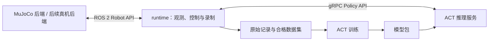

# sim_dual_arm

面向双臂机器人的仿真数据采集、ACT 训练与策略执行项目。以 MuJoCo 双 Panda
堆叠任务作为首个场景，验证从程序示教到学习策略闭环的完整过程，并为后续
切换真机保留统一的机器人接口。

目前已接通采集、训练、推理和反馈链路，并完成一次真实堆叠回归；跨场景可靠性、
真机驱动和双臂协作仍待验证。最新阶段统一维护在[总目标与当前阶段](docs/project-status.md)。

## 系统组成

| 部分 | 责任 | 主要位置 |
| --- | --- | --- |
| simulation | MuJoCo 物理步进、传感器、执行参考、实测反馈、任务判定和程序示教 | `simulation/mujoco/` |
| runtime | 固定身份的观测、控制会话、动作块 ACK/接续、录制、审计与导出 | `runtime/ros2/` |
| learning | 数据转换、ACT 训练、模型包和 ROS-free Policy 服务 | `learning/lerobot/` |
| hardware | 真机统一 Robot API 边界；驱动尚未实现 | `hardware/` |
| contracts | 公共 ROS/Policy 接口、数据格式和语义校验 | `contracts/` |

真机接入时替换机器人后端，应用仍使用同一 Robot API。当前物理执行使用 MuJoCo +
Panda；CPU mock 只验证软件链路，mock 记录不作为正式训练数据。真机驱动、相机和
硬件在环尚未实现，边界见 [hardware/README.md](hardware/README.md)，不提供假驱动或
空框架。学习侧当前固定为 LeRobot ACT；替换其他学习框架时保持 Policy API、三路
RGB + 16 维实测输入和 60×16 位置动作块语义，不改运行端对具体模型的依赖。

## 环境与目录

当前 ROS 侧以 Ubuntu 24.04 / ROS 2 Jazzy / Python 3.12 为基线；学习侧直接继承
官方 `huggingface/lerobot-gpu:latest`。ROS 与机器学习环境分开，
镜像只装依赖，源码、配置、SDK、资产、数据和模型通过挂载提供。

| 目录 | 内容 |
| --- | --- |
| `simulation/`、`hardware/`、`runtime/`、`learning/` | 仿真、真机边界、运行和学习实现；各自持有源码、配置、`docker/` 与 `scripts/` |
| `libraries/` | 有明确调用方的共享实现 |
| `contracts/`、`profiles/` | 接口定义、机器人关节/相机/动作语义 |
| `infrastructure/` | 公共 Docker 文件、容器内构建/SDK 工具和公开示例 |
| `tests/` | 单元、集成测试和测试替身 |
| `docs/` | 目标、规范、功能说明、重要实践与阶段历史 |
| `third_party/` | 固定的外部来源；下载源码在忽略的 `src/` 下 |
| `var/` | 数据、实验、模型、台账与运行日志，不进 Git |
| `.build/` | 构建、SDK、开发环境与隔离工作树，不进 Git |

维护前阅读[项目规范](docs/standards.md)。各目录 README 说明本地职责和入口。

## 一次完整闭环

先在宿主打开三个终端。以下命令均从项目当前目录结构执行；进入容器后保留对应终端。

### 1. 准备运行端接口（终端 A）

~~~bash
cd /path/to/sim_dual_arm/runtime/ros2/docker
docker compose build
docker compose up -d
docker compose exec runtime bash
runtime/ros2/scripts/run.sh build-ros-sdk
runtime/ros2/scripts/run.sh build-policy-sdk
~~~

### 2. 启动程序示教仿真（终端 B）

~~~bash
cd /path/to/sim_dual_arm/simulation/mujoco/docker
docker compose build
docker compose up -d
docker compose exec simulation bash
scripts/run.sh prepare --template /app/configs/backend/backend_stack_teacher.yaml --seed 0 --run-id teacher-backend --output /data/prepared/teacher-backend
scripts/run.sh backend --config /data/prepared/teacher-backend/backend.yaml --run-id teacher-backend
~~~

### 3. 采集 50 条合格数据（回到终端 A）

每次尝试由台账分配 seed；示教运行、录制、导出和质量判定都在容器内完成。循环在获得 50 条合格 episode 后结束。

~~~bash
mkdir -p /data/campaigns/panda_stack_v1
until runtime/ros2/scripts/run.sh campaign select > /data/campaigns/panda_stack_v1/formal-select.json; do
  runtime/ros2/scripts/run.sh campaign run --purpose formal --mode teacher -- python3 /workspace/runtime/ros2/scripts/collect_stack_attempt.py || exit 1
done
~~~

采集结束后，在终端 B 按 Ctrl+C 停止示教后端。

### 4. 转换、训练并生成模型包（终端 C）

~~~bash
cd /path/to/sim_dual_arm/learning/lerobot/docker
docker compose build
docker compose up -d
docker compose exec learning bash
set -e -o pipefail
learning/lerobot/scripts/run.sh convert
TRAIN_RUN=$(learning/lerobot/scripts/run.sh train --mode full | python3 -c 'import json,sys; print(json.load(sys.stdin)["run_dir"])')
learning/lerobot/scripts/run.sh bundle --mode full --run "$TRAIN_RUN" --output /data/learning/bundles/stack-act
learning/lerobot/scripts/run.sh prepare-policy --template /workspace/learning/lerobot/configs/act_policy_temporal.yaml --bundle /data/learning/bundles/stack-act --run-id infer-20000 --output /data/prepared/infer-20000/policy
~~~

### 5. 运行 ACT 推理

终端 B 启动无示教的任务后端：

~~~bash
scripts/run.sh prepare --template /app/configs/backend/backend_stack_act_chunked.yaml --seed 20000 --run-id infer-20000 --output /data/prepared/infer-20000/simulation
scripts/run.sh backend --config /data/prepared/infer-20000/simulation/backend.yaml --run-id infer-20000
~~~

终端 C 启动模型服务：

~~~bash
learning/lerobot/scripts/run.sh policy --config /data/prepared/infer-20000/policy/policy.yaml --run-id infer-20000 --log-directory /data/logs/infer-20000
~~~

终端 A 执行策略并读取物理任务结果：

~~~bash
runtime/ros2/scripts/run.sh prepare --template /workspace/runtime/ros2/configs/native_task_act_chunked.yaml --policy-binding /data/prepared/infer-20000/policy/policy_binding.json --seed 20000 --run-id infer-20000 --output /data/prepared/infer-20000/runtime
runtime/ros2/scripts/run.sh policy --config /data/prepared/infer-20000/runtime/runtime.yaml --run-id infer-20000 --episode-id infer-20000 --output /data/raw/infer-20000
cat /data/raw/infer-20000/infer-20000/task_result.json
~~~
