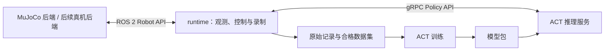

# sim_dual_arm

面向双臂机器人的仿真数据采集、ACT 训练与策略执行项目。以 MuJoCo 双 Panda
堆叠任务作为首个场景，验证从程序示教到学习策略闭环的完整过程，并为后续
切换真机保留统一的机器人接口。

目前已接通采集、训练、推理和反馈链路，并完成一次真实堆叠回归；跨场景可靠性、
真机驱动和双臂协作仍待验证。最新阶段统一维护在[总目标与当前阶段](docs/project-status.md)。

## 系统组成



| 部分 | 责任 | 主要位置 |
| --- | --- | --- |
| backend-sim | 物理步进、传感器、执行参考、实测反馈、任务判定和程序示教 | `components/backend_sim/` |
| runtime | 固定身份的观测、控制会话、动作块 ACK/接续、录制与审计 | `components/runtime/` |
| learning | 数据转换、ACT 训练、模型包和 ROS-free 推理服务 | `components/learning/` |
| contracts | 公共 ROS/Policy 接口、数据格式和语义校验 | `contracts/` |

真机接入时替换机器人后端，应用仍使用同一接口。当前物理执行使用 MuJoCo；
CPU mock 验证软件链路，mock 记录不作为正式训练数据。

## 环境与目录

当前 ROS 侧以 Ubuntu 24.04 / ROS 2 Jazzy / Python 3.12 为基线，学习侧使用固定的
LeRobot ACT。ROS 与机器学习依赖分开，精确版本以 `deploy/docker/` 的 Dockerfile、
锁文件和 `third_party/panda-source.json` 为准。已验证的本地 GPU 为 RTX 4050 6 GB，
训练与仿真可分时运行。

| 目录 | 内容 |
| --- | --- |
| `components/`、`libraries/` | 业务组件与职责明确的共享实现 |
| `contracts/`、`profiles/` | 接口定义、机器人关节/相机/动作语义 |
| `configs/` | 场景、控制、任务、数据与训练配方 |
| `deploy/`、`tools/` | Docker/Compose、构建、SDK 生成和公共启动命令 |
| `tests/` | 单元测试、集成测试和测试替身 |
| `docs/` | 目标、规范、功能说明、重要实践与阶段历史 |
| `third_party/` | 固定的外部来源；下载源码在忽略的 `src/` 下 |
| `var/` | 数据、实验、模型、台账与运行日志，不进 Git |
| `.build/` | 构建、SDK、开发环境与隔离工作树，不进 Git |

维护前阅读[项目规范](docs/standards.md)。各目录的 README 说明本地职责和入口，
详细计划、原操作材料与验收按 DSH 编号归档，见[文档索引](docs/README.md)。

## 使用前的路径设置

示例从仓库根执行。更换机器先修改 `ROOT`；使用数据盘时，确认挂载后再调整
配置和 env 中的路径。仅修改 shell 变量不会迁移已有数据或 Docker 存储。

```bash
export ROOT="/home/ljk/work/sim_dual_arm"
export DATA_ROOT="$ROOT/var"
export ROS_PYTHON="$ROOT/.build/native-dev-venv/bin/python"
export ROS_SDK="$ROOT/.build/ros-dev"
export POLICY_SDK="$ROOT/.build/generated/policy-sdk"
export ASSETS_ROOT="$ROOT/third_party/src/mujoco_menagerie"
export ASSET_SUMMARY="$ROOT/.build/assets/panda.json"
export LEARNING_ROOT="$DATA_ROOT/learning"
export LEARNING_VENV="$ROOT/.build/learning-dev-venv"
export LEARNING_SOURCE="$ROOT/third_party/src/lerobot-act-v0.6.1"
cd "$ROOT"
findmnt -T "$ROOT"
findmnt -T "$DATA_ROOT"
df -hT "$ROOT" "$DATA_ROOT"
```

需要可用的 Docker 和 Compose；GPU 仿真、训练及 ACT 推理还需要 Docker 能使用
NVIDIA GPU。`.build` 中的本机环境与 SDK 不随 Git 提供，新机器需要先构建，
不能把目录存在当作依赖已准备好。

## 先验证软件链路

无需 GPU 或宿主 ROS 的 CPU mock 自动采集：

```bash
bash tools/build/stage2.sh
bash tools/run/mock_collect.sh
```

`stage2.sh` 构建 ROS/dev/Policy 依赖镜像并生成宿主 ROS 与 Policy SDK，业务源码、
配置和测试均通过挂载提供。这次构建方式调整后先执行一次该入口；此后修改
Python/配置只需重启对应进程。ROS IDL 改动运行 `bash tools/build/dev.sh contracts`，
Policy proto 改动运行 `bash tools/build/policy_sdk.sh`，再重启相关服务。
缺失挂载或过期 SDK 会拒绝启动。规则检查入口为
`python3 tools/build/check_dockerfiles.py`。

结果在 `var/runs/<run-id>/status.json`，原始记录在 `var/data/raw/<run-id>/`。
成功表示本次 mock 进程、日志收尾和独立 MCAP 审计通过，不表示完成物理堆叠。

开发时使用源码挂载，依赖变化才重建镜像，ROS 契约变化才重建 SDK：

```bash
bash tools/build/dev.sh
python3 tools/run/mock.py --run-id dev-001 up
python3 tools/run/mock.py --run-id dev-001 status
python3 tools/run/mock.py --run-id dev-001 start --task-id mock-script --wait
python3 tools/run/mock.py --run-id dev-001 down
```

`down` 按归属停止该项目，保留数据与日志。人工控制、退出码和故障排查细节见
[现有操作资料](docs/history/dsh-013.md#src-docs-stage2-quickstart-md)。

## 验证仿真环境与场景

```bash
bash tools/build/sim.sh
python3 tools/assets/fetch_panda.py fetch
python3 tools/assets/fetch_panda.py verify
python3 tools/run/sim_check.py --run-id sim-check-001
python3 tools/run/sim_check.py --check scene --run-id scene-check-001
python3 tools/run/sim_check.py --check kinematics --run-id kinematics-check-001
```

依次验证依赖/EGL、三相机布局和关键位姿/运动学净空，报告在
`.build/reports/sim-check/<run-id>/`。这些检查不代表抓取成功。
完整任务还使用带 Ruckig 的 `follower-dev` 后端和生成的 Policy SDK；镜像目标见
[Dockerfile](deploy/docker/backend-sim/Dockerfile)，准备步骤见
[原生后端](docs/history/dsh-027.md#src-docs-native-backend-md)和[策略执行入口](docs/history/dsh-032.md#src-docs-native-policy-md)。

## 采集、训练与推理

| 操作 | 公共入口 | 参数来源 / 产物 |
| --- | --- | --- |
| 程序示教、次数预算和种子 | `tools/run/stack_campaign.py` + `stack_once.py` | `configs/experiments/`；`var/campaigns/` |
| 导出与重放 | `tools/run/stack_export.py`、`stack_replay.py` | 已审计记录、RGB、执行参考标签 |
| 转换、校验、筛选、训练、模型包 | `tools/run/learning.py` | `configs/learning/`；`var/learning/` |
| ACT 服务与仿真执行 | `tools/run/native_policy.py`、`stack_once.py` | 明确的 bundle 和成对的 runtime/backend 配方 |
| 只读评估汇总 | `tools/run/stack_evaluate.py` | 独立报告、逐种子结果和视频 |

程序示教可以读取仿真物体位置；ACT 使用三路 RGB 和双臂测量状态，输出双臂
16 维位置目标，不读物体真值，不用程序示教补救推理。
详细操作资料：[采集](docs/history/dsh-034.md#src-docs-native-teacher-runtime-md)、[训练与模型包](docs/history/dsh-035.md#src-docs-learning-training-md)、
[ACT 服务](docs/history/dsh-036.md#src-docs-act-policy-service-md)。已有数据、模型和新实验的位置见[当前阶段](docs/project-status.md)。

当前已完成一次真实堆叠回归的实验组合是：
`native_task_act_chunked.yaml` + `backend_stack_act_chunked.yaml` +
`act_policy_temporal.yaml`。它使用 0.5 秒执行窗口、任务开始前 2 秒稳定等待、
按仿真时间对齐的预测融合；完整模型输出仍是 60×16、50 ms。
本仿真实验的策略目标—执行参考允许偏差为用户批准的 0.30 rad / 0.04 m，
机器人硬限位、实测跟踪和成功判定保持原值。它是一次同场景修复回归，
腕部目标短时遮挡尚未通过完整图像质量门禁，不能作为泛化成功率结论。

新运行先准备独立 campaign 配置，明确未使用的种子、次数和存储路径；已有成功
回归台账已经用完，不能直接补跑。模型包须实际存在，默认镜像与 SDK 按上文先构建：

```bash
export BUNDLE="$LEARNING_ROOT/experiments/act-static-b16-20k-20261103/bundle-best-20k"
export CAMPAIGN_CONFIG="/absolute/path/to/new-campaign.yaml"
test -f "$BUNDLE/manifest.json" && test -f "$CAMPAIGN_CONFIG"

"$ROS_PYTHON" tools/run/stack_campaign.py --project-root "$ROOT" \
  --config "$CAMPAIGN_CONFIG" run --purpose evaluation --mode act \
  --runtime-config configs/runtime/native_task_act_chunked.yaml -- \
  "$ROS_PYTHON" tools/run/stack_once.py --campaign-config "$CAMPAIGN_CONFIG" \
  --runtime-config configs/runtime/native_task_act_chunked.yaml \
  --backend-config configs/simulation/backend_stack_act_chunked.yaml \
  --act-policy-config configs/learning/act_policy_temporal.yaml \
  --policy-mode act --bundle "$BUNDLE" --build-root "$ROS_SDK" \
  --policy-sdk "$POLICY_SDK" --timeout 150
```

[修复过程、成功视频与验收边界](docs/history/dsh-048.md)均保留原始证据。

本机新训练使用独立 Compose 作业。查看时使用实际冻结的 env：

```bash
export EXPERIMENT_ROOT="$LEARNING_ROOT/experiments/act-static-b16-20k-20261103"
export TRAIN_PROJECT="sim-dual-arm-act-b16-20k-20261103"
export TRAIN_ENV="$EXPERIMENT_ROOT/training-workers2.env"
docker compose --project-name "$TRAIN_PROJECT" --env-file "$TRAIN_ENV" \
  -f "$ROOT/deploy/compose/act_training.yaml" ps -a
```

另开训练前复制并修改 [env 示例](deploy/examples/act_training.env.example)，核对
输入只读挂载、输出、预算和新实验名，再执行同一 Compose 的 `up -d train`。
启动不等于完成；以 run 内 `training_report.json`、实际步数和验证记录判断。
操作与停止说明见[本次训练资料](docs/history/dsh-041.md#src-docs-act-b16-20k-training-md)。

完整仿真尝试须先通过 campaign 预留身份与预算。已有基线种子已经使用，
复现实验先明确新配置、种子和配额，不能清空旧台账来重新计数。
ACT 修复配方使用 `configs/runtime/native_task_act_fast.yaml` 与
`configs/simulation/backend_stack_act.yaml` 成对配置；完整命令见
[仿真闭环操作资料](docs/history/dsh-036.md#src-docs-minimal-simulation-loop-md)。

## 查看结果与参与维护

排查时分别查看进程退出、运行结果、记录完整性、图像质量和物理任务结果，
不要只看一个成功字段。ACT 原始输出、准入目标、执行参考和实测反馈也需分开。
新实验使用新目录，旧模型、失败记录与日志保留；磁盘清理先列目录并取得授权。

修改前确认所属组件、配置和契约，按[项目规范](docs/standards.md)检查。
当前状态只更新[总目标与当前阶段](docs/project-status.md)，详细计划与验收按同一
DSH 编号保存。历史材料集中在 `docs/history/`；各目录 README 只维护本地用途与入口。
