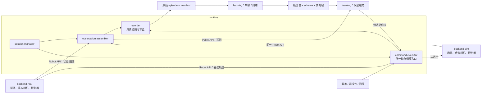

# 环境边界与通信接口设计 v1

更新日期：2026-10-29。本文为目标接口规范。阶段 1～2 已实现其中的 mock 控制/采集子集和 SDK 生成；运行范围与未实现项见 [使用指南](stage2-quickstart.md)。完整 Policy 服务、物理仿真和真机后端仍待后续实现。

## 1. 推荐部署：四类镜像，后端二选一

| 镜像 / 环境 | 拥有的职责 | 主要依赖 | 对外接口 |
| --- | --- | --- | --- |
| `backend-real` | 厂商驱动、真实相机、设备标定与时间映射、底层控制器、设备状态与控制保护；将设备适配成公共 Robot API | ROS 2、厂商 SDK、相机 SDK、必要的 ros2_control 插件 | Robot API v1（ROS） |
| `backend-sim` | Gazebo 场景、物理、虚拟传感器、仿真控制器、时钟与场景复位；实现相同 Robot API | ROS 2、Gazebo、ros_gz、gz_ros2_control、模型资产 | 相同的 Robot API v1（ROS），附加声明的仿真能力 |
| `runtime` | episode 编排、观测同步、示教/策略控制源选择、动作调度、采集记录、模型服务客户端 | ROS 2、公共接口包、gRPC/Protobuf、记录工具；不依赖厂商 SDK 或模型框架 | 消费 Robot API，调用 Policy API，提供 Runtime API，写原始数据 |
| `learning` | 离线转换、数据检查、训练、模型预处理、模型推理与模型内部状态 | Python、PyTorch、LeRobot/其他框架、数据/视频工具；不依赖 ROS | Policy API v1（gRPC）和版本化文件产物 |

一次运行只启动一个设备后端。仿真采集运行 `backend-sim + runtime`；真机采集换成 `backend-real + runtime`；推理再加入 `learning` 的模型服务进程；离线转换/训练只启动 `learning`。

训练和模型服务使用相同镜像、不同启动命令及容器实例。`runtime` 内的 session、观测、执行和记录是独立逻辑模块，首版可复用一个镜像，不要求每个节点都有独立 Dockerfile。

图中两个后端表示可选实现，不表示同时控制两个环境。模型输出始终先经过 executor，recorder 不产生控制命令。

## 2. 解耦的关键：统一语义与唯一所有者

单纯统一话题名称不足以切换设备。需要同时约定关节名称/顺序、单位、夹爪开度、时间、控制模式、相机坐标和错误含义。

| 内容 | 唯一所有者 |
| --- | --- |
| SDK、设备连接、硬件序列号与原生话题 | 当前 backend |
| 电机闭环、关节插值、设备限位、连接看门狗 | backend 中的控制器/驱动，留在设备近端 |
| 公共关节/夹爪坐标到设备坐标的映射 | backend，带标定版本 |
| 观测取样、跨传感器同步与缺帧判定 | runtime 的 observation assembler |
| RGB 裁剪/缩放、归一化、模型特征选择、反归一化 | learning 的模型 adapter；训练与推理共用 |
| 控制源选择、模型动作有效性检查、动作时间调度 | runtime 的 command executor |
| episode ID、任务和成功标签、运行状态转换 | runtime 的 session manager |
| 原始记录、写盘状态与数据完整性报告 | runtime 的 recorder |
| 仿真物体真值、随机种子、场景重置 | backend-sim；真值默认仅用于评估/标签 |

backend 负责物理设备坐标到统一 SI 坐标；learning 负责 SI 特征到模型坐标的转换，避免两边各做一次归一化。首版控制空间限定为 `joint_position`，旋转关节用 rad，直线关节用 m。夹爪可表示成标定后的虚拟开度关节（m），由 backend 映射到原生驱动；无法提供该语义的设备应在握手时报告不支持，而不是填伪造值。

公共 RGB 帧统一为 `rgb8`，由 backend 将相机/Gazebo 原生编码转换为该格式；原始分辨率与内参保持一致。模型所需的裁剪、缩放和归一化仍属于 learning，避免把模型预处理藏进设备适配器。

相同的 RobotProfile 应用于同一机器人本体及其仿真模型。换成另一种关节结构、标定或动作定义时，要重新校验数据和模型适配；接口可替换不代表已有策略可以跨任意机器人直接使用。

## 3. 公共契约与模块依赖方向

独立的 `contracts/` 是契约源码的唯一维护位置；已有 policy 草案，其余类型随实现加入：

- `ros/robot_api_msgs/`：ROS 类型定义和版本约定，backend 与 runtime 共同使用。
- `policy/v1/policy.proto`：框架无关的推理协议，runtime 与 learning 各自生成 SDK。
- `schemas/v1/`：RobotProfile、ObservationSchema、ActionSchema、数据/模型 manifest 的结构定义。

具体语义实例放在仓库根 `profiles/`，部署地址/设备绑定放 `deploy/`，机器人几何与场景资源放 `assets/`。代码、配置、资源和产物的权威归属见 [目录组织规范](repository-layout.md)。

依赖方向指向公共契约和用途明确的共享库，组件之间不 import 对方实现。两个 backend 可共用 libraries/backend_core 的 lease、上下文校验与事件封装；该库不包含厂商/Gazebo/ML 依赖，runtime 不依赖其执行实现。runtime 不 import LeRobot 或厂商驱动，learning 不 import `rclpy`。契约中不传递 Python pickle、Torch Tensor 对象或 Gazebo 内部对象。

语义 schema 计算稳定哈希；厂商端口、设备序列号、容器地址、后端类型和动态实例 ID 单独放在部署绑定中。切换真实/仿真不会因为网络地址变化而改变模型输入 schema；标定或几何语义变化则应显式形成新版本。

本文使用的 `robot_api_msgs/*` 是项目自定义类型，阶段 1～2 已实现其中的控制与采集子集；ResetWorld 等目标接口尚未实现。实际类型以 contracts/ros 为准。推理协议草案见 [policy.proto](../contracts/policy/v1/policy.proto)，部署绑定示例见 [sim_collect.yaml](../deploy/examples/sim_collect.yaml)。

## 4. 设备侧：Robot API v1（ROS 2）

公共根命名空间由配置给出，例如 `/cell_01/robot`；下表用 `~` 表示该根。原生厂商/Gazebo 话题留在 backend 内部，应用不订阅它们。

| 接口 | 方式 / 类型草案 | 方向与主要内容 |
| --- | --- | --- |
| `~/info` | topic，`BackendInfo` | backend → runtime：协议版本、robot/profile/schema 哈希、实例 UUID、时钟域/epoch、就绪状态、可用传感器与控制/复位能力 |
| `~/state` | topic，`RobotState` | backend → runtime：实例/epoch、递增 state_seq、采样时间、标准 `sensor_msgs/JointState`、有效性、驱动状态和故障 |
| `~/cameras/<id>/frame` | topic，`CameraFrame` | backend → runtime：实例/epoch、frame_seq、源时间、标准 `sensor_msgs/Image` 与 `CameraInfo`、标定版本 |
| `/tf`、`/tf_static` | 标准 ROS TF | backend 发布公共坐标树；runtime 按当前 profile 的 frame ID 使用 |
| `~/acquire_control` | service，`AcquireControl` | runtime → backend：runtime 实例与 episode；返回唯一 lease ID、有效时长和接受的控制模式 |
| `~/renew_control`、`~/release_control` | service | 续约或释放当前 lease，backend 以本地单调时钟判断过期 |
| `~/execute_trajectory` | action，`ExecuteTrajectory` | runtime → backend：上下文、lease、command ID/序号、有效期、标准 `JointTrajectory`；返回接受/拒绝、进度和终态 |
| `~/command_events` | topic，`CommandEvent` | backend → runtime/recorder：递增 event_seq、command ID、接受/开始/完成/取消/失败、原因、接受的轨迹及可提供的控制目标反馈 |
| `~/stop` | service，`Stop` | 取消待执行命令，进入后端已声明的停止/保持行为；返回实际处理状态和原因 |
| `~/reset_world` | 可选 action，`ResetWorld` | 仅有对应 capability 时可调用：复位场景/物体/初始关节状态，返回新 clock_epoch 和就绪状态 |

ROS 图像、关节状态和轨迹使用标准载荷，外层只增加实例、epoch 和序号等上下文。这些字段用于区分重启和复位前后的迟到数据；不能只靠重复的图像时间戳判断所属 episode。供 RViz 等工具使用的标准原生输出可另外发布，但采集与策略使用公共契约输出。

`ExecuteTrajectory` 的 request 上下文至少包含：`backend_instance_id`、`clock_epoch`、`episode_id`、`control_epoch`、`lease_id`、`command_id`、`command_seq`、`robot_profile_hash`、`observation_id`、`accept_before_robot_time`。该截止时间表示最晚接受命令的机器人时间；执行时长由轨迹 horizon 限制，lease 过期则取消剩余执行。backend 检查过期、乱序、重复、lease、模式和限位；首版超出允许范围直接拒绝，不静默改变目标。runtime 主动进行的限速/转换必须记录转换后的命令。

lease 绑定 runtime 实例、episode、control_epoch 和控制模式。相同 lease 下重复 command ID 返回已有接受/执行状态，不再次执行；更低 command_seq 被拒绝。重启、换控制源或复位后使用新 lease，续约不恢复旧代次的控制权。

该公共 action 在后端内部适配到 ros2_control 的 `FollowJointTrajectory` 或厂商等价接口。若拆成左右控制器，后端负责共同调度、取消和聚合反馈，并声明同步能力。JTC 同时只能有一个活动 action goal，新 goal 会发生抢占；因此动作块替换策略需要明确实现。[JTC action 与抢占语义](https://control.ros.org/jazzy/doc/ros2_controllers/joint_trajectory_controller/doc/userdoc.html)

后端 controller_manager 和高频控制循环留在后端所在主机；跨容器或远程模型 RPC 不承担电机伺服周期。ros2_control 可用于统一真实/仿真的硬件接口，但厂商不支持该框架时仍可在相同公共 API 后实现适配。[ros2_control 硬件抽象](https://control.ros.org/jazzy/doc/ros2_control/hardware_interface/doc/hardware_components_userdoc.html)

### 设备流的 QoS 与速率

| 流 | 首版 QoS 建议 | 处理规则 |
| --- | --- | --- |
| info / 能力 | reliable + transient_local，depth=1 | 新订阅者获得当前描述；实例变化立即使旧缓存失效 |
| 关节与相机数据 | best_effort + volatile，小队列 | 优先新鲜样本；记录 seq 缺口和缺帧，不无限堆积 |
| command_events / episode 事件 | reliable + volatile，有界队列 | recorder 启动并订阅就绪后才开启 episode，缺失事件报告数据不完整 |
| service / action | ROS 对应的 reliable 配置 | 请求有业务 ID 与超时；传输可靠不等于执行恰好一次 |
| TF / clock | 遵循 ROS/桥接的对应 profile | 首次联调验证发布/订阅 QoS 兼容 |

此为设计选择，最终队列深度、传感器频率和记录带宽要实测。底层控制、关节发布、相机发布、策略推理和动作更新具有独立频率，不设一个全系统统一 FPS。QoS 兼容性直接影响能否收发数据。[ROS QoS 官方说明](https://github.com/ros2/ros2_documentation/blob/jazzy/source/Concepts/Intermediate/About-Quality-of-Service-Settings.rst)

## 5. 模型侧：Policy API v1（gRPC + Protobuf）

首版建议明确采用 gRPC unary RPC，传递 Protobuf 载荷；本机使用 Compose 服务地址，模型迁移时改 endpoint。它提供独立 IDL、deadline 和结构化错误，便于 ROS 客户端与 ML Python 环境独立维护。[gRPC 概念](https://grpc.io/docs/what-is-grpc/core-concepts/)、[deadline](https://grpc.io/docs/guides/deadlines/)

| RPC | 输入 | 输出 / 行为 |
| --- | --- | --- |
| `GetPolicyInfo` | 指定模型包 digest | 协议版本、实际模型与预处理 digest、输入/动作 schema、必需关节/相机、动作周期、状态性与就绪状态 |
| `OpenSession` | 机器人与 schema 绑定、当前运行上下文、固定模型包 | 校验兼容、准备模型，返回 model session ID 与绑定信息；加载/预热失败则不就绪 |
| `Predict` | session/request ID、运行上下文、观测 | 同一上下文、observation ID、实际模型 digest，以及带关节名和相对时间的 SI 目标动作块 |
| `ResetSession` | session、新上下文、reset ID | 清空模型历史/时序缓存，确认新上下文生效；重复 reset ID 不重复改变状态 |
| `CloseSession` | session | 释放 session 状态；重复关闭可安全返回 |

### 观测与动作内容

观测由 runtime 同步形成，至少包括：

- `robot_profile_hash`、`backend_instance_id`、`time_domain_id`、`clock_epoch`、`episode_id`、`control_epoch`。
- 单调递增的 `observation_id`，参考时间，以及每个状态/相机样本自身的源时间与序号。
- 按声明顺序排列的关节位置；速度/力矩只有设备提供且 schema 声明时才使用，缺失不填零冒充测量值。
- 有名称和标定版本的 RGB 帧；任务 ID / 文本作为可选任务条件。

首版传连续 RGB8 二进制数据，并携带宽、高和时间信息；必要时协商 PNG/JPEG，深度不走有损 JPEG。模型特定的裁剪、缩放、归一化在 learning 内完成，并与训练共用。双方配置最大 RPC 载荷和有界队列，超出明确拒绝。

响应是 `joint_position` 动作块：`joint_names`、多个 `positions` 向量和各点 `time_from_start_ns`，不是设备 SDK 命令。runtime 验证维度、名称、数值、观测年龄和上下文，按当前机器人时间安排起点，再向 backend 下发。learning 不选择厂商控制器，不直接操作相机或执行动作。

首版一个 episode 只有一个模型 session 和一个在途预测。`request_id` 用于有界去重，模型有状态时重试不能额外推进历史；服务应返回已缓存结果或明确失败。RPC 超时或取消后 GPU 计算可能仍然完成，runtime 必须丢弃其迟到结果。模型 ID 和预处理绑定在 session 中，不能在 episode 中静默换权重。

Policy API 使用标准 gRPC status 表达通信/调用结果，并在约定的错误元数据中提供机器可读 `reason`：例如 `FAILED_PRECONDITION + SCHEMA_MISMATCH`、`UNIMPLEMENTED + UNSUPPORTED_CAPABILITY`、`DEADLINE_EXCEEDED + INFERENCE_TIMEOUT`。ROS API 的结果消息保存同一业务 reason，避免客户端解析报错文本。

这里复用 LeRobot 的模型实现和处理器，并用项目 adapter 实现公共 Policy API；它不要求沿用 LeRobot 某一版本的网络协议。因此协议包装有明确实现成本，但能避免框架客户端把模型依赖带入 runtime。

## 6. runtime 的内部边界与管理接口

| 模块 | 输入 | 输出 / 边界 |
| --- | --- | --- |
| observation assembler | 公共 state/camera 流与 schema | 同步观测、样本引用和同步质量；不做模型归一化 |
| command executor | policy、脚本、遥操作、回放产生的候选动作 | 仅当前控制源可进入调度；持有 backend lease；记录原动作、变换后命令与结果 |
| recorder | 公共观测原始流、动作/反馈、episode/policy 事件 | 原始 episode 与 manifest；不执行动作 |
| session manager | 用户/CLI 请求、模块状态 | episode 生命周期、模式与控制源切换、复位编排 |

建议的 Runtime API：

| 接口 | 方式 | 主要内容 |
| --- | --- | --- |
| `/runtime/episode/start` | service | task、记录配置；返回 episode ID 和准备/启动结果 |
| `/runtime/episode/end` | service | 当前只接受结束原因并返回 ENDING 确认；最终状态由 status/manifest 确认。任务标签与完整结束结果待补充 |
| `/runtime/control/select_source` | service | `none / script / teleop / policy / replay`，切换前停旧源、更新 control_epoch 与 lease |
| `/runtime/episode/reset` | action | 编排停止、记录结束、模型清理与可用的后端复位能力 |
| `/runtime/status` | topic | episode 阶段、当前控制源、记录状态、模块就绪与故障 |
| `/runtime/observation_index` | topic | observation ID → state_seq / frame_seq 引用、时间差与缺帧信息 |
| `/runtime/control/commands` | topic | 候选动作、来源、对应 observation/request、最终发送的命令与 ID |
| `/runtime/policy_events` | topic | 模型绑定、请求/响应动作、延迟、丢弃原因、错误与 reset 事件 |

episode 阶段（IDLE/PREPARING/ACTIVE/ENDING/FAULT）、控制源和记录状态分别表示，允许“策略推理同时记录”。recording 为必需的采集任务遇到写盘故障时，episode 标记失败并按任务策略停止；推理反馈和 backend 看门狗不等待写盘线程。事件有序号与有界缓冲，缺失/溢出会进入完整性报告；日志发布和写盘不阻塞底层伺服循环。

以上是目标行为。当前 mock 实现仍在 ROS 回调内同步写盘，提前 EndEpisode 会按失败收尾，信号退出也存在未完成收尾的缺口；改进项见 [可维护性审查](maintainability-review.md)。

## 7. 控制权、时间与状态转换

backend 只接受有效 lease 下的命令；runtime 中只有 executor 持有该 lease。脚本、遥操作、模型和回放均提交候选意图到 executor。backend 的停止、lease 过期与故障处理不依赖模型服务是否在线；软件 stop 的具体保持/停止能力由设备声明，不能替代物理急停。

| 标识 / 时间 | 作用 |
| --- | --- |
| `backend_instance_id` | 后端每次启动生成新 UUID，拒绝旧实例的命令 |
| `clock_epoch` | 仿真复位或时钟不连续时更新，隔离回跳前后的样本 |
| `episode_id` | 数据与模型历史边界 |
| `control_epoch` | 暂停/恢复、换控制源时更新，使在途旧预测失效 |
| 机器人时间 | 源样本时间与轨迹调度；真机采用校准的 ROS 时间，仿真采用 `/clock` |
| 本地单调时钟 | lease、RPC/模块超时、性能测量；不跨主机直接比较数值 |

后端将设备时钟映射到声明的机器人时钟域，保存必要的原始时间与映射版本。learning 只透传观测时间和相对动作时间，不拿自己的系统时间与 ROS 时间直接比较。仿真暂停或回跳不能绕过 wall/steady-time 超时。[ROS 时间抽象](https://design.ros2.org/articles/clock_and_time.html)

启动顺序：backend 就绪并发布 info → runtime 校验 profile/能力 → 等待有效状态与图像 → 模型兼容校验及预热（推理模式）→ recorder 就绪（需要记录时）→ 获取控制权 → 开始 episode。

切换真机/仿真默认采用停止后切换：结束当前 episode、取消动作、释放 lease、关闭模型 session、停止旧 backend；启动另一 backend，清空观测/TF 缓冲并重新握手。禁止两个后端同时占用同一公共 namespace。修改部署绑定即可选择后端，上层不需要分支处理厂商名字。

复位流程：停止并等待后端确认 → 结束并提交旧记录 → 释放 lease / 失效旧结果 → 调用支持的世界复位 → 接收新 clock_epoch 和新鲜传感器样本 → 重置模型历史 → 获取新 lease → 开启新 episode。真机缺少 reset_world 能力时返回 UNSUPPORTED，回到初始位姿需要独立的已验证动作流程。

首版需要的明确错误包括：`NOT_READY`、`SCHEMA_MISMATCH`、`UNSUPPORTED_CAPABILITY`、`STALE_CONTEXT`、`STALE_OBSERVATION`、`LEASE_EXPIRED`、`COMMAND_REJECTED`、`DEVICE_FAULT`、`INFERENCE_TIMEOUT`、`RECORDING_ERROR`。不会因一个动作缺少真实反馈而标记为完成。

## 8. 离线边界：数据和模型文件协议

训练侧不通过 ROS 远程拉取采集节点内部状态。runtime 完成原始 episode 后发布完整 manifest；learning 从挂载目录或后续对象存储按固定清单读取。

| 产物 | 必需内容 |
| --- | --- |
| 原始 episode | MCAP、episode ID、source=real/simulation、profile/schema/calibration 版本、时钟信息、任务与标签、原始 state/frame、候选/发送动作、后端 command_events、缺帧/写盘报告 |
| 转换后数据集 | 数据 schema、特征/动作名称与单位、同步/动作对齐/图像处理配置、原始 episode 引用与哈希、转换器版本、统计量和划分规则 |
| 模型包 | 权重、框架版本/代码版本、输入/动作 schema、预处理/反归一化、RobotProfile 绑定、标定要求、训练数据 manifest 引用、支持的控制模式与频率 |

区分模型原始输出、runtime 实际发送目标、backend 接受的目标和传感器测量。动作标签按声明的目标语义与时间对齐生成，不能把下一帧关节位置冒充实际下发动作；若后端无法反馈底层实际生效目标，明确标记未知。

原始记录和模型包先写临时目录，完成校验后原子提交 manifest；只消费完整产物。框架内部文件布局由 learning adapter 管理，外部依赖 manifest 和内容 digest，不依赖自动变化的 `latest`。

## 9. 首版实现范围与验收

首版实现单机器人、一个活动后端、joint_position、单个模型 session、有界动作块、RGB 与关节观测、离线数据转换。更复杂的力矩控制、跨多个后端的协同、多模型仲裁和共享内存作为后续扩展。

建议先写契约与后端一致性验证，再写大规模场景或训练脚本。验收覆盖：

1. 相同公共 API 的 mock/仿真后端能让同一个 runtime 完成采集与推理，切换时只改部署绑定。
2. backend 实例变化、复位、旧 episode/旧 control_epoch、过期 lease、重复 command ID 和迟到模型结果均不会重复执行动作。
3. schema 不匹配、缺少相机、缺帧、非法数值、越限目标在约定层被拒绝，并产生可记录原因。
4. recorder 能关联 observation、模型输出、发送命令、接受/反馈与实际状态；落盘不完整时不会生成完整产物标记。
5. 从同一原始 episode 导出数据，训练/推理使用相同预处理，并加载同一模型包完成闭环。
6. 对真实后端的接口验证在设备确定后执行；在此之前不能宣称其驱动、标定或控制行为已经兼容。

阶段 1～2 已验证 mock 采集链路、核心控制/观测行为和原生 MCAP 审计。完整推理、物理仿真及真机相关验收随相应实现继续执行。
