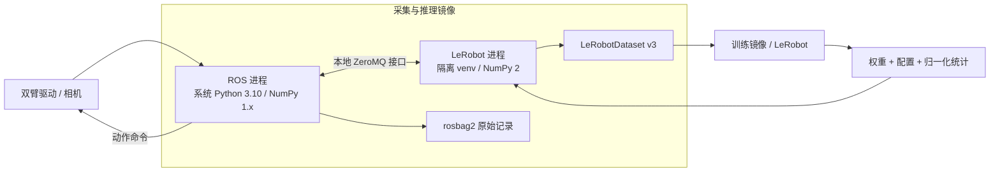

> 历史方案：曾按 Humble / Python 3.10 作为约束进行分析。用户已澄清这些只是倾向；当前建议见上级目录的 docker-dependency-analysis.md。

# 双臂机器人 Docker 环境依赖分析

分析日期：2026-10-29。当前阶段为依赖分析；本文给出首版基线和后续 Docker 实现边界，尚未构建镜像。

## 1. 已确定的需求

| 项目 | 当前约定 |
| --- | --- |
| 环境划分 | 一个 ROS 2 数据采集与推理环境，一个训练环境 |
| ROS 2 | Humble |
| 机器人 | 双臂，型号、夹爪、通信接口和厂商驱动待定 |
| 相机 | 暂按 RealSense 预留，可更换 |
| 学习框架 | LeRobot |
| 本地 GPU | 用户提供：RTX 4050，6 GB 显存 |
| 训练机器 | 后续更换，GPU 和架构待定 |
| 维护方式 | 先建立基本环境，版本、硬件和算法会频繁修改 |

当前目录没有项目代码、ROS 包或已有依赖清单，所以机械臂、控制接口和模型类型均不能从代码推导。下文的版本组合是设计基线，不代表已经完成运行验证。

## 2. 首版推荐方案

| 组件 | 采集与推理环境 | 训练环境 |
| --- | --- | --- |
| 操作系统 | Ubuntu 22.04 | 首版同样使用 Ubuntu 22.04 |
| 基础镜像候选 | `ros:humble-ros-base-jammy` | `ubuntu:22.04`，安装相同 ML 依赖 |
| ROS Python | 系统 Python 3.10 | 无需安装 ROS |
| ML Python | 独立 Python 3.10 venv | 独立 Python 3.10 venv |
| LeRobot | `0.4.4`，显式固定版本 | 与推理端保持一致 |
| PyTorch / torchvision | `2.7.1` / `0.22.1` | 首版同版本；换机器后重新核对 GPU 支持 |
| CUDA 用户态运行库 | PyTorch `cu126` wheel 对应依赖 | 首版同样采用 `cu126`，按训练 GPU 调整 |
| TorchCodec | `0.4.0`，首版使用 CPU 视频解码 | 同版本 |
| ML NumPy / OpenCV | `2.2.6` / `opencv-python-headless==4.12.0.88` | 同版本 |
| ROS NumPy / OpenCV | 由 Jammy / ROS apt 包管理 | 无 |
| 数据 | ROS 原始记录 + LeRobotDataset v3 | 读取同一版 LeRobotDataset v3 |

Humble 的 Tier 1 Ubuntu 平台为 22.04，发行时 Python 为 3.10；官方支持期到 2027 年 5 月。这里按用户要求采用 Humble，并在后续维护中保留升级 ROS 的边界。[ROS REP-2000](https://raw.githubusercontent.com/ros-infrastructure/rep/master/rep-2000.rst)

两个基础镜像标签的用途分别是提供 ROS 栈和纯训练系统；ROS 标签已在官方镜像清单核对，尚未实际拉取镜像。实现时还需固定基础镜像 digest。[官方 ROS 镜像清单](https://github.com/docker-library/official-images/blob/master/library/ros)

选择 LeRobot 0.4.4 是为了先使用支持 Python 3.10 的固定版本。查阅时 LeRobot `main` 已要求 Python >=3.12，因此 `pip install -U lerobot` 不能作为 Humble 首版环境的安装策略。未来升级新版 LeRobot 时，可以只升级 ML 进程的解释器和依赖。[LeRobot 0.4.4 声明](https://github.com/huggingface/lerobot/blob/v0.4.4/pyproject.toml)、[main 声明](https://github.com/huggingface/lerobot/blob/main/pyproject.toml)

PyTorch 和 torchvision 的上述配对、`cu126` 安装源来自官方安装表；TorchCodec 0.4 对应 PyTorch 2.7。[PyTorch 安装表](https://pytorch.org/get-started/previous-versions/)、[TorchCodec 兼容表](https://github.com/meta-pytorch/torchcodec/blob/v0.5.0/README.md#installing-torchcodec)

## 3. 关键兼容问题：ROS 与 LeRobot 分进程

本次实际依赖解析发现：

```text
lerobot==0.4.4
  -> rerun-sdk>=0.24.0,<0.27.0
  -> numpy>=2
```

因此，给 LeRobot 0.4.4 强制加入 `numpy==1.26.4` 会产生无解依赖。Jammy 的 ROS 图像处理栈使用系统 NumPy 1.x / OpenCV；NumPy 1.x 编译的扩展在 NumPy 2 下存在 ABI 不兼容风险。仅创建一个可访问系统包的 venv，不能消除这种冲突。[NumPy ABI 说明](https://numpy.org/doc/stable/user/troubleshooting-importerror.html)

建议保留两个 Docker 镜像，在采集与推理镜像内部运行两个独立进程：



进程隔离需要落实以下边界：

- ROS 进程使用 `/usr/bin/python3` 以及 apt 安装的 `rclpy`、`cv_bridge` 等包。
- ML 进程使用普通隔离 venv，不启用 `--system-site-packages`，不导入 ROS Python 包，也不继承 ROS 注入的 Python 搜索路径。
- ROS 端通过 apt 安装 `python3-zmq`、`python3-msgpack`；ML 端安装 `pyzmq`、`msgpack`。接口传输数组元数据和原始字节，避免跨进程序列化 Python 对象。
- 接口应携带协议版本、相机名称、数据形状、dtype、时间戳、状态/动作顺序及请求序号。图像吞吐量实测后再决定是否改为共享内存。
- 推理超时、动作过期、退出和重连由 ROS 桥接层处理，不能让模型推理阻塞机器人通信。

ROS 官方要求使用与预编译包匹配的 Python 解释器；不能直接把 Humble 的 Python 路径加入不同版本 Python 环境。[ROS Python 环境说明](https://github.com/ros2/ros2_documentation/blob/humble/source/How-To-Guides/Using-Python-Packages.rst)

LeRobot 的机器人接口仍需适配：安装 LeRobot 并不会自动获得未知机械臂的 ROS 2 驱动、双臂控制器和数据映射。这里的本地接口及桥接代码属于后续实现工作。

## 4. 采集与推理环境依赖

### 4.1 ROS 和系统基础

以下为候选 apt 包，最终应结合 ROS 工作空间的 `package.xml` 使用 rosdep 安装并验证：

| 类别 | 依赖 | 用途 |
| --- | --- | --- |
| ROS 基础 | `ros-humble-ros-base`、`ros-humble-rclpy` | 节点、消息、服务、action 和启动支持 |
| 通用消息 | `ros-humble-sensor-msgs`、`ros-humble-geometry-msgs`、`ros-humble-trajectory-msgs`、`ros-humble-control-msgs` | 图像、关节状态、位姿和轨迹接口 |
| 图像与同步 | `ros-humble-cv-bridge`、`ros-humble-image-transport`、`ros-humble-message-filters` | 图像转换、传输与时间同步 |
| 坐标变换 | `ros-humble-tf2-ros`、`ros-humble-tf2-geometry-msgs` | 相机、末端与机器人基座坐标关系 |
| 原始数据记录 | `ros-humble-rosbag2`、`ros-humble-rosbag2-py`、`ros-humble-rosbag2-storage-mcap` | 记录、回放和离线转换；明确选择 MCAP 插件 |
| 通信桥接 | `python3-zmq`、`python3-msgpack` | 与隔离的 LeRobot 进程通信 |
| 构建工具 | `build-essential`、`cmake`、`python3-dev`、`python3-venv`、`python3-colcon-common-extensions`、`python3-rosdep`、`python3-vcstool` | 后续编译厂商驱动、自定义消息和桥接包 |
| 通用工具 | `git`、`curl`、`ca-certificates`、`pkg-config`、`ffmpeg` | 源码、证书和视频处理 |

DDS 首版沿用 Humble 默认 Fast DDS；只有在设备联调需要时再切换 Cyclone DDS。`ROS_DOMAIN_ID`、RMW、QoS 和网络配置独立于模型版本。

### 4.2 模型与数据依赖

ML 进程与训练镜像共用候选依赖文件 `dependencies/lerobot-py310.candidate.in`：

- `lerobot`、`torch`、`torchvision`：策略、推理和张量处理。
- `numpy`、`opencv-python-headless`：数值与图像预处理。
- `datasets`、`pyarrow`、`pandas`：数据集和表格数据，由 LeRobot 依赖解析确定版本。
- `av`、`torchcodec`、FFmpeg：视频编码、读取和按时间戳取帧。
- `safetensors` 等权重依赖按选定策略补齐；保存策略配置和归一化统计，不能只拷贝单个权重文件。
- `pyzmq`、`msgpack`：本项目建议增加的进程通信依赖。

LeRobot 0.4.4 的普通安装本身就包含 `accelerate`、`diffusers`、`wandb`、`rerun-sdk`、`pynput` 等依赖。因此，即使代码只执行推理，首版镜像也会包含这些包。直接使用 `--no-deps` 删去它们会绕过上游依赖约束，不能当作默认瘦身方案。[0.4.4 完整依赖](https://github.com/huggingface/lerobot/blob/v0.4.4/pyproject.toml)

### 4.3 硬件依赖作为可选模块

| 模块 | 暂定依赖 | 加入条件 |
| --- | --- | --- |
| RealSense ROS 驱动 | `ros-humble-realsense2-camera`、`ros-humble-realsense2-description` 及匹配的 librealsense | 确认使用 RealSense 后启用构建选项 |
| RealSense Python SDK | `pyrealsense2` | 只有 ML/采集代码直接操作相机时才增加 |
| 双臂控制器 | `ros-humble-ros2-control`、`ros-humble-ros2-controllers` | 厂商驱动采用 ros2_control 时加入 |
| 机器人描述 | `ros-humble-xacro`、`ros-humble-robot-state-publisher`、URDF、SRDF | 确定机器人模型后加入 |
| 运动规划 | MoveIt 2 | 确认需要规划、碰撞检查或相关控制接口时加入 |
| 总线/串口 | `python-can`、串口 SDK、厂商库 | 根据 CAN、串口或网络接口选择 |
| 可视化 | RViz 2、图像查看工具 | 作为开发选项 |
| 仿真 | ROS 仿真桥接或 MuJoCo 等 | 仿真平台尚未确定，另设可选依赖 |

RealSense 首版建议由 ROS 驱动统一占用相机，LeRobot 经桥接读取 ROS 图像，避免两个进程竞争同一台设备。librealsense 选择一种安装来源并与 wrapper 匹配，避免同时安装多个互相覆盖的版本。[RealSense ROS 安装说明](https://github.com/realsenseai/realsense-ros#installation-on-linux)

相机设备映射、USB 权限、宿主机 udev 规则、内核支持和固件版本都需在真机阶段核对。Docker 共享宿主机内核，容器内安装驱动包不能替代宿主机的内核或设备配置。

## 5. 训练环境依赖

训练环境复用相同的 LeRobot、PyTorch、视频处理和数据格式基线，首版无需 ROS、相机 SDK 或机械臂驱动。

| 类别 | 依赖/设计 | 备注 |
| --- | --- | --- |
| 系统 | Python 3.10、venv、构建工具、FFmpeg、证书、git | LeRobot 的 `pynput -> evdev` 在 Linux 上可能需要源码构建，因此不能仅准备 wheel 安装环境 |
| 单卡训练 | LeRobot、PyTorch、torchvision | 具体策略暂建议先用 ACT 跑通链路，最终模型类型仍可调整 |
| 数据与预处理 | 与推理端相同的 schema、图像通道、裁剪/缩放、动作定义、归一化方式 | 训练/推理输入必须一致 |
| 加速与日志 | LeRobot 自带的 `accelerate`、`wandb` 等 | 配置支持本地/离线记录，账号和联网不是基础环境启动前提 |
| 多卡 | PyTorch 分布式及对应 NCCL 运行库 | 训练机器确定后再验证，不先引入集群相关组件 |
| 可选交互 | JupyterLab、TensorBoard、matplotlib | 按实际工作方式添加 |
| 可选优化 | FlashAttention、DeepSpeed、TensorRT、ONNX Runtime | 模型明确需要或实测收益充分时再加入 |

PyTorch wheel 提供运行所需的 CUDA 用户态依赖；运行普通预编译模型不要求宿主机安装同版本完整 CUDA Toolkit。宿主机仍需要兼容的 NVIDIA 驱动和 NVIDIA Container Toolkit。只有编译 CUDA 扩展时，才需要在构建阶段加入匹配的 Toolkit / nvcc。[NVIDIA 容器前提](https://docs.nvidia.com/datacenter/cloud-native/container-toolkit/latest/install-guide.html)、[CUDA 驱动兼容说明](https://docs.nvidia.com/deploy/cuda-compatibility/minor-version-compatibility.html)

更换训练 GPU 后核对架构、驱动、显存和所选 wheel 的支持范围；必要时同时升级 PyTorch / torchvision / TorchCodec / CUDA 组合，并重新生成平台锁文件。不要只替换 CUDA 镜像标签。

## 6. 数据、视频和本地显存边界

- 原始 ROS 记录建议保存图像、`camera_info`、双臂关节状态、真实下发的动作、夹爪状态、TF 和时间信息。仅记录关节状态不能替代模仿学习中的动作标签。
- 首版训练数据采用 LeRobotDataset v3：Parquet 保存状态/动作，MP4 保存 RGB 视频，另存 schema、episode 和归一化元数据；由同一版本 LeRobot 写入和读取。[格式说明](https://github.com/huggingface/lerobot/blob/main/docs/source/lerobot-dataset-v3.mdx)
- 通过离线转换或在线桥接导出数据，两种模式均应记录丢帧、时间偏差和同步策略。ROS QoS、`header.stamp`、仿真时钟和多机时钟同步需显式配置。
- 双臂状态和动作顺序、单位、绝对量/增量、左右臂和夹爪编码必须写入 schema；不要先固定为某个机械臂的 14 维。
- 首版可显式使用 H.264 编码和 CPU 解码，先验证系统 FFmpeg、PyAV、TorchCodec 的端到端读写。LeRobot 0.4.4 支持 `h264`；默认/自动编码可能走 AV1，不能假设 Jammy 的 FFmpeg 已具备所需编码器。[视频实现](https://github.com/huggingface/lerobot/blob/v0.4.4/src/lerobot/datasets/video_utils.py)、[安装中的 FFmpeg 要求](https://github.com/huggingface/lerobot/blob/v0.4.4/docs/source/installation.mdx)
- 如果后续采集深度图，原始深度保留量纲和精度，单独设计无损存储；RGB 的有损 H.264 路径不适合作为精确深度存储。
- 针对 RTX 4050 6 GB，先以 ACT、小图像输入、推理 batch=1 建立基线，实测多相机下的峰值显存和延迟。6 GB 是否够用取决于模型、分辨率、历史窗口和动作块长度，不能直接保证大规模 VLA 模型运行。
- 采集模式应能在不启用 GPU 推理时工作；NVENC/NVDEC 优化留作后续选项，并单独验证容器视频能力和 FFmpeg 支持。

## 7. 为频繁修改预留的文件结构

建议后续实现以下结构；本轮仅创建分析文档与依赖解析材料：

```text
docker/
  runtime/Dockerfile          # ROS 基础层 + 隔离的 ML 环境
  train/Dockerfile            # 相同 ML 栈，无 ROS 驱动
  entrypoints/               # 分别启动 ROS、模型和训练进程
requirements/
  ml-common.in               # 两端共用的顶层模型依赖
  runtime.in                 # 本地桥接等增量依赖
  train.in                   # 训练端增量工具
  locks/                     # 按 Python、架构、CUDA 组合生成
config/
  cameras/                   # 相机参数与可选设备配置
  robots/                    # 机械臂、关节与动作映射
  policies/                  # 模型和预处理配置
compose.yaml
.env.example                 # 镜像选项、设备、数据和缓存路径
```

基础镜像/模型依赖、ROS 包、厂商驱动、相机和项目代码分层，COPY 依赖文件后先安装依赖，再加入业务代码。开发时挂载源码，避免每改一个节点都重新安装 PyTorch。

数据、模型输出、Hugging Face 缓存、ROS 工作空间持久化到独立目录；训练端可只读挂载数据，输出单独挂载。Docker 构建上下文排除原始数据和大模型文件。

`ROS_DISTRO`、`LEROBOT_VERSION`、PyTorch 版本组、CUDA wheel 源、相机开关、设备路径、`ROS_DOMAIN_ID`、UID/GID 和挂载路径应集中管理。版本变量可编辑，但相互约束的组件必须成组解析和验收。

## 8. 本次验证与后续验收

已完成：

1. 核对官方 ROS 平台、镜像标签、LeRobot 版本声明、PyTorch / TorchCodec 配对和 RealSense 安装路线。
2. 使用 `uv pip compile`，以 Python 3.10 / Linux x86_64 为目标，对候选 ML 依赖做元数据解析。
3. 证实 NumPy 1.26.4 与 LeRobot 0.4.4 的依赖无解；改为隔离的 NumPy 2.2.6 后解析通过，包含建议的 ZeroMQ / MessagePack 依赖。
4. 确认 Linux `evdev` 缺少适用 wheel，纯 wheel 模式解析失败；允许该类包的源码元数据处理后解析通过，应在镜像构建中准备编译工具。

解析输入与结果保存在 `dependencies/`。结果来自 PyPI 元数据，**不是已通过 Docker 构建、CUDA 加载和硬件联调的部署锁文件**；尚未验证 cu126 专用索引上的具体 wheel、哈希及 apt 完整依赖。

当前执行会话看到的系统为 Ubuntu 24.04 / x86_64，Docker 客户端为 29.1.3，但访问 Docker socket 被拒绝；`nvidia-smi` 未能连接驱动，虽然可找到 `nvidia-ctk` 命令。这些仅描述当前会话的可见性，不能据此断定用户物理机器的 GPU 或驱动故障。本轮未修改宿主机配置。

后续镜像验收应覆盖：

- 两个 Dockerfile 完成构建，分别检查 ROS 和隔离 ML 解释器的包路径、`pip check` 及关键模块导入。
- ROS 端 `cv_bridge` 图像转换正常，ML 端 NumPy 2 和 PyTorch 正常，两者通过桥接往返一组图像、关节状态和动作。
- 容器内检测 GPU，执行 CUDA 张量运算和一个最小策略推理，检查峰值显存及延迟。
- 写入并读取一小段带时间戳的 LeRobotDataset v3 视频，执行至少一个真实训练步，再将得到的模型加载到推理端。
- 机械臂和相机确定后，再验证设备权限、驱动、话题 QoS、时间同步、持续录制和动作接口。

当前无需确定机械臂品牌或训练显卡即可完成首版环境文件；这些信息主要决定可选硬件层和平台相关锁文件。
