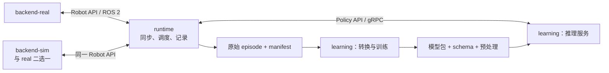

# 双臂机器人环境设计与依赖分析

更新日期：2026-10-29。阶段 1～2 已有构建和运行验证；本文件仍包含后续真实/仿真/模型环境的候选方案。实际已实现范围见 [使用指南](stage2-quickstart.md)，职责与目标接口以 [环境边界与接口设计 v1](architecture-and-interfaces.md) 为准。

## 1. 目标与选型原则

目标是通过独立环境完成真实/仿真双臂的数据采集、数据转换、训练和推理，支持无真机开发。用户本地 GPU 为 RTX 4050 6 GB，训练机器后续更换；机械臂、相机和最终策略尚未确定。

Humble、RealSense、LeRobot 是候选倾向。设计优先确定公共数据与动作语义，具体型号和包版本在最小闭环验证时冻结。

## 2. 四类镜像与职责

| 镜像 | 拥有的职责 | 主要依赖 |
| --- | --- | --- |
| `backend-real` | 真实机械臂/相机驱动、标定、设备时钟映射、底层控制器、公共 Robot API 适配 | ROS 2、厂商/相机 SDK、按需 ros2_control |
| `backend-sim` | 仿真物理、虚拟传感器、场景与控制器、仿真时钟、复位、相同 Robot API | ROS 2、Gazebo、ros_gz、gz_ros2_control、机器人与场景资产 |
| `runtime` | episode、观测同步、控制源仲裁、动作调度、记录和推理客户端 | ROS 2、公共契约包、gRPC/Protobuf、rosbag2；独立于驱动 SDK 与模型框架 |
| `learning` | 原始数据转换、训练、模型预处理、推理服务、模型包输出 | Python、PyTorch、LeRobot 等框架、数据和视频处理；独立于 ROS |

先前的 `robot` 拆分为 `backend-real` 和 `runtime`；先前的 `simulator` 收敛为实现公共设备接口的 `backend-sim`。这是职责拆分，不要求为每个逻辑节点单独建立镜像。

## 3. 启动组合与通信

| 用途 | 启动组合 |
| --- | --- |
| 真机采集 | `backend-real + runtime` |
| 仿真采集 | `backend-sim + runtime` |
| 真机推理 | `backend-real + runtime + learning(serve)` |
| 仿真推理 | `backend-sim + runtime + learning(serve)` |
| 离线转换/训练 | `learning(convert/train)` |

同一机器人 namespace 中，真实和仿真后端只启动一个。推理时可同时记录数据；训练与推理复用 learning 镜像，以不同命令和容器实例运行。



设备侧 ROS API 统一状态、图像、控制权、轨迹、反馈与能力声明；模型侧采用框架无关的 gRPC/Protobuf 草案。离线数据和模型通过版本化 manifest 与文件目录交付。字段和所有者见 [接口规范](architecture-and-interfaces.md)，可审阅的 IDL 见 [policy.proto](../contracts/policy/v1/policy.proto)。

## 4. 候选基础系统

| 层 | 当前建议 | 调整方式 |
| --- | --- | --- |
| ROS 环境 | Ubuntu 24.04 + ROS 2 Jazzy | 厂商驱动有约束时，backend 与 runtime 配套调整 |
| 仿真环境 | Gazebo Harmonic + Jazzy | 与 ROS 和仿真控制插件成组选择 |
| 模型环境 | Ubuntu 24.04 + Python 3.12 | 按经过验证的模型框架发布版和 GPU 支持确认 |
| 模型框架/策略 | LeRobot / ACT 作为首选候选 | 通过 learning adapter 接入公共 Policy API |
| 相机 | ROS 图像接口，RealSense 为候选 | SDK 和驱动留在 backend-real |
| GPU 软件 | 匹配的 PyTorch / torchvision / CUDA / 视频解码组合 | 换训练机器时重新核对并生成平台锁文件 |

Humble 官方支持期截至 2027 年 5 月，Jazzy 截至 2029 年 5 月；Jazzy 的 Tier 1 Ubuntu 平台为 24.04，因此当前无驱动约束时优先 Jazzy。[ROS REP-2000](https://raw.githubusercontent.com/ros-infrastructure/rep/master/rep-2000.rst)

Jazzy / Harmonic 是 Gazebo 官方推荐组合；gz_ros2_control 为仿真提供 ros2_control 接入。[Gazebo 配对表](https://gazebosim.org/docs/harmonic/ros_installation/)、[控制插件](https://control.ros.org/jazzy/doc/gz_ros2_control/doc/index.html)

查阅时 LeRobot main 要求 Python >=3.12 和 NumPy 2。正式环境固定经过验证的发布版/commit，runtime 不安装模型包，避免把模型的 NumPy/OpenCV 依赖混入 ROS。[LeRobot 声明](https://github.com/huggingface/lerobot/blob/main/pyproject.toml)

## 5. 依赖归属与开发结构

| 公共/独有依赖 | 放置位置 |
| --- | --- |
| ROS base、公共接口包、RobotProfile 语义定义 | backend-real、backend-sim、runtime 的共享 ROS 基础层 |
| backend_core 控制权/上下文/事件库 | 真实与仿真 backend 共用，不依赖厂商、Gazebo 或模型框架 |
| 厂商控制与总线 SDK、真实相机 SDK、标定 | backend-real |
| Gazebo、渲染、桥接、仿真控制器、world 与模型资产 | backend-sim |
| 观测同步、session、executor、rosbag2、轻量 gRPC 客户端 | runtime |
| PyTorch、LeRobot/其他框架、模型处理器、数据转换、模型服务 | learning |
| Protobuf SDK | runtime 与 learning 各自生成，只依赖公共协议 |

完整划分以 [目录组织规范](repository-layout.md) 为准，当前实现按以下类别逐步增加：

```text
contracts/                   # 唯一 ROS / proto / JSON Schema 定义
components/                  # backend_real、backend_sim、runtime、learning
libraries/                   # 用途明确的共享实现，如 backend_core
profiles/                    # 机器人、观测、动作的语义实例
configs/                     # 采集、推理、转换、训练及适配配方
assets/                      # 机器人描述、几何与被动场景资源
deploy/                      # Docker、Compose、部署示例与本地机器绑定
tools/                       # 构建、生成、配置检查、启动辅助入口
tests/                       # 跨组件契约、一致性与闭环验证
var/                         # 数据、模型、标定、运行记录和缓存，不进 Git
.build/                      # 可重建构建与生成产物，不进 Git
```

模型权重、数据、输出和缓存以挂载目录管理。底层电机伺服和插值留在设备近端；runtime 及远程模型服务不承担电机控制周期。

## 6. 数据、时钟与本地资源

真实和仿真采用相同语义的 profile/schema，部署信息单独配置。切换后端通过结束 episode、取消旧命令、释放控制权、重新握手完成。clock_epoch、episode 和 control_epoch 用于隔离旧数据与在途动作，详细规则见接口规范。

原始数据同时记录观测、模型/示教意图、实际发送命令、后端接受/反馈和物理测量；离线转换显式定义动作对齐。仿真真值主要用于评估，默认不进入策略观测。

learning 可用不依赖 ROS 的 rosbags 读取原始 rosbag2/MCAP，并验证实际消息与压缩类型。[Rosbags](https://ternaris.gitlab.io/rosbags/)、[存储支持](https://ternaris.gitlab.io/rosbags/topics/rosbag2.html)

本地先运行单场景、小图像输入与小型策略，测量 Gazebo 渲染和模型同时运行的显存与延迟。必要时将模型服务迁移到另一台 GPU 主机，只改变 endpoint；具体配置参考 [仿真设计](simulation-design.md)。

## 7. 验证和版本管理

实现顺序与各阶段完成标准以 [逐步实现路线图](implementation-roadmap.md) 为准：先完成最小契约与 mock 控制/采集，再用 fake policy 验证独立 RPC，然后加入 Gazebo、示教数据转换、小模型训练与实际策略闭环。真实后端在设备确定并完成相同接口验证后接入。

配置、契约、后端、RPC、数据和模型检查随着对应功能逐步加入。切换/复位、迟到预测、lease 失效、写盘失败等行为应在测试后端阶段就验证，并在仿真与真机中复用一致性检查。

最小闭环通过后固定镜像 digest、契约版本、框架版本和 Python/CUDA 锁文件。旧 Python 3.10 依赖解析快照保留在 `dependencies/`，仅供追溯；它不代表当前架构已经通过构建或运行验证。
