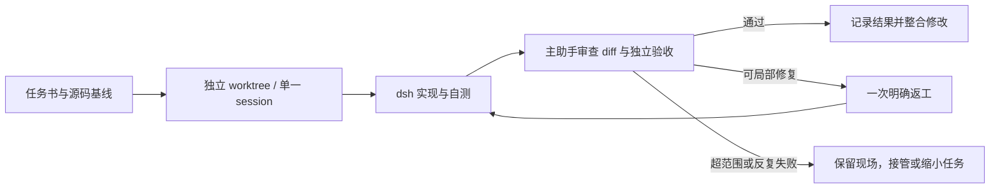

# dsh 委派执行试验计划

日期：2026-10-30。状态：只读预检及 DSH-001～003 已执行并整合。R2/R3 首轮通过；R1 经一次定点返工和监督者局部补齐后通过，见 [DSH-001](tasks/dsh-001-result.md)、[DSH-002](tasks/dsh-002-result.md)、[DSH-003](tasks/dsh-003-result.md)。尚无节省用量或全流程提速的对照结论。项目功能推进继续停留在阶段 2R。

目标是验证一种分工：主助手负责限定问题、写任务书、审查代码与独立验收；dsh 负责在限定范围内实现和自测。评价对象是交付一个可接受修改的总成本，包括计划、执行、返工、审查、测试和人工介入。

后续实施已推进至 [DSH-015](tasks/dsh-015-result.md)，S1、S2a环境门槛及双臂场景模型完成，按用户要求暂停；下面保留首次试验规划和当时状态，当前阶段以 [执行记录](simulation-loop-progress.md) 为准。DSH-013 达到一次返工上限后由主助手接管，说明扩大范围仍需严格验收和控制返工；目前没有可据以宣称节省费用或整体提速的对照数据。

## 1. 已确认的本地条件

| 项目 | 事实与限制 |
| --- | --- |
| 项目版本基线 | `c2c3e939116f9926f37a256b3b315cd80ce7fe53`，首次提交；本轮开始时工作区干净 |
| dsh checkout | `/home/ljk/tools/deepseek-harness`，commit `687f282e8625c6b8d11ff58211a90524be2e4317`，包版本 `0.2.1-rc.2` |
| 自动执行接口 | 本地文档及源码提供 `--profile headless`、stdin 任务、`--json` 事件和 `--session-id` 续做 |
| 启动入口 | 已运行 CLI help、headless 只读探针和 DSH-001；实际结果见任务记录 |
| Web | 用户已启动 Web 并得到模型列表；本轮未控制已有 Web 会话 |
| 认证差异 | 默认 headless 禁用已保存凭据和 DeepSeek account 消费者，Web 登录不会自动证明 headless 可用 |
| 工作目录 | CLI 调用目录是默认工作区；从 harness 目录执行 pnpm dsh，不能据此认定工作区是机器人项目 |
| 用量事件 | 本地 headless JSON 实现在 step_end 可携带 usage，缺失任一尝试的样本时可省略；需实际核对完整性 |

上述判断来自本地 `apps/cli/README.md`、`packages/bundle/headless/README.md`、`packages/bundle/headless/src/json-stream.ts` 和 `packages/sandbox/sandbox-policy/README.md`。这是针对该 checkout 的方案，升级 dsh 后需复查。

Web 登录 URL 中的 token 不写入项目文件或任务书。模型账号沿用本地凭据机制，任务文本不携带密钥。

## 2. 分工和交接材料

| 角色 | 负责的工作 | 交付材料 |
| --- | --- | --- |
| 主助手：任务作者 | 确定单一行为、允许文件、兼容要求、验收和停止条件 | 可单独理解的任务书、固定源码基线 |
| dsh：执行者 | 阅读最小必要上下文、实现、补行为测试、自测 | 未提交的源码差异、命令及结果、未解决项 |
| 主助手：审查者 | 检查范围和实现、验证测试有效性、独立运行验收 | 接受 / 定点返工 / 接管，以及具体证据 |
| 用户 | 调整目标和资源偏好，在需要时查看任务书与差异 | 不必逐步搬运实现细节 |

一个任务对应一个独立 Git worktree 和一个 dsh session。首轮串行执行。主助手验证时 dsh 应已停止写入，避免边改边测。worktree 用于隔离源码差异，并不等于操作系统权限隔离；有效写入策略与工作目录仍需在预检中确认。

任务书应包含：问题与复现、基线、允许修改文件、必要阅读、预期行为、兼容边界、验证命令、停止条件和交付格式。任务中的实施要求足够独立，不要求 dsh 读完整对话或所有设计文档。

## 3. 先做三层试验

### A. 入口预检：只读、短任务

先确认实际选中的 provider/model、推理档位和认证路径。若复用 Web 已登录账号，按本地 headless 文档使用单次 overlay 恢复对应服务，并检查模型路由；若已有环境 API-key 路由，验证其可用性即可。profile 和模型选择通过已支持的配置机制设置，不假设存在 `--model` 或 `--max-tokens` 参数。

在临时工作区写入无敏感信息的小文件，让 dsh 只读并报告内容、cwd 和任务标记。预检覆盖：

1. JSON session 事件中的 cwd 是预定工作区，模型请求实际成功。
2. 退出状态、turn_end 和 final 可以读取；只读任务没有产生源码变化。
3. 任务失败或外部超时可以被识别并停止；结束后核对任务启动的子进程。
4. 写任务前确认有效权限策略限制在指定工作区；任务书的文件白名单再通过 Git 差异核对。

这个阶段不需要真实项目修改。若 headless 的认证/权限预检不通过，记录阻碍；可改用现有 Web 新会话，显式选择试验 worktree 后提交同一任务书。此时标记为人工交接试验，不能把手工搬运时间从统计中去掉。

### B. 第一个实现任务：R2 观测身份稳定

使用 [DSH-001 任务书](tasks/dsh-001-observation-identity.md)。只允许修改 `observation.py` 和 `test_observation.py`，无需 ROS、Docker 或新增依赖。

选择原因：缺陷可确定复现，行为边界清楚，能够检查回归测试是否在旧代码上失败，并能观察 dsh 是否引入多余抽象。它既验证执行能力，也验证我们能否用少量上下文完成可靠审查。

建议试验上限：首轮执行 15 分钟，最多一次定点返工、额外 10 分钟。这些是监督进程应实施的 wall-time 限制，不是声称 dsh 原生支持 token 硬上限。首次审查记录实际耗时；预算到达时保留现场和结果，不自动无限续跑。

### C. 按结果扩大范围

| 顺序 | 候选任务 | 开始条件 |
| --- | --- | --- |
| 1 | R2 观测 ID 固定引用 | 入口预检通过 |
| 2 | R3 清理步骤独立尝试 | R2 经独立验收，范围控制与交付材料可用 |
| 3 | R1 中断与线程收尾 | R3 通过；先由主助手补充 ROS 生命周期设计和故障验收方案 |
| 4 | runtime 职责提取 | 已修复行为有回归保障；按一个责任一次提取 |

R1 不是简单增加 join；涉及信号处理、ROS 上下文和写盘生命周期，应在任务书明确设计后再委派。阶段 3 RPC 与 Gazebo 不在本次试验范围。

## 4. 单个任务的执行流程



准备时记录 base SHA、任务书摘要、dsh 版本、模型选择和工具权限。试验 worktree 建议放在 `/home/ljk/work/sim_dual_arm-worktrees/dsh-001`，使用独立任务分支；主工作区可保留未提交的计划文档，任务书通过 stdin 传入。

从 worktree 的 cwd 启动已构建 CLI，可保持源码位置正确。下面仅是认证、权限、路径和超时监督就绪后的调用形式，不是已经执行的命令：

```bash
node "$DSH_ENTRY" --profile headless --patch "$TASK_OVERLAY" --json < "$TASK_FILE"
```

监督者捕获 stdout/stderr、退出码和起止时间。续做仅使用该任务已产生的 session ID，且 cwd 一致；不接管用户已有 Web 会话。每次返工只发送具体问题、失败证据和仍有效的边界，避免重新发送整份项目背景。

任务结束后先检查 `git status --short`、`git diff --name-status` 和 `git diff --check`，包含未跟踪文件。HEAD 应仍为约定基线，dsh 不自行提交或改分支。范围异常先解释，不能通过删除测试、放宽校验或修改任务书获得通过。

主助手验证通过后再整合已审查的差异；整合到目标分支后运行相应回归。具体 Git 提交按当次执行范围处理，不自动推送。失败 worktree 和日志保留到问题记录完成，清理仅针对本次创建的资源。

## 5. 审查与验收

主助手依次检查：

1. **范围：** 是否仅修改允许文件，是否新增依赖、改配置、改测试入口或隐藏失败。
2. **行为：** 缺陷是否消失，旧行为是否保留，边界条件是否明确。
3. **测试：** 新回归用例能否在固定基线失败、在修改后通过；验收使用实际候选源码，不使用旧镜像内的代码。
4. **可维护性：** 命名、类型、状态归属和注释是否让人更容易理解；是否出现为一个局部修复增加的通用框架。
5. **交付证据：** 命令确实执行，未执行项明确标注，主助手独立结果与 dsh 自述一致。

dsh 的退出码 0 或“任务完成”只表示执行过程结束，不能代替项目验收。DSH-001 先跑针对性测试，再跑当前纯 Python 测试与 Ruff；不因纯 Python 小修复重复构建全部 Docker 镜像。

## 6. 如何判断是否节省用量、加快进度

每次试验在 `var/runs/dsh/<task_id>/<attempt>/` 保存任务快照、运行元数据、事件、stderr、自测输出、候选差异、审查结果和独立验证结果。可公开的结论再归纳到任务记录，原始事件留在本地。

| 指标 | 记录方式 |
| --- | --- |
| 交付质量 | 首轮通过与否、返工次数、越界修改、独立验收发现的缺陷 |
| 总耗时 | 计划 + 排队/执行 + 自测 + 审查 + 返工 + 整合验证；另外记录人工操作时间 |
| 主助手用量 | 能取得的实际用量；没有数据时记 unavailable，不能填 0 |
| dsh 用量 | provider 报告的输入、缓存和输出用量，包含重试/失败；缺失字段标记未知 |
| 总成本 | 采用当次实际账单/账户用量；订阅额度与 API 费用分别记录，不把异构 token 简单相加当作费用 |
| 建设成本 | 认证适配、任务书模板、监督工具的首次成本单列，同时计入首轮总投入 |

headless 的 step_end usage 与最终会话统计不能重复相加。界面上下文占用估计也不能当作实际账单。若需要监督者的精确 token 数据但平台没有提供，则只报告可观测结果和未知项。

首次 R2 试验只能判断流程可行性，不能给出可信的节省百分比。通过后，可选至少三项规模相近的独立任务交替采用“主助手直接实施”和“dsh 实施、主助手审查”，保持验收标准一致；同一缺陷重复实现会受到已有解法影响，不能视为无偏对照。避免为了测量而重复完成整轮重构。

继续委派的条件是质量达标、返工有界、审查负担可接受；若只是把实现时间转成更长的修补时间，收缩到更小的任务。提速与节省主助手用量分别报告，不能假设二者必然同时发生。

## 7. 交付状态与下一次试验

方案阶段交付协作计划和 DSH-001 任务书。用户随后授权试验，已完成入口适配、独立 worktree 实施、主助手审查与验收，并将 R2 修复整合到主工作区，尚未提交 Git。

后续已完成 R3 和 R1。R1 首轮测试通过后，独立审查仍发现异常分支、测试打包和 Docker 信号入口问题；一次返工后由监督者补齐剩余的 executor 异常分支。结果说明独立验收不能省略，也不证明这类复杂任务一定更省用量或更快。

下一次候选为 R4：先提取一个具体职责，保持外部行为，复用现有回归。每个新任务使用新 session，限制单次返工；达到边界后接管，避免持续扩大上下文。职责重构、完整监督器可靠性和成本优势仍待验证。本轮源码未提交，主工作区暂存区未改动。

## 2026-11-01 · 隔离快照与主工作区提交的区别

每项任务使用临时Git index生成隔离输入快照，并以快照SHA建立`codex/dsh-*`工作树分支。
这些快照保留于Git对象与任务分支，供审查/复现；不移动主工作区HEAD，不改主暂存区。
任务结果中的“未提交”指没有提交主工作区的业务修改，dsh也不自行提交候选或推送。
输入快照、实际候选差异和整合结果分别记录在对应`var/runs/dsh/.../metadata.json`及验收产物中。
