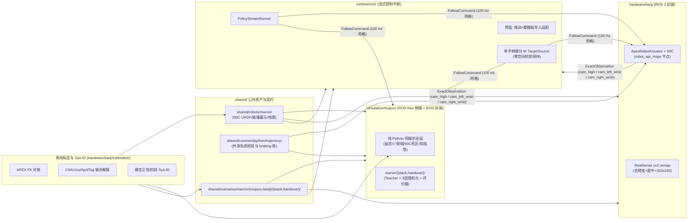

# 天机 Real2Sim 标定与实施方案

本文定义实验室天机双臂平台（APEX 双臂 + 大寰 CTAG2F90-C 夹爪 + 3 路 RealSense + 4 路视触觉指垫）的 **Real2Sim 仿真对齐方案**、开工前待确认的硬件参数清单、跨端模块分工及四项定量验收门禁。

> **状态区分**
> - **当前已就位基础**：[`shared/robots/marvin/`](../../shared/robots/marvin/README.md) 7 轴双臂本体资产；[`simulation/mujoco/`](../../simulation/mujoco/README.md) 纯物理装配与结构化 `TaskObservation` 评价器；[`hardware/tianji/`](../../hardware/tianji/README.md)（APEX 双臂 TCP 9100 / UDP 9101 在线跟踪与 `forward_kinematics`、大寰 90C 夹爪 Modbus RTU 驱动、RealSense 与 4 路视触觉采集，见 [`devices.yaml`](../../hardware/tianji/configs/devices.yaml)）；[`runtime/ros2/`](../../runtime/ros2/README.md) 统一 `TargetSource` 流式护栏与 `RobotProfile.interface_digest`。
> - **前置待确认项**：见第 2 节“待向实验室硬件同事确认清单”；确认末端 CAD 模型、指垫实测尺寸及手柄/拖动程序细节后启动阶段一代码改造。
> - **阶段一实施目标**：完成 `marvin` 原地 Real2Sim 标定重构、5 项 RL 预留接口就位（见 [强化学习架构与 Real2Sim 协同设计](强化学习架构与Real2Sim协同设计.md)）、[`hardware/tianji/`](../../hardware/tianji/README.md) ROS 2 后端与跨仿真/真机单手柄微分 IK 遥操打通，并以 `stack` 与 `handover` 双基准任务通过四项定量门禁收口。

---

## 1. 八项定型架构与物理对齐决策

| 维度 | 定型方案 |
| :--- | :--- |
| **1. 本体身份演进** | 按“零历史包袱”原则**原地升级 `marvin`**。将 `shared/robots/marvin/` 与 `robot_backend_sim/marvin/` 重构为实验室天机真机标定版（90C 夹爪 + 视触觉软指垫 + 实测外参），使 `marvin/mujoco/<task>` 与 `marvin/tianji/<task>` 共享 `robot_id: marvin` 与完全一致的 `RobotProfile.interface_digest`。原未标定 80 mm 夹爪（`Arm_*8~11_Link`）及旧仿真数据集退役重采。 |
| **2. 末端与底座几何** | 法兰（`Arm_*7_Link`）之后采用**物理碰撞与视觉网格解耦设计**：碰撞与接触使用实测尺寸解析几何（指垫用 `box` 保证法向稳定，壳体与相机支架用轻量 `box`/`capsule`），视觉层预留可选 STL 网格挂载位（`contype=0, conaffinity=0`）；物理装配统一暴露语义句柄 `tcp_site_ids`、`finger_pad_body_ids`、`pad_aperture_m` 与 `arm_collision_body_ids`。 |
| **3. 运动学与手眼标定** | 采用“**控制器 FK 对账 → 桌面 ChArUco/AprilTag 联合解算 → TCP 四角点触校验**”三步法：先后核对双臂零位/正负号/映射、一次性联立解算双臂基座残差与桌面 `top_z` 及 3 路相机外参，并通过指尖点触标定 `T_flange_tcp`。 |
| **4. 相机契约与投影** | 全仓统一使用真机命名 **`cam_high`、`cam_left_wrist`、`cam_right_wrist`**（同步更新公共观测档案、仿真配置与测试，无名称映射中间层）；真机启动时基于 RealSense 出厂内参预计算 `cv2.initUndistortRectifyMap`，每帧单次 `cv2.remap` 同时完成去畸变、主点居中 `(160.0, 120.0)` 与 `640×480 → 320×240` 下采样，严格对齐 MuJoCo 理想中心针孔 `fovy` 投影。4 路视触觉保留在 `devices.yaml` 按可选配置开关，阶段一不进入主 `Observation` 契约。 |
| **5. 夹爪与软指垫建模** | 跨端 `left_gripper_width` / `right_gripper_width` 统一定义为 **`[0.0, 0.090] m`**，直接对应大寰 90C 导轨行程（`invert_stroke: true`，真机零偏置换算）；MuJoCo 双侧滑块行程 `[0.0, 0.045] m`，按实测厚度挂载视触觉硅胶 `box` 碰撞体，通过 `solref`/`solimp` 与接触摩擦复现 `1~2 mm` 压缩形变与 90C `60%` 力限堵转；任务评价器通过 `pad_aperture_m(scene, side)` 读取指垫内侧物理净间隙。 |
| **6. 动力学 Sys-ID** | 在 `hardware/tianji` 跑安全悬空无接触小幅正弦（`3°~5°`）与 90C 开合阶跃辨识，自动拟合双臂纯延迟 `τ_arm`、`OnlinePlanner` 等效带宽（映射为延迟缓冲 + `arm_kp`/`arm_kv`/`joint_damping`/`joint_armature`）及 90C 串口延迟 `τ_gripper`、`0.3 mm` 重触发死区与最大速度，封装入**零 `rclpy` 依赖**的纯 Python 伺服步进层供仿真与 Colab RL 共用。 |
| **7. 首发对齐基准任务** | 不新增第三任务，将存量 **`stack`**（单臂精细抓放）与 **`handover`**（双臂空中协同交接）迁移适配至真机标定桌面高程、工作空间及标准实物方块，同步更新程序 Teacher 航点、抓取开度与 `reset(seed)` 三层可开关域随机化。 |
| **8. 真机后端与遥操** | 上提纯 Python 轨迹连续性检查与刹停核至 `shared/common/python/trajectory/`，打通 `hardware/tianji` ROS 2 后端（`robot_api_msgs` + `BackendInfo.control_grid_ns`）；优先落地跨仿真/真机通用的**单手柄“微分 IK + 零空间肘部保持”遥操源**（接入 `runtime` `TargetSource`）；并在采集架构中预留实验室现有“**边拖边录 + 脚踏板数字输入控制**”程序的产物导入接口。 |

### 1.1 三步联合标定细则

1. **控制器 FK 对账**：离线采样双臂多组安全关节角 `q`（`rad` 转 `deg`），调用 APEX TCP 命令 `forward_kinematics` 与 UDP 9101 `currentPose (World)`，逐轴核对 MuJoCo 中 `Arm_L1..7` / `Arm_R1..7` 的零位偏置、关节旋转方向、`armId` 与左右臂归属及标称基座位置。
2. **桌面标定板多视角联合解算**：在工作桌面固定平铺已知方格尺寸的刚性 ChArUco / AprilTag 标定板，采集 15～20 组双臂多姿态无遮挡样本，同步记录 `cam_high`、`cam_left_wrist`、`cam_right_wrist` 图像与双臂关节角，联合优化求解：
   - 桌面相对机器人基座系的平面位姿与高度 `table.top_z`（同时检验桌面水平度）；
   - 左右臂相对安装残差（若双臂立柱与原厂 `ZJ_Robot_link` 存在装配偏差）；
   - `cam_high` 眼在手外外参 `T_base_cam_high` 及左右腕部相机眼在手上外参 `T_flange_cam_left`、`T_flange_cam_right`。
3. **TCP 四角点触交叉校验**：闭合大寰 90C 夹爪，点动轻触标定板四个角点已知世界坐标，反算 `T_flange_tcp` 并验证全链路闭环残差 `< 2.0 mm`。

### 1.2 视觉去畸变居中对齐与触觉隔离

- **单次 `cv2.remap` 对齐**：RealSense 启动时由 `pyrealsense2` 读取出厂颜色内参矩阵 `K_raw` 与畸变系数 `D_raw`。离线/启动阶段构造目标理想针孔内参 `K_target`（分辨率 `320×240`，主点严格居中 `cx = 160.0, cy = 120.0`，无畸变 `D = 0`，`fovy` 与仿真相机一致），调用 `cv2.initUndistortRectifyMap(K_raw, D_raw, R=I, K_target, (320, 240), CV_32FC1)` 预生成映射表，热路径每帧仅执行一次 `cv2.remap`，直接消除近景腕部相机桶形畸变与主点偏移。
- **相机拓扑与视触觉边界**：阶段一部署态公共观测固定为 `(cam_high, cam_left_wrist, cam_right_wrist)` 3 路 `320×240` RGB；`devices.yaml` 中 4 路 `tactile_*` 保留配置与独立驱动，按开关决定是否记录到真机私有诊断/扩展通道，不强行写入公共主 `RobotProfile` 或在 MuJoCo 渲染光学触觉图像。

### 1.3 纯 Python 伺服步进层与单手柄微分 IK 遥操

- **零 ROS 伺服步进层**：将 Sys-ID 拟合得到的双臂指令队列纯延迟 `τ_arm`、`OnlinePlanner` 带宽等效参数、APEX 单周期限幅（`max_joint_step_deg: 1.0°`）、90C 串口轮询延迟 `τ_gripper` 与重触发死区（`0.3 mm`）内聚到与 `rclpy` 完全隔离的纯 Python 步进器，使 `simulation/mujoco` ROS 后端与后续 Colab `rl_env` 执行完全一致的控制动力学。
- **单手柄“微分 IK + 零空间肘部保持”遥操**：作为 `runtime/ros2` 的标准 `TargetSource` 实现（可先接入 `simulation/mujoco` 在 `viewer` 中调试，再零修改切至 `hardware/tianji`）：
  - 手柄右摇杆/十字键/肩键映射为活跃臂（左臂 / 右臂 / 双臂同步平动）末端笛卡尔速度指令 `v_des ∈ R^6`，通过标定 URDF 计算 7 轴几何雅可比 `J` 的阻尼最小二乘逆，并叠加零空间投影 `(I - J^+ J) k_null (q_home - q)` 保持肘部自然构型、避开奇异与桌面碰撞；
  - 扳机键连续控制活跃夹爪在 `[0.0, 0.090] m` 行程开合；
  - 功能键负责切换控制臂、启停录制及人工标注 `SUCCEEDED` / `FAILED`（废弃重采）。
- **工作站既有拖动采集程序预留**：后续迁入实验室工作站现有的“边拖边录 + 脚踏板数字输入控制”脚本时，通过独立离线适配入口把原始录制（关节位置、脚踏板事件与 3 路相机图像）规整为标准 `output/marvin/tianji/<task>/datasets/raw/` 与无损扩展版 LeRobot Parquet 契约，不破坏主链路。

---

## 2. 开工前待向实验室硬件同事确认清单（Checklist）

在切出开发分支修改本体模型与配置前，需与硬件/结构同事核实以下四类信息：

1. **末端与台架 CAD / 几何参数**
   - [ ] `Arm_*7_Link` 法兰之后（转接板 + 腕部 RealSense 支架 + 大寰 90C 壳体 + 视触觉手指）是否有完整 STEP / STL / URDF 模型？若暂缺，请提供各部件关键外形包络尺寸与安装偏置草图。
   - [ ] 真机双臂立柱相对安装位置是否与原厂 `ZJ_Robot_link` URDF 一致（肩高 `1.121 m`、左右偏置 `±0.2005 m`、侧装倾角 `∓90°`）？
   - [ ] 末端组件（90C + 相机 + 支架 + 视触觉）大致总质量与质心位置（用于修正仿真连杆惯量与重力补偿检查）。

2. **90C 夹爪与视触觉硅胶指垫实测尺寸**
   - [ ] 90C 导轨处于 `90.0 mm`（全开）与 `0.0 mm`（全闭）时，两块视触觉硅胶内侧面之间的实际物理净间距各是多少 mm？
   - [ ] 两块硅胶指垫在无物块时刚好接触合拢，此时 90C 驱动读取的导轨行程 `stroke_at_touch` 是多少 mm？
   - [ ] 单侧硅胶指垫有效接触面的长 × 宽 × 厚（mm）及常规夹持力（`default_force_pct: 60%`）下的法向压陷量（mm）。

3. **相机型号、工作台与标定/任务道具**
   - [ ] `cam_high`、`cam_left_wrist`、`cam_right_wrist` 三台 RealSense 的具体型号（如 D435i / D405 / D415）及 `cam_high` 的固定支架大致高度与俯仰角。
   - [ ] 实验室桌面相对机器人立柱底部的粗测高程 `top_z`、桌面尺寸及双臂安全可达工作区边界。
   - [ ] 现场是否已有已知规格的 ChArUco / AprilTag 标定板，以及 `stack` / `handover` 计划使用的实物方块尺寸（如 `40 mm` / `60 mm` 3D 打印块或木块）与表面材质。

4. **遥操手柄与工作站既有拖动程序细节**
   - [ ] 用于遥操的物理手柄型号（如 Xbox / PS5 手柄，确认 Linux `/dev/input/js*` 或 `evdev` 映射）。
   - [ ] 工作站现有“边拖边录 + 脚踏板数字输入控制”程序的代码路径、落盘格式、采样频率，以及脚踏板触发键位语义（启停录制 / 夹爪开合 / 打标）与 APEX 零力矩拖动开关方式。

---

## 3. 跨端模块分工、数据流与时序契约

### 关键模块落位表

| 模块路径 | 核心职责与约束 |
| :--- | :--- |
| `shared/robots/marvin/` | 原地升级后的双臂本体 URDF、90C/支架视觉网格与碰撞规格、`marvin_rgb_joint.json`（`cam_high` / `cam_left_wrist` / `cam_right_wrist`）、`marvin_joint_position.json`（`[0.0, 0.090] m` 夹爪行程）。 |
| `shared/common/python/trajectory/` | 从 `simulation/mujoco` 上提纯 Python 轨迹连续性检查、局部拼接覆盖与 `braking` 可刹停包络验证，供仿真后端与 `hardware/tianji` 共用。 |
| `simulation/mujoco/src/robot_backend_sim/marvin/` | 更新 `assembly.py` / `io.py` / `robot_config.py` / `scene_base.py`，暴露语义末端句柄（`tcp_site_ids`、`finger_pad_body_ids`、`pad_aperture_m`、`arm_collision_body_ids`），接入零 `rclpy` 伺服步进层，适配 `stack` / `handover` 的桌面高程、90C 抓取与三层域随机化。 |
| `hardware/tianji/src/robot_backend_hardware/` | 新增标定与 Sys-ID 工具脚本；在相机采集模块加入预计算 `cv2.remap` 去畸变居中下采样；实现暴露 `robot_api_msgs`（含 `BackendInfo.control_grid_ns`）的 ROS 2 后端节点。 |
| `runtime/ros2/` | 基于 `BackendInfo.capabilities` 分流真机与仿真生命周期；新增跨后端单手柄微分 IK `TargetSource` 与手柄按键交互控制；在 `offline/` 预留“边拖边录 + 脚踏板”数据导入转换接口。 |
| `shared/scenarios/marvin/{mujoco,tianji}/{stack,handover}/` | 按三层正交坐标维护标定后仿真与真机的 `RobotProfile`（保持两端 `interface_digest` 一致）及独立运行配方。 |

---

## 4. 五步工程实施路线与定量验收门禁

### 4.1 实施路线（拿到硬件确认清单后切 `dev/` 分支执行）

1. **Step 1：离线契约与纯 Python 控制核改造**：全仓统一相机命名 `cam_high` / `cam_left_wrist` / `cam_right_wrist` 与 90C `[0.0, 0.090] m` 行程契约；上提纯 Python `trajectory` 连续性/刹停校验核；在 `simulation/mujoco` 抽离零 `rclpy` 伺服步进层并重构语义末端句柄。
2. **Step 2：真机运动学、多相机手眼联合标定与悬空 Sys-ID**：运行 APEX `forward_kinematics` 对账、桌面 ChArUco/AprilTag 标定板多视角联合求解、TCP 四角点触校验及悬空小幅激励 Sys-ID，导出标定结果写入 `shared/robots/marvin/` 与场景配方。
3. **Step 3：MuJoCo 标定版 `marvin` 装配与双任务迁移**：完成 90C 软指垫几何与可选 STL 视觉网格装配，校准 `stack` 与 `handover` 的桌面/方块参数、程序 Teacher 与三层域随机化，并通过现有四步全链路门禁。
4. **Step 4：`hardware/tianji` ROS 2 后端与单手柄微分 IK 遥操打通**：在真机端落地 `cv2.remap` 对齐与 `robot_api_msgs` 实时节点，在 `runtime/ros2` 打通单手柄微分 IK 遥操（先在 MuJoCo `viewer` 验证，再切换至天机真机采集与回放录制）。
5. **Step 5：Real2Sim 定量对账与零样本真机推理验收**：在真机与仿真下逐项核验下表四项门禁，确认无误后进入规范分支收敛并合入 `main`。

### 4.2 Real2Sim 阶段一四项定量验收门禁

| 验收项 | 定量判据与通过条件 |
| :--- | :--- |
| **1. 运动学与外参精度** | 控制器 `forward_kinematics` 与 MuJoCo 法兰位姿偏差 `< 0.5 mm` 且姿态 `< 0.05°`；桌面标定板多视角闭环与 TCP 四角点触交叉校验残差 `< 2.0 mm`。 |
| **2. 三路相机重投影对齐** | 同关节角与桌面标定物下，真机 `cv2.remap`（`320×240`）与 MuJoCo 渲染画面半透明叠图，标定板关键角点与夹爪轮廓偏差 `< 3 px`。 |
| **3. 伺服与夹爪动态对齐** | 同一安全测试轨迹在真机与仿真下执行时，双臂关节角相位延迟差 `< 10 ms`、稳态与动态跟踪 RMSE 对齐，90C 开合时机一致，全程不触发 `0xFF73` / `0xE001`。 |
| **4. 双任务与真机闭环** | 校准后的 `marvin/mujoco/{stack,handover}` 通过 `AGENTS.md §3.5` 四步全链路审查；`marvin/tianji/{stack,handover}` 在 `runtime` 下跑通单手柄微分 IK 遥操录制与仿真训练 ACT 策略真机闭环推理。 |

---

目录导航：[功能说明索引](README.md) · [强化学习架构与 Real2Sim 协同设计](强化学习架构与Real2Sim协同设计.md) · [架构扩展与演进指南](架构扩展与演进指南.md) · [跨端架构分工与解耦审查](跨端架构分工与解耦审查.md) · [文档总索引](../README.md) · [根 README](../../README.md)
