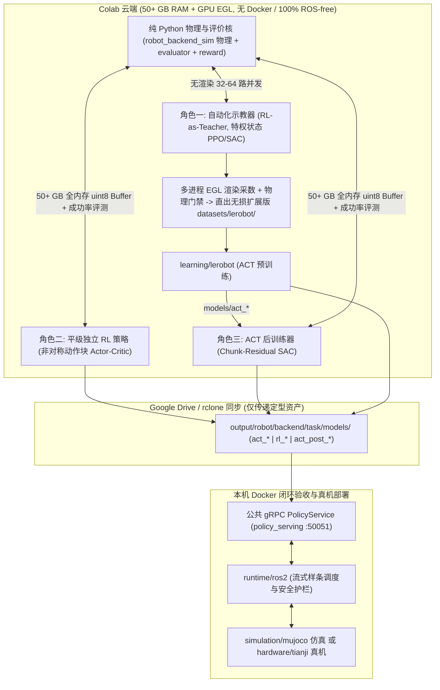
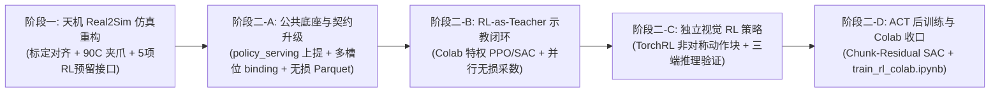

# 强化学习（RL）架构与 Real2Sim 协同设计

本文定义 `sim_dual_arm` 引入强化学习（RL）作为**与 ACT 平级的独立策略、ACT 后训练器及自动化示教器**的顶层架构、Colab 大内存训练与无损数据集方案、多范式方案绑定契约，以及开展天机硬件 **Real2Sim** 仿真重构时的预留接口清单。

> **状态区分**
> - **当前已就位基础**：四维正交解耦目录与 `output/<robot>/<backend>/<task>/` 四分区产物规范；[`simulation/mujoco/`](../../simulation/mujoco/README.md) 无 ROS 物理装配与结构化 `TaskObservation` 评价器；[`learning/lerobot/`](../../learning/lerobot/README.md) 策略服务协议（`bimanual.policy.PolicyService`）与 [`PolicyModelAdapter`](../../learning/lerobot/src/dual_arm_learning/adapters/base.py) 抽象；[`hardware/tianji/`](../../hardware/tianji/README.md) APEX 双臂、大寰 90C 夹爪与多路相机驱动配置（[`devices.yaml`](../../hardware/tianji/configs/devices.yaml)）；[`docs/colab/`](../colab/train_act_colab.ipynb) 无 Docker `uv` 云端训练与 `rclone` 同步工作流。
> - **后续落地路线**：按“**阶段一：天机硬件 Real2Sim 仿真对齐与接口预留（详见 [天机 Real2Sim 标定与实施方案](天机Real2Sim标定与实施方案.md)） → 阶段二：公共策略服务上提与独立 `learning/rl` 三位一体接入**”分阶段实施。

---

## 1. 顶层定位与七项定型架构共识

| 维度 | 定型方案 |
| :--- | :--- |
| **1. 推进节奏** | 先完成天机真机 **Real2Sim** 仿真重构并在场景层预留 RL 物理与随机化接口；待 Real2Sim 收敛后，再落地 `learning/rl/` 代码与具体任务奖励配方。 |
| **2. 端形态与算力定位** | 新建与 `learning/lerobot/` 平级的独立学习端 `learning/rl/`（在 [`env.sh`](../../env.sh) 注册 `rl` 容器用于本地推理与冒烟测试，并提供 `docs/colab/scripts/setup_colab_rl.sh` 支持 Colab 无 Docker `.venv` + `MUJOCO_GL=egl`）；重算力训练、后训练、示教采数与物理闭环成功率评测均集中在 **Google Colab（50+ GB 内存 + 云端 GPU）** 进程内完成。 |
| **3. 算法底座与公共服务复用** | `learning/rl/` 基于 **`TorchRL` + `TensorDict`** 构建；将现有 [`learning/lerobot/src/dual_arm_learning/serving/`](../../learning/lerobot/src/dual_arm_learning/serving/server.py) 与 [`PolicyModelAdapter`](../../learning/lerobot/src/dual_arm_learning/adapters/base.py) 上提至公共包 `shared/common/python/policy_serving/`，供 `lerobot`（ACT）、`rl` 及未来自定义 VLA 共用同一 gRPC `PolicyService`。 |
| **4. 观测与特权状态边界** | 部署态 Actor 输入跨仿真与真机统一为 **3 路下采样 RGB（`cam_high`、`cam_left_wrist`、`cam_right_wrist`，`320×240`；真机经 `cv2.remap` 去畸变居中后严格对齐 MuJoCo `fovy`）+ 16 维关节/夹爪状态**（暂不在 MuJoCo 渲染 4 路光学视触觉图像）；仿真中的物体 6D 位姿、线/角速度与双指法向接触力仅作为训练期 **Critic 与特权示教器（RL-as-Teacher）** 输入。 |
| **5. 动作空间与控制契约** | 跨端 [`policy.proto`](../../shared/common/interfaces/policy/policy.proto) 维持 **16 维 `joint_position` 动作块**契约；`learning/rl/` 内部采用双轨制——从零训练与特权示教支持双臂末端笛卡尔增量（`Δpos + Δrot` + 夹爪）经内置 `mink` IK 转为平滑关节块，ACT 后训练直接输出有界关节残差块 `Δq`。 |
| **6. 统一无损数据集格式** | 采用**扩展版 LeRobot Parquet 分片**作为唯一权威数据集格式，支持内嵌**无损 PNG 字节列**（256 MB 分片存储、像素 100% 无损），统一写入 `observation.state`、`observation.velocity`、`action`、**双臂末端 EE 6D 位姿**、`task` 自然语言指令及 `reward` / `done` 列；Colab 内存直出该格式，既可直接训练 ACT/RL，也可通过 `pyarrow` 无损转换为任意外部 VLA 格式（RLDS / HDF5 / Zarr / WebDataset）。 |
| **7. 多范式绑定与模型产物** | [`binding.py`](../../shared/common/python/contracts/src/robot_contracts/binding.py) 升级支持 `binding.yaml` 中按范式命名的多槽位 `learning` 字典（`learning.act`、`learning.rl`，后续可扩展 `learning.vla`，其中在线 RL 槽位无需强依赖前置 `dataset`）；`output/<robot>/<backend>/<task>/models/` 下以 `<范式前缀>_<YYYYMMDD_HHMMSS>/`（`act_*`、`rl_*`、`act_post_*`）平级存放 `model.safetensors` 与 `training_args.yaml`。 |

---

## 2. Colab 大内存进程内训练与本机部署全景架构

在线 RL 探索需要十万至百万步高频交互，且探索期含噪动作易触发 `runtime/ros2` 与后端轨迹跟随护栏的制动拒绝。因此系统将**训练期进程内物理直连**与**部署期标准三端闭环**彻底分离：

### Colab 50+ GB 内存工程收益

1. **全内存零拷贝视觉 Replay Buffer**：单步 3 路相机（`3 × 320 × 240 × 3` `uint8`）原始图像仅约 `230.4 KB`。10 万步在线交互加上 50 条离线演示（约 1.5 万步）全量常驻内存的 `TensorDictReplayBuffer` 约占 `26.5 GB` RAM，消除磁盘解码 I/O 瓶颈，且不在 `output/` 产生中间缓存垃圾。
2. **进程内高并发异步环境**：单个 MuJoCo `MjData` 内存占用仅数 MB，Colab 单机 `AsyncVectorEnv` 可稳定运行 **32～64 路无渲染特权环境**（用于极速训练 RL 示教器），或 **8～16 路开启 EGL 离屏渲染的视觉环境**（用于独立视觉 RL、ACT 后训练与数据采集）。
3. **内置真实物理闭环选模**：打通无 ROS 的 MuJoCo 环境后，ACT、独立 RL 与后训练模型在 Colab 训练期间均可定期跑 20 局固定/随机种子闭环评估，依据 `evaluator.py` 的真实物理 `success_rate` 保留最优权重，弥补纯 `val_l1` 验证指标与真实成功率不完全一致的局限。

---

## 3. “三位一体”角色设计与模块归属

### 3.1 角色一：自动化示教器（RL-as-Teacher）
- **定位**：替代复杂双臂任务或大范围随机化场景下的人工手写路径状态机（如 `teacher.py`）。
- **实现机制**：关闭相机渲染，Actor 与 Critic 均基于 `TaskObservation` 低维特权物理真值，使用并行 PPO/SAC 极速收敛；对于双臂自由空间接近与协同搬运，支持在末端笛卡尔增量空间采样并经内置 `mink` IK 转为平滑关节块。
- **数据产出**：训成后在 Colab 开启 3 路 `320×240` EGL 渲染并行采样合格轨迹（通过全部物理判据与相机可见性门禁），直接在内存中编码写出**扩展版 LeRobot Parquet 分片**（含无损 PNG 字节列、双臂 EE 6D 位姿、`task`、`reward`、`done`），供 ACT、离线 RL 或外部自定义 VLA 直接消费。

### 3.2 角色二：与 ACT 平级的独立策略（Standalone Peer Policy）
- **定位**：直接学习端到端闭环操作策略，具备自主探索更优节拍与接触恢复动作的能力。
- **实现机制**：基于 `TorchRL` 构建非对称动作块 Actor-Critic：
  - **Critic**：通过 `in_keys=[("obs", "privileged"), "action"]` 读取特权物理状态，实现精准快速的价值评估；
  - **Actor**：通过 `in_keys=[("obs", "pixels"), ("obs", "qpos")]` 仅消费部署态 3 路 RGB 与 16 维关节状态，视觉骨干复用离线 [`resnet18-f37072fd.pth`](../../third_party/weights/resnet18-f37072fd.pth)，输出未来 `K` 步平滑动作块。
- **动力学对齐**：训练环境步进内嵌与 `runtime/ros2` 一致的轨迹跟随插值与伺服限幅逻辑，导出 `models/rl_<algo>_<YYYYMMDD_HHMMSS>/`，直接通过 `PolicyModelAdapter` 对接标准 `PolicyService` 部署。

### 3.3 角色三：ACT 后训练器（Macro-Step Chunk-Residual RL）
- **定位**：以最少样本代价提升已有 ACT 模型的初始位姿随机化泛化能力、阶段切换果断度与接触对位精度。
- **实现机制**：只读加载 `models/act_<ts>/model.safetensors` 输出 `(60, 16)` 基准动作块，残差 Actor 输出受逐轴 `max_prediction_corrections` 与安全包络约束的修正块 `Δq`；每执行 `M = 10~20` 步（`0.5~1.0 s`）作为一步宏决策累计折扣奖励，由 Off-Policy SAC 更新残差网络与 Critic。
- **产物输出**：导出 `models/act_post_<ts>/model.safetensors`，对外维持标准 `(60, 16)` 块接口，推理侧 `runtime/ros2` 配置零改动即可闭环运行。

### 3.4 代码目录归属划分

| 模块路径 | 职责与边界 |
| :--- | :--- |
| `shared/common/python/policy_serving/` | 从 `learning/lerobot` 上提的 100% 算法无关策略服务核心（gRPC `PolicyServicer`、`ChunkedPolicyPipeline`、`PolicyModelAdapter` 协议、逐轴准入与凸包时间融合）。 |
| `simulation/mujoco/src/robot_backend_sim/common/rl_env/` | 方案无关的纯 Python `Gymnasium` / `VectorEnv` 包装器，连接物理装配、可选 EGL 渲染与伺服步进。 |
| `simulation/mujoco/src/robot_backend_sim/<robot>/<task>/reward.py` | 按任务对称组织的多阶段/稀疏奖励函数，直接消费同目录 `evaluator.py` 的 `TaskObservation` 与阶段门控事实。 |
| `learning/rl/src/dual_arm_rl/` | 独立 RL 学习端：`algorithms/`（`TorchRL` PPO/SAC 与非对称网络）、`post_train/`（ACT 宏步残差）、`teacher_rollout/`（特权采数与扩展版 LeRobot 写出）、`adapters/`（`PolicyModelAdapter` 实现）。 |
| `learning/rl/scripts/` 与 `learning/rl/docker/` | 单职责脚本（`train.sh`、`post_train.sh`、`collect_sim.sh`、`server_policy.sh`、`test.sh`）及本机容器环境（在 [`env.sh`](../../env.sh) 注册 `rl`）。 |
| `docs/colab/` | 新增 `setup_colab_rl.sh`（`.venv` 集成 PyTorch、`TorchRL`、`mujoco`、`mink` 与 EGL 环境）及 `train_rl_colab.ipynb`。 |

---

## 4. Real2Sim 改造预留接口清单（防返工准则）

在基于天机硬件（[`devices.yaml`](../../hardware/tianji/configs/devices.yaml)：APEX 双臂 + 大寰 90C 夹爪 + 3 路 RealSense 外参）原地重构 [`simulation/mujoco/`](../../simulation/mujoco/README.md) 与 [`shared/robots/marvin/`](../../shared/robots/marvin/README.md) 时（完整标定与实施细节见 [天机 Real2Sim 标定与实施方案](天机Real2Sim标定与实施方案.md)），遵循以下五项接口准则，可使 Real2Sim 完成后直接无缝接入 RL：

1. **物理、运动学、渲染与任务评价层保持 100% 零 `rclpy` 依赖**
   - `scene_base`、机器人装配（[`assembly.py`](../../simulation/mujoco/src/robot_backend_sim/marvin/assembly.py)）、`RobotIO`、IK 求解、`RendererThread` 与 `evaluator.py` 的导入链严禁触碰 ROS 2 包（ROS 适配严格收敛在 `common/ros/`）。这是 Colab 无 Docker 环境直接高频导入 `robot_backend_sim` 的先决条件。
2. **用语义化末端与接触句柄替代硬编码 URDF Link 名称**
   - 替换当前 [`evaluator.py`](../../simulation/mujoco/src/robot_backend_sim/marvin/stack/evaluator.py) 中写死的 `Arm_L10_Link`、`Arm_R_tcp` 等原装末端命名；换装大寰 90C 夹爪后，公共控制/状态字段 `left_gripper_width` / `right_gripper_width` 直接对应 `[0.0, 0.090] m` 导轨行程（`invert_stroke: true`），并统一由机器人装配绑定（`scene.indices.robot`）暴露语义句柄：
     - 左右臂 `tcp_site_ids`（同时用于 IK 求解与数据集双臂 EE 6D 位姿导出）；
     - 左右手指接触体 `finger_pad_body_ids`（按实测指垫厚度与硅胶接触参数建模）；
     - 指面物理净间隙接口 `pad_aperture_m`；
     - 碰撞检测集合 `arm_collision_body_ids`。
   - 各任务 `evaluator.py` 与后续 `reward.py` 仅通过语义句柄读取接触力与指面间隙，不绑死具体夹爪型号。
3. **底层伺服步进层复刻天机真机执行动力学**
   - 通过真机小幅悬空正弦/阶跃激励 Sys-ID 自动拟合双臂纯延迟、控制器 `OnlinePlanner` 等效带宽与 90C 串口延迟/最大速度，在纯 Python 伺服步进模块中显式复刻天机真机物理与控制约束（延迟缓冲、APEX 单周期 `max_joint_step_deg: 1.0°` 限幅、90C `90 mm` 行程与 `0.3 mm` 重触发死区）。ROS 仿真后端与 Colab RL Gym 环境共用同一伺服步进层，消除控制动力学失配。
4. **场景配置原生内建三层可开关域随机化（Domain Randomization）**
   - 在场景配置与 `reset(seed)` 中内置由 `seed` 确定性驱动的三层随机化字段（范围配置为 `0` 时自动退化为确定性固定点回归）：
     - **任务几何随机化**：物块与目标容器初始 `XY + Yaw` 安全采样边界；
     - **物理动力学随机化**：表面摩擦系数、物体质量、关节阻尼与夹爪响应延迟微扰；
     - **视觉与外参随机化**：光源亮度/色温及 3 路相机（`cam_high`、`cam_left_wrist`、`cam_right_wrist`）安装位姿微扰（仅在渲染前作用于仿真 `MjModel`，对外契约仍保持 `RobotProfile` 名义 `calibration_digest` 一致）。
5. **保持结构化 `TaskObservation` 纯数据输出**
   - `capture_task_observation(scene)` 持续集中输出物体 6D 位姿与线/角速度、TCP 到目标相对几何量、双指有效法向接触力及各成功判据连续误差值，作为 RL 特权观测向量与分段 `reward.py` 的单一数据源（SSOT），避免奖励函数重复遍历底层 `MjData.contact`。

---

## 5. 分阶段实施路线图

1. **阶段一（前置基础）**：完成实验室天机硬件参数实测标定与 MuJoCo Real2Sim 重构，按第 4 节清单同步预留五项 RL 接口。
2. **阶段二-A（公共服务与契约）**：上提 `shared/common/python/policy_serving/`，升级 [`binding.py`](../../shared/common/python/contracts/src/robot_contracts/binding.py) 支持多范式槽位，并将 LeRobot 数据集写出器扩展为支持无损 PNG 字节、EE 6D 位姿与 `reward/done` 的权威格式。
3. **阶段二-B（示教角色落地）**：搭建 `learning/rl/` 与 `simulation/mujoco/.../rl_env/`，在 Colab 跑通特权 RL 示教与随机化场景并行无损采数，为 ACT 与外部 VLA 供给高质量演示。
4. **阶段二-C（平级独立策略）**：接入 `TorchRL` 非对称视觉动作块策略，实现 Colab 全内存训练与物理成功率在线选模，并经标准 `PolicyService` 在本机三端完成闭环推理验收。
5. **阶段二-D（ACT 后训练与工具链收口）**：落地宏步残差后训练器，补齐 `train_rl_colab.ipynb` 与 Google Drive 双向同步。

---

目录导航：[功能说明索引](README.md) · [天机 Real2Sim 标定与实施方案](天机Real2Sim标定与实施方案.md) · [架构扩展与演进指南](架构扩展与演进指南.md) · [跨端架构分工与解耦审查](跨端架构分工与解耦审查.md) · [文档总索引](../README.md) · [根 README](../../README.md)
