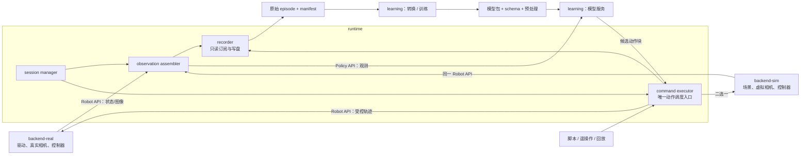
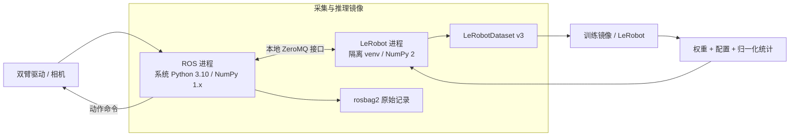
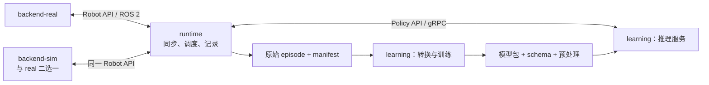

# DSH-000：设计基线（接口、目录、路线与仿真方案）

**索引分组**：设计基线 · **状态**：历史归档，不是当前操作指南

## 阶段简述

汇总早期环境边界与 Robot/Policy/Runtime 接口、仓库目录规范、逐步实现路线图、仿真环境与最小闭环方案、容器依赖分析，以及当时的文档索引和旧路径迁移提示。正文保留 2026-10-30 前后的设计语境；其中 Gazebo、旧目录和 Python 3.10 解析仅作历史依据，当前入口以 `docs/README.md` 和 `docs/project-status.md` 为准。

> 以下按原材料分块保存当时正文，块首记录原路径、SHA256 和原始字节数；命令、路径、预算、镜像、版本和外部来源均属当时状态，不保证今天可直接执行。结论、失败和限制保持原样，未按当前实现改写。

## 原始时间线

`docs/simulation-loop-progress.md` 在清单指定行区间内的逐字快照；行区间互不重叠，全部 531 行按阶段拆分，完整覆盖见 [历史索引](README.md#timeline)。

<a id="timeline-0001-0015"></a>
### 时间线第 1～15 行

- 原路径：`docs/simulation-loop-progress.md`
- 原始行区间：1～15
- 区间 SHA256：`139269b58434e38c0b470afa5d7477871263c3b70ca7f3f75f338016b142c645`

<!-- TIMELINE BEGIN 1-15 sha256=139269b58434e38c0b470afa5d7477871263c3b70ca7f3f75f338016b142c645 -->
```text
# 仿真学习闭环执行记录

执行依据：[实施计划](minimal-simulation-loop-plan.md)。只记录状态、决定、问题与验收结果；原始工具输出留在本地 `var/runs/` 或 `.build/reports/`。

当前状态：**DSH-019～027已验收整合，ROS 原生后端已可运行**。S2已通过；继续推进运行时精确观测/MCAP与Policy接线，再完成采集/训练/评估。S3整体与S4～S7尚未验收，正式数据和ACT未开始。

## 2026-10-30 · 需求冻结与 S1 准备

- 已确认 MuJoCo/双 Panda、三相机、单臂堆叠但 ACT 双臂 16 维输出、50 条合格数据及 45/5 划分、20 次目标 16 成功、首轮完整训练 4 h。
- 已确认物理随机化/稳定 2 s/单次 30 s、试采 10 次/正式最多 100 次、原始数据 30 GiB 预算。
- 已读 Menagerie/mink/LeRobot/原 ACT/robosuite 的相关源码和依赖声明。现有 runtime 容器能读取 RTX 4050；EGL、物理任务和训练尚未验证。
- 主工作区 R1～R3 修复保留，尚未提交；dsh 使用包含这些修改的隔离快照。
- 本轮先执行 S1a（DSH-004）：类型配置和启动前校验。其余阶段未开始，不将规划记为实现。
- DSH-004 已在独立 worktree 启动，输入快照 `12aef86cad44cdabe9ca43d56bb0b9219ef8fa7b`；首轮上限 15 分钟。主助手独立基线探针共 13 项：10 项暴露错误值被接受或快照可污染，3 项已有拒绝但缺来源路径。候选实现尚未验收。

```
<!-- TIMELINE END 1-15 -->

## 原始材料

<a id="src-docs-readme-md"></a>
### 原材料：文档索引

- 原路径：`docs/README.md`
- SHA256：`40c599f4977b9b5294408b4187850f559a660d1610f8f3515563cfee4bdac6c4`
- 原始字节：9423
- 归档锚点：`src-docs-readme-md`

<!-- BEGIN SOURCE path="docs/README.md" sha256="40c599f4977b9b5294408b4187850f559a660d1610f8f3515563cfee4bdac6c4" bytes="9423" -->
### 文档索引

当前入口：[最小仿真闭环操作与结果](dsh-036.md#src-docs-minimal-simulation-loop-md)，本轮结论见[采集、训练与固定20次评估结果](dsh-036.md#src-docs-simulation-loop-result-md)。其余按设计、组件操作和历史验收查阅。

当前设计材料：

| 文档 | 内容 |
| --- | --- |
| [最小仿真学习闭环实施计划](#src-docs-minimal-simulation-loop-plan-md) | 已确认目标、模块边界、日志要求和 S1～S7 验收门槛 |
| [仿真闭环执行记录](README.md#timeline) | 当前阶段、决策、验收与限制 |
| [运行日志与原始记录约定](dsh-009.md#src-docs-logging-and-recording-md) | 事件、故障、MCAP队列、v2结果与审计；顶层监督待完成 |
| [Episode记录格式](dsh-010.md#src-docs-episode-recording-format-md) | v2三维结果、三相机audit、旧v1读取与人工结束语义 |
| [机器人 profile 与三相机绑定](dsh-018.md#src-profiles-readme-md) | v1/v2结构、双Panda 16维顺序、相机校准摘要算法与后端责任 |
| [仿真闭环讨论记录](#src-docs-simulation-loop-discussion-md) | 用户确认事项及开源调研来源 |
| [dsh 委派执行试验计划](dsh-001.md#src-docs-dsh-collaboration-plan-md) | 主助手规划/审查、dsh 实施的试验流程与成本评价 |
| [学习训练操作手册](dsh-035.md#src-docs-learning-training-md) | 变量/findmnt/df、真实 convert→verify→smoke/overfit/full→bundle、预算/恢复/日志、容器本机 venv 与跨机器 bootstrap |
| [学习数据转换、ACT 训练与离线模型包](dsh-035.md#src-docs-learning-dataset-act-md) | DSH-035 45/5 独立数据集、train-only processor、预算训练、safetensors bundle 与公共命令 |
| [具名 ACT Policy 服务与固定种子评估](dsh-036.md#src-docs-act-policy-service-md) | DSH-036 ACT adapter/入口、真实 bundle 校验、独立 Compose、pilot 1008/1009 与 test 20000..20019 台账/只读报告 |
| [DSH-001 试验结果](dsh-001.md#src-docs-tasks-dsh-001-result-md) | 首次委派修复 R2 的独立验收、运行时间、用量及限制 |
| [DSH-002 修复结果](dsh-002.md#src-docs-tasks-dsh-002-result-md) | 控制清理独立尝试、原实现回归验证与执行记录 |
| [DSH-003 修复结果](dsh-003.md#src-docs-tasks-dsh-003-result-md) | 中断收尾、定点返工、ROS/Docker 验收与限制 |
| [DSH-004 配置整改结果](dsh-004.md#src-docs-tasks-dsh-004-result-md) | S1a 类型配置、提前校验、快照隔离与独立验收 |
| [DSH-005 控制客户端结果](dsh-005.md#src-docs-tasks-dsh-005-result-md) | S1b 控制状态所有权、续租/清理提取与独立验收 |
| [DSH-006 episode 提取结果](dsh-006.md#src-docs-tasks-dsh-006-result-md) | S1b 生命周期、线程所有权、连续运行与中断回归 |
| [DSH-007 日志基础库结果](dsh-007.md#src-docs-tasks-dsh-007-result-md) | 有界事件队列、文件轮转、并发故障复验与局部接管 |
| [DSH-008 runtime 日志结果](dsh-008.md#src-docs-tasks-dsh-008-result-md) | 命令和停止事件、日志故障停止、配置快照、真实ROS/镜像验证 |
| [DSH-009 MCAP 队列与审计结果](dsh-009.md#src-docs-tasks-dsh-009-result-md) | 慢盘不阻塞控制、有界记录、故障持久化与内存实测 |
| [DSH-010 结果分类与人工结束](dsh-010.md#src-docs-tasks-dsh-010-result-md) | v2迁移、历史兼容、停止后的终止ACK与故障优先级 |
| [DSH-011 Compose 开发挂载](dsh-011.md#src-docs-tasks-dsh-011-result-md) | 源码与配置挂载、契约生成保护、实际容器验收及暂停位置 |
| [DSH-012 人工操作命令](dsh-012.md#src-docs-tasks-dsh-012-result-md) | up/start/status/end/down、指定 episode 等待、容器身份与失联验收 |
| [DSH-013 自动采集与整次监督](dsh-013.md#src-docs-tasks-dsh-013-result-md) | 真实退出、审计/日志门槛、共享期限、资源归属、原始声明与验证分离 |
| [阶段 1～2 可维护性审查](dsh-001.md#src-docs-maintainability-review-md) | 已复现问题、目录与职责评估、阶段 2R 整改顺序；R1～R3 已修复 |
| [阶段 1～2 使用与验证](dsh-013.md#src-docs-stage2-quickstart-md) | 实际构建/启动命令、MCAP 输出、测试与维护规则 |
| [逐步实现路线图](#src-docs-implementation-roadmap-md) | 推荐实现顺序、每阶段产物、完成标准和首批工作 |
| [目录划分与组织规范](#src-docs-repository-layout-md) | 仓库分类、配置层次、构建输出、数据产物与扩展规则 |
| [环境边界与接口设计](#src-docs-architecture-and-interfaces-md) | 四类环境职责、Robot/Policy/Runtime API、时钟与控制权 |
| [仿真环境检查](dsh-014.md#src-docs-simulation-environment-md) | S2a pinned MuJoCo/mink 依赖/资产/EGL 检查，以及 S2b 三相机场景可见性入口 |
| [双 Panda 堆叠场景](dsh-015.md#src-docs-panda-stack-scene-md) | S2b 双 Panda/柱/桌/两块/三相机配置、构建、确定性复位与固定外参 |
| [16维SI执行器与测量映射](dsh-020.md#src-docs-panda-io-md) | DSH-020 具名qpos/dof/actuator绑定、夹爪总开度转换、线程约束与真实测量边界 |
| [定时参考轨迹与物理执行边界](dsh-021.md#src-docs-reference-trajectory-design-md) | DSH-021 分段三次系数契约、无SciPy采样/连续极值验证、SciPy一次性编译；DSH-023 显式起止参考速度与严格区间采样 |
| [连续动作块：时间、衔接与反馈](dsh-023.md#src-docs-continuous-action-design-md) | DSH-023 观测窗口与预编译边界、DSH-024 有界连续执行；ROS/Policy现已接通，当前操作见闭环入口 |
| [无ROS物理运动、接触完成与有界停止](dsh-022.md#src-docs-native-motion-md) | DSH-022/024 严格控制配置、真实步进参考/测量快照、双指接触完成、常加速度刹车、有界连续块与停钟/进度/跟踪故障 |
| [原生控制会话、幂等命令与复位](dsh-025.md#src-docs-native-control-md) | DSH-025 控制身份/共享 generation、显式租约、整体命令与块幂等、有界历史、聚合状态和 episode 复位 |
| [可运行的原生 ROS 后端](dsh-027.md#src-docs-native-backend-md) | 物理owner、规划/渲染、原生ROS服务和公共Compose |
| [示教运行时、任务收尾与有预算试采入口](dsh-034.md#src-docs-native-teacher-runtime-md) | DSH-034 teacher/policy 统一 stream、任务真实 Stop/冻结事实、标签/质量导出与 pilot/formal 台账 |
| [原生诊断记录](dsh-028.md#src-docs-native-recording-md) | 精确捕获、租约/ACK、MCAP v3与独立审计 |
| [原生受限跟随执行](dsh-030.md#src-docs-native-follower-md) | 同一控制器、连续接续、2ms网格及可审计边界规范化 |
| [受限跟随公共协议与ROS后端](dsh-031.md#src-docs-native-follower-protocol-md) | DSH-031 独立FollowerReference、SubmitFollower、可选后端配置与固定Ruckig配方 |
| [DSH-030验收](dsh-030.md#src-docs-tasks-dsh-030-result-md) | 真实物理/ROS回归、双向边界与旧模式指纹 |
| [受限目标跟随](dsh-029.md#src-docs-bounded-target-follower-md) | 原预测/实际参考分离、端速与连续偏差验证 |
| [DSH-029验收](dsh-029.md#src-docs-tasks-dsh-029-result-md) | 严格模式数学反例、独立随机对照和待物理边界 |
| [DSH-028验收](dsh-028.md#src-docs-tasks-dsh-028-result-md) | 真实ROS、故障、旧格式兼容及公共入口证据 |
| [原生参考与反馈公共类型](dsh-026.md#src-docs-native-protocol-md) | DSH-026 NativeRequest/AcceptedReference/反馈DTO、canonical digest、显式ROS双向转换与独立重建；无服务实现 |
| [DSH-016 三相机验收](dsh-016.md#src-docs-tasks-dsh-016-result-md) | 67 个初始布局、PNG、原生像素审计和关闭故障验证 |
| [DSH-017 场景阶段验收](dsh-017.md#src-docs-tasks-dsh-017-result-md) | IK、关键位姿、采样净空、逐阶段视野与独立审计 |
| [DSH-018 三相机记录验收](dsh-018.md#src-docs-tasks-dsh-018-result-md) | v2 profile、16维绑定、三相机mock/MCAP与暂停位置 |
| [DSH-019 命令状态查询、执行时间与反馈记录](dsh-019.md#src-docs-tasks-dsh-019-command-status-md) | CommandStatus/QueryCommand、采样/执行时钟分离、feedback MCAP 审计与 mock 边界 |
| [DSH-019命令与反馈验收](dsh-019.md#src-docs-tasks-dsh-019-result-md) | 时钟分离、查询、原生ROS故障、轨迹审计和历史兼容 |
| [DSH-020原生执行器验收](dsh-020.md#src-docs-tasks-dsh-020-result-md) | 16维SI、真实测量/ctrl、声明标定、线程与原生动态对照 |
| [DSH-021参考轨迹验收](dsh-021.md#src-docs-tasks-dsh-021-result-md) | 固定SciPy、连续约束、随机独立对照和无科学依赖验证 |
| [DSH-022原生运动验收](dsh-022.md#src-docs-tasks-dsh-022-result-md) | 仿真/墙钟分离、真实接触、减速停止、原生重放和停止边界 |
| [DSH-023连续计划验收](dsh-023.md#src-docs-tasks-dsh-023-result-md) | 显式速度边界、观测锚定窗口、刹车余量与独立对照 |
| [DSH-024连续执行验收](dsh-024.md#src-docs-tasks-dsh-024-result-md) | 真实跨块衔接、事件身份、受控停止、接触与期限故障及独立物理重放 |
| [DSH-025控制会话验收](dsh-025.md#src-docs-tasks-dsh-025-result-md) | 租约、幂等/有界查询、真实停止、reset/epoch、关键事件保留与跨episode兼容 |
| [DSH-026公共原生协议验收](dsh-026.md#src-docs-tasks-dsh-026-result-md) | 完整请求、显式系数参考、真实反馈/接触、CDR往返和独立重建 |
| [S3 接口实施前核对](dsh-019.md#src-docs-simulation-control-design-md) | 现有单相机/控制/观测缺口与下一阶段依赖顺序 |
| [关键位姿、IK、路径净空与视野检查](dsh-017.md#src-docs-kinematic-scene-check-md) | DSH-017 的 67 布局右臂 6 目标、mink/DAQP、冻结、离散净空和三相机视野 |
| [环境与依赖分析](#src-docs-docker-dependency-analysis-md) | 镜像依赖归属、候选技术栈和运行组合 |
| [仿真环境设计](#src-docs-simulation-design-md) | 历史 Gazebo 候选分析及公共仿真边界；当前路线见最小闭环计划 |

唯一维护的协议与部署草案：

- [Policy API v1](../../contracts/policy/v1/policy.proto)
- [仿真采集部署绑定示例](../../infrastructure/examples/sim_collect.yaml)

历史材料：archive 中的早期 Humble 方案，以及 dependencies 中的 Python 3.10 解析快照。它们保留用于追溯，不能当作当前安装基线。docs/contracts 的旧文件路径仅保留迁移提示。
<!-- END SOURCE path="docs/README.md" -->

<a id="src-docs-architecture-and-interfaces-md"></a>
### 原材料：环境边界与通信接口设计 v1

- 原路径：`docs/architecture-and-interfaces.md`
- SHA256：`173795450fde1ed9ae903349f3769c8a0783fc629fe97815bf88a816fb9de3ab`
- 原始字节：26723
- 归档锚点：`src-docs-architecture-and-interfaces-md`

<!-- BEGIN SOURCE path="docs/architecture-and-interfaces.md" sha256="173795450fde1ed9ae903349f3769c8a0783fc629fe97815bf88a816fb9de3ab" bytes="26723" -->
### 环境边界与通信接口设计 v1

更新日期：2026-11-02。四环境边界保持；当前MuJoCo原生控制与fake Policy服务已通过真实链路验收，详见[原生后端](dsh-027.md#src-docs-native-backend-md)和[连续策略入口](dsh-032.md#src-docs-native-policy-md)。本文第4节保留的ExecuteTrajectory描述对应旧mock接口；当前MuJoCo使用显式参考/反馈与SubmitFollower。ACT训练/真实模型provider及真机后端尚未完成。

#### 1. 推荐部署：四类镜像，后端二选一

| 镜像 / 环境 | 拥有的职责 | 主要依赖 | 对外接口 |
| --- | --- | --- | --- |
| `backend-real` | 厂商驱动、真实相机、设备标定与时间映射、底层控制器、设备状态与控制保护；将设备适配成公共 Robot API | ROS 2、厂商 SDK、相机 SDK、必要的 ros2_control 插件 | Robot API v1（ROS） |
| `backend-sim` | MuJoCo 场景、物理、三相机、仿真控制器、时钟与场景复位；实现相同 Robot API | ROS 2、MuJoCo、Ruckig、可选mink示教、固定模型资产 | 相同的 Robot API v1（ROS），附加声明的仿真能力 |
| `runtime` | episode 编排、观测同步、示教/策略控制源选择、动作调度、采集记录、模型服务客户端 | ROS 2、公共接口包、gRPC/Protobuf、记录工具；不依赖厂商 SDK 或模型框架 | 消费 Robot API，调用 Policy API，提供 Runtime API，写原始数据 |
| `learning` | 离线转换、数据检查、训练、模型预处理、模型推理与模型内部状态 | Python、PyTorch、LeRobot/其他框架、数据/视频工具；不依赖 ROS | Policy API v1（gRPC）和版本化文件产物 |

一次运行只启动一个设备后端。仿真采集运行 `backend-sim + runtime`；真机采集换成 `backend-real + runtime`；推理再加入 `learning` 的模型服务进程；离线转换/训练只启动 `learning`。

训练和模型服务使用相同镜像、不同启动命令及容器实例。`runtime` 内的 session、观测、执行和记录是独立逻辑模块，首版可复用一个镜像，不要求每个节点都有独立 Dockerfile。



图中两个后端表示可选实现，不表示同时控制两个环境。模型输出始终先经过 executor，recorder 不产生控制命令。

#### 2. 解耦的关键：统一语义与唯一所有者

单纯统一话题名称不足以切换设备。需要同时约定关节名称/顺序、单位、夹爪开度、时间、控制模式、相机坐标和错误含义。

| 内容 | 唯一所有者 |
| --- | --- |
| SDK、设备连接、硬件序列号与原生话题 | 当前 backend |
| 电机闭环、关节插值、设备限位、连接看门狗 | backend 中的控制器/驱动，留在设备近端 |
| 公共关节/夹爪坐标到设备坐标的映射 | backend，带标定版本 |
| 观测取样、跨传感器同步与缺帧判定 | runtime 的 observation assembler |
| RGB 裁剪/缩放、归一化、模型特征选择、反归一化 | learning 的模型 adapter；训练与推理共用 |
| 控制源选择、模型动作有效性检查、动作时间调度 | runtime 的 command executor |
| episode ID、任务和成功标签、运行状态转换 | runtime 的 session manager |
| 原始记录、写盘状态与数据完整性报告 | runtime 的 recorder |
| 仿真物体真值、随机种子、场景重置 | backend-sim；真值默认仅用于评估/标签 |

backend 负责物理设备坐标到统一 SI 坐标；learning 负责 SI 特征到模型坐标的转换，避免两边各做一次归一化。首版控制空间限定为 `joint_position`，旋转关节用 rad，直线关节用 m。夹爪可表示成标定后的虚拟开度关节（m），由 backend 映射到原生驱动；无法提供该语义的设备应在握手时报告不支持，而不是填伪造值。

公共 RGB 帧统一为 `rgb8`，由 backend 将相机/Gazebo 原生编码转换为该格式；原始分辨率与内参保持一致。模型所需的裁剪、缩放和归一化仍属于 learning，避免把模型预处理藏进设备适配器。

RobotProfile v2 用有序的具名相机集合描述一路或多路相机；当前双 Panda 绑定为
`global`、`left_wrist`、`right_wrist`（320×240，各自唯一光学 frame_id 和 SHA256
标定摘要）。runtime 的订阅、BackendInfo 检查、ObservationIndex 与记录 audit 都使用
同一完整顺序，不静默取第一路。当前观测仍采用 latest-state/causal-frame 选择规则；
延迟渲染与精确快照状态配对的完善属于后续物理适配，本阶段不宣称已解决。

相同的 RobotProfile 应用于同一机器人本体及其仿真模型。换成另一种关节结构、标定或动作定义时，要重新校验数据和模型适配；接口可替换不代表已有策略可以跨任意机器人直接使用。

#### 3. 公共契约与模块依赖方向

独立的 `contracts/` 是契约源码的唯一维护位置；已有 policy 草案，其余类型随实现加入：

- `ros/robot_api_msgs/`：ROS 类型定义和版本约定，backend 与 runtime 共同使用。
- `policy/v1/policy.proto`：框架无关的推理协议，runtime 与 learning 各自生成 SDK。
- `schemas/v1/`：历史 RobotProfile、ObservationSchema、ActionSchema、运行配方与数据/模型 manifest 的结构定义。
- `schemas/v2/`：具名相机集合的 RobotProfile 与 v2 episode manifest；旧 v1 profile 继续按 v1 严格读取。

具体语义实例放在仓库根 `profiles/`（版本、绑定顺序和相机标定摘要算法见
[profiles/README.md](dsh-018.md#src-profiles-readme-md)），部署地址/设备绑定放 `deploy/`，机器人
几何与场景资源放 `assets/`。代码、配置、资源和产物的权威归属见
[目录组织规范](#src-docs-repository-layout-md)。

依赖方向指向公共契约和用途明确的共享库，组件之间不 import 对方实现。两个 backend 可共用 libraries/backend_core 的 lease、上下文校验与事件封装；该库不包含厂商/Gazebo/ML 依赖，runtime 不依赖其执行实现。runtime 不 import LeRobot 或厂商驱动，learning 不 import `rclpy`。契约中不传递 Python pickle、Torch Tensor 对象或 Gazebo 内部对象。

语义 schema 计算稳定哈希；厂商端口、设备序列号、容器地址、后端类型和动态实例 ID 单独放在部署绑定中。切换真实/仿真不会因为网络地址变化而改变模型输入 schema；标定或几何语义变化则应显式形成新版本。

本文使用的 `robot_api_msgs/*` 是项目自定义类型，阶段 1～2 已实现其中的控制与采集子集；ResetWorld 等目标接口尚未实现。实际类型以 contracts/ros 为准。推理协议草案见 [policy.proto](../../contracts/policy/v1/policy.proto)，部署绑定示例见 [sim_collect.yaml](../../infrastructure/examples/sim_collect.yaml)。

#### 4. 设备侧：Robot API v1（ROS 2）

公共根命名空间由配置给出，例如 `/cell_01/robot`；下表用 `~` 表示该根。原生厂商/Gazebo 话题留在 backend 内部，应用不订阅它们。

| 接口 | 方式 / 类型草案 | 方向与主要内容 |
| --- | --- | --- |
| `~/info` | topic，`BackendInfo` | backend → runtime：协议版本、robot/profile/schema 哈希、实例 UUID、时钟域/epoch、就绪状态、可用传感器与控制/复位能力；`protocol_major=1`，DSH-019 mock 声明 `command_query` / `command_feedback_v1` |
| `~/state` | topic，`RobotState` | backend → runtime：实例/epoch、递增 state_seq、采样时间、标准 `sensor_msgs/JointState`、有效性、驱动状态和故障 |
| `~/cameras/<id>/frame` | topic，`CameraFrame` | backend → runtime：实例/epoch、frame_seq、源时间、标准 `sensor_msgs/Image` 与 `CameraInfo`、标定版本 |
| `/tf`、`/tf_static` | 标准 ROS TF | backend 发布公共坐标树；runtime 按当前 profile 的 frame ID 使用 |
| `~/acquire_control` | service，`AcquireControl` | runtime → backend：runtime 实例与 episode；返回唯一 lease ID、有效时长和接受的控制模式 |
| `~/renew_control`、`~/release_control` | service | 续约或释放当前 lease，backend 以本地单调时钟判断过期 |
| `~/execute_trajectory` | action，`ExecuteTrajectory` | runtime → backend：上下文、lease、command ID/序号、有效期、标准 `JointTrajectory`；返回接受/拒绝、进度和终态 |
| `~/command_events` | topic，`CommandEvent` | backend → runtime/recorder：递增 event_seq、command ID、接受/开始/完成/取消/失败、原因、接受的轨迹及事件发生时的机器人时间 |
| `~/command_feedback` | topic，`CommandStatus` | backend → runtime/recorder：每 tick 的参考/测量位置、`reference-measured`、progress、`execution_clock`/`interpolation_version`、robot clock 采样时间；活跃期间周期发布，terminal 至少一次 |
| `~/query_command` | service，`QueryCommand` | runtime → backend：按完整原 context + command ID 读取只读快照；未知/被逐出返回 `RESULT_EXPIRED`，错误 context 返回 `STALE_CONTEXT` |
| `~/stop` | service，`Stop` | 取消待执行命令，进入后端已声明的停止/保持行为；返回实际处理状态和原因 |
| `~/reset_world` | 可选 action，`ResetWorld` | 仅有对应 capability 时可调用：复位场景/物体/初始关节状态，返回新 clock_epoch 和就绪状态 |

ROS 图像、关节状态和轨迹使用标准载荷，外层只增加实例、epoch 和序号等上下文。这些字段用于区分重启和复位前后的迟到数据；不能只靠重复的图像时间戳判断所属 episode。供 RViz 等工具使用的标准原生输出可另外发布，但采集与策略使用公共契约输出。

`CommandStatus` 的 accepted/started/sample 时间均来自后端机器人时钟；`elapsed` 是生成本次参考的实际执行时长，其时钟由 `execution_clock` 声明（mock 为 `steady`，后续物理可为 `robot`），不能假定 `elapsed = sample - started`。`interpolation_version` 当前为 `linear_v1`，审计按它和实际接受轨迹逐样本重建参考与 progress。数组顺序必须与 command 的 joint_names 一致。mock 以单调墙钟推进插值，`reference_positions` 与合成 `measured_positions` 相同，因此它只证明协议、时钟和记录接线，不证明物理跟踪；物理后端仍应保留参考/测量分离。查询是只读操作，不推进插值、不续租、不产生事件，也不能把查询到的 COMPLETED 改写成丢失的 action 结果。runtime 的 `ControlClient.query_command` 必须由调用者显式传入期望 joint_names，并对查询意图/成功使用关键日志（日志故障向上传播）；服务错误仍保留原错误。backend 声明 `command_feedback_v1` 时，episode 末尾的同一个有界 terminal 等待同时要求该命令的 terminal event 和已验证反馈入队，避免 recorder 在 feedback 到达前关闭；旧 backend 不具备该能力时沿原 event 规则。

`ExecuteTrajectory` 的 request 上下文至少包含：`backend_instance_id`、`clock_epoch`、`episode_id`、`control_epoch`、`lease_id`、`command_id`、`command_seq`、`robot_profile_hash`、`observation_id`、`accept_before_robot_time`。该截止时间表示最晚接受命令的机器人时间；执行时长由轨迹 horizon 限制，lease 过期则取消剩余执行。backend 检查过期、乱序、重复、lease、模式和限位；首版超出允许范围直接拒绝，不静默改变目标。runtime 主动进行的限速/转换必须记录转换后的命令。

lease 绑定 runtime 实例、episode、control_epoch 和控制模式。相同 lease 下重复 command ID 返回已有接受/执行状态，不再次执行；更低 command_seq 被拒绝。重启、换控制源或复位后使用新 lease，续约不恢复旧代次的控制权。

该公共 action 在后端内部适配到 ros2_control 的 `FollowJointTrajectory` 或厂商等价接口。若拆成左右控制器，后端负责共同调度、取消和聚合反馈，并声明同步能力。JTC 同时只能有一个活动 action goal，新 goal 会发生抢占；因此动作块替换策略需要明确实现。[JTC action 与抢占语义](https://control.ros.org/jazzy/doc/ros2_controllers/joint_trajectory_controller/doc/userdoc.html)

后端 controller_manager 和高频控制循环留在后端所在主机；跨容器或远程模型 RPC 不承担电机伺服周期。ros2_control 可用于统一真实/仿真的硬件接口，但厂商不支持该框架时仍可在相同公共 API 后实现适配。[ros2_control 硬件抽象](https://control.ros.org/jazzy/doc/ros2_control/hardware_interface/doc/hardware_components_userdoc.html)

##### 设备流的 QoS 与速率

| 流 | 首版 QoS 建议 | 处理规则 |
| --- | --- | --- |
| info / 能力 | reliable + transient_local，depth=1 | 新订阅者获得当前描述；实例变化立即使旧缓存失效 |
| 关节与相机数据 | best_effort + volatile，小队列 | 优先新鲜样本；记录 seq 缺口和缺帧，不无限堆积 |
| command_events / command_feedback / episode 事件 | reliable + volatile，有界队列 | recorder 启动并订阅就绪后才开启 episode；feedback 按 sample_time 记录，反馈异常报告数据不完整；v2缺terminal事件诊断与运行故障分别报告 |
| service / action | ROS 对应的 reliable 配置 | 请求有业务 ID 与超时；传输可靠不等于执行恰好一次 |
| TF / clock | 遵循 ROS/桥接的对应 profile | 首次联调验证发布/订阅 QoS 兼容 |

此为设计选择，最终队列深度、传感器频率和记录带宽要实测。底层控制、关节发布、相机发布、策略推理和动作更新具有独立频率，不设一个全系统统一 FPS。QoS 兼容性直接影响能否收发数据。[ROS QoS 官方说明](https://github.com/ros2/ros2_documentation/blob/jazzy/source/Concepts/Intermediate/About-Quality-of-Service-Settings.rst)

#### 5. 模型侧：Policy API v1（gRPC + Protobuf）

首版建议明确采用 gRPC unary RPC，传递 Protobuf 载荷；本机使用 Compose 服务地址，模型迁移时改 endpoint。它提供独立 IDL、deadline 和结构化错误，便于 ROS 客户端与 ML Python 环境独立维护。[gRPC 概念](https://grpc.io/docs/what-is-grpc/core-concepts/)、[deadline](https://grpc.io/docs/guides/deadlines/)

| RPC | 输入 | 输出 / 行为 |
| --- | --- | --- |
| `GetPolicyInfo` | 指定模型包 digest | 协议版本、实际模型与预处理 digest、输入/动作 schema、必需关节/相机、动作周期、状态性与就绪状态 |
| `OpenSession` | 机器人与 schema 绑定、当前运行上下文、固定模型包 | 校验兼容、准备模型，返回 model session ID 与绑定信息；加载/预热失败则不就绪 |
| `Predict` | session/request ID、运行上下文、观测 | 同一上下文、observation ID、实际模型 digest，以及带关节名和相对时间的 SI 目标动作块 |
| `ResetSession` | session、新上下文、reset ID | 清空模型历史/时序缓存，确认新上下文生效；重复 reset ID 不重复改变状态 |
| `CloseSession` | session | 释放 session 状态；重复关闭可安全返回 |

##### 观测与动作内容

观测由 runtime 同步形成，至少包括：

- `robot_profile_hash`、`backend_instance_id`、`time_domain_id`、`clock_epoch`、`episode_id`、`control_epoch`。
- 单调递增的 `observation_id`，参考时间，以及每个状态/相机样本自身的源时间与序号。
- 按声明顺序排列的关节位置；速度/力矩只有设备提供且 schema 声明时才使用，缺失不填零冒充测量值。
- 按 profile 声明顺序排列的具名 RGB 帧，各自带源时间、frame_seq、光学 frame_id 和标定版本；任务 ID / 文本作为可选任务条件。

首版传连续 RGB8 二进制数据，并携带宽、高和时间信息；必要时协商 PNG/JPEG，深度不走有损 JPEG。模型特定的裁剪、缩放、归一化在 learning 内完成，并与训练共用。双方配置最大 RPC 载荷和有界队列，超出明确拒绝。

响应是 `joint_position` 动作块：`joint_names`、多个 `positions` 向量和各点 `time_from_observation_ns`（相对原 Observation 的机器人时间），不是设备 SDK 命令。runtime 验证维度、名称、数值、观测年龄和上下文，按当前机器人时间安排起点，再向 backend 下发。learning 不选择厂商控制器，不直接操作相机或执行动作。

首版一个 episode 只有一个模型 session 和一个在途预测。`request_id` 用于有界去重，模型有状态时重试不能额外推进历史；服务应返回已缓存结果或明确失败。RPC 超时或取消后 GPU 计算可能仍然完成，runtime 必须丢弃其迟到结果。模型 ID 和预处理绑定在 session 中，不能在 episode 中静默换权重。

Policy API 使用标准 gRPC status 表达通信/调用结果，并在约定的错误元数据中提供机器可读 `reason`：例如 `FAILED_PRECONDITION + SCHEMA_MISMATCH`、`UNIMPLEMENTED + UNSUPPORTED_CAPABILITY`、`DEADLINE_EXCEEDED + INFERENCE_TIMEOUT`。ROS API 的结果消息保存同一业务 reason，避免客户端解析报错文本。

这里复用 LeRobot 的模型实现和处理器，并用项目 adapter 实现公共 Policy API；它不要求沿用 LeRobot 某一版本的网络协议。因此协议包装有明确实现成本，但能避免框架客户端把模型依赖带入 runtime。

#### 6. runtime 的内部边界与管理接口

| 模块 | 输入 | 输出 / 边界 |
| --- | --- | --- |
| observation assembler | 公共 state/camera 流与 schema | 同步观测、样本引用和同步质量；不做模型归一化 |
| command executor | policy、脚本、遥操作、回放产生的候选动作 | 仅当前控制源可进入调度；持有 backend lease；记录原动作、变换后命令与结果 |
| recorder | 公共观测原始流、动作/反馈、episode/policy 事件 | 原始 episode 与 manifest；不执行动作 |
| session manager | 用户/CLI 请求、模块状态 | episode 生命周期、模式与控制源切换、复位编排 |

建议的 Runtime API：

| 接口 | 方式 | 主要内容 |
| --- | --- | --- |
| `/runtime/episode/start` | service | task、记录配置；返回 episode ID 和准备/启动结果 |
| `/runtime/episode/end` | service | 接受一次人工结束意图并返回 ENDING 确认；重复请求幂等且不覆盖首次原因，无活动 episode 返回 NO_ACTIVE_EPISODE。最终记录/运行/任务结果读 manifest 与结构化 episode 事件，不在 status wire 中新增成功字段 |
| `/runtime/control/select_source` | service | `none / script / teleop / policy / replay`，切换前停旧源、更新 control_epoch 与 lease |
| `/runtime/episode/reset` | action | 编排停止、记录结束、模型清理与可用的后端复位能力 |
| `/runtime/status` | topic | episode 阶段、当前控制源、记录状态、模块就绪与故障 |
| `/runtime/observation_index` | topic | observation ID → state_seq / frame_seq 引用、时间差与缺帧信息 |
| `/runtime/control/commands` | topic | 候选动作、来源、对应 observation/request、最终发送的命令与 ID |
| `/runtime/policy_events` | topic | 模型绑定、请求/响应动作、延迟、丢弃原因、错误与 reset 事件 |

episode 阶段（IDLE/PREPARING/ACTIVE/ENDING/FAULT）、控制源和记录状态分别表示，允许“策略推理同时记录”。`RuntimeStatus.phase` 继续只表达生命周期和故障阶段，不扩展 wire 字段；episode manifest v2 的 `recording`、`runtime`、`task` 三个对象分别表示记录完整性、运行结局（completed/stopped/interrupted/failed）和任务标签（当前一律 not_evaluated）。recording 为必需的采集任务遇到写盘故障时，episode 标记失败并按任务策略停止；合法人工结束或信号不因自身把完整记录判成损坏。推理反馈和 backend 看门狗不等待写盘线程。事件有序号与有界缓冲，缺失/溢出会进入完整性报告；日志发布和写盘不阻塞底层伺服循环。

当前 mock 已实现上述 v2 结果分类、人工 EndEpisode 意图、记录完整性独立发布和离线 inspect 版本分支；信号/故障路径仍按 DSH-003/009 的退出码与 partial 语义处理。S1d 的 Compose 启动/状态命令和整个 run 监督尚未完成，不能把当前 mock 链路视为真实堆叠闭环。

#### 7. 控制权、时间与状态转换

backend 只接受有效 lease 下的命令；runtime 中只有 executor 持有该 lease。脚本、遥操作、模型和回放均提交候选意图到 executor。backend 的停止、lease 过期与故障处理不依赖模型服务是否在线；软件 stop 的具体保持/停止能力由设备声明，不能替代物理急停。

| 标识 / 时间 | 作用 |
| --- | --- |
| `backend_instance_id` | 后端每次启动生成新 UUID，拒绝旧实例的命令 |
| `clock_epoch` | 仿真复位或时钟不连续时更新，隔离回跳前后的样本 |
| `episode_id` | 数据与模型历史边界 |
| `control_epoch` | 暂停/恢复、换控制源时更新，使在途旧预测失效 |
| 机器人时间 | 源样本时间与轨迹调度；真机采用校准的 ROS 时间，仿真采用 `/clock` |
| 本地单调时钟 | lease、RPC/模块超时、性能测量；不跨主机直接比较数值 |

后端将设备时钟映射到声明的机器人时钟域，保存必要的原始时间与映射版本。learning 只透传观测时间和相对动作时间，不拿自己的系统时间与 ROS 时间直接比较。仿真暂停或回跳不能绕过 wall/steady-time 超时。[ROS 时间抽象](https://design.ros2.org/articles/clock_and_time.html)

启动顺序：backend 就绪并发布 info → runtime 校验 profile/能力 → 等待有效状态与图像 → 模型兼容校验及预热（推理模式）→ recorder 就绪（需要记录时）→ 获取控制权 → 开始 episode。

切换真机/仿真默认采用停止后切换：结束当前 episode、取消动作、释放 lease、关闭模型 session、停止旧 backend；启动另一 backend，清空观测/TF 缓冲并重新握手。禁止两个后端同时占用同一公共 namespace。修改部署绑定即可选择后端，上层不需要分支处理厂商名字。

复位流程：停止并等待后端确认 → 结束并提交旧记录 → 释放 lease / 失效旧结果 → 调用支持的世界复位 → 接收新 clock_epoch 和新鲜传感器样本 → 重置模型历史 → 获取新 lease → 开启新 episode。真机缺少 reset_world 能力时返回 UNSUPPORTED，回到初始位姿需要独立的已验证动作流程。

首版需要的明确错误包括：`NOT_READY`、`SCHEMA_MISMATCH`、`UNSUPPORTED_CAPABILITY`、`STALE_CONTEXT`、`STALE_OBSERVATION`、`LEASE_EXPIRED`、`COMMAND_REJECTED`、`DEVICE_FAULT`、`INFERENCE_TIMEOUT`、`RECORDING_ERROR`。不会因一个动作缺少真实反馈而标记为完成。

#### 8. 离线边界：数据和模型文件协议

训练侧不通过 ROS 远程拉取采集节点内部状态。runtime 完成原始 episode 后发布完整 manifest；learning 从挂载目录或后续对象存储按固定清单读取。

| 产物 | 必需内容 |
| --- | --- |
| 原始 episode | MCAP、episode ID、source=real/simulation、profile/schema/calibration 版本、时钟信息、任务与标签、原始 state/frame、候选/发送动作、后端 command_events/command_feedback、缺帧/写盘报告 |
| 转换后数据集 | 数据 schema、特征/动作名称与单位、同步/动作对齐/图像处理配置、原始 episode 引用与哈希、转换器版本、统计量和划分规则 |
| 模型包 | 权重、框架版本/代码版本、输入/动作 schema、预处理/反归一化、RobotProfile 绑定、标定要求、训练数据 manifest 引用、支持的控制模式与频率 |

区分模型原始输出、runtime 实际发送目标、backend 接受的目标和传感器测量。动作标签按声明的目标语义与时间对齐生成，不能把下一帧关节位置冒充实际下发动作；若后端无法反馈底层实际生效目标，明确标记未知。

原始记录和模型包先写临时目录，完成校验后原子提交 manifest；只消费完整产物。框架内部文件布局由 learning adapter 管理，外部依赖 manifest 和内容 digest，不依赖自动变化的 `latest`。

#### 9. 首版实现范围与验收

首版实现单机器人、一个活动后端、joint_position、单个模型 session、有界动作块、RGB 与关节观测、离线数据转换。更复杂的力矩控制、跨多个后端的协同、多模型仲裁和共享内存作为后续扩展。

建议先写契约与后端一致性验证，再写大规模场景或训练脚本。验收覆盖：

1. 相同公共 API 的 mock/仿真后端能让同一个 runtime 完成采集与推理，切换时只改部署绑定。
2. backend 实例变化、复位、旧 episode/旧 control_epoch、过期 lease、重复 command ID 和迟到模型结果均不会重复执行动作。
3. schema 不匹配、缺少相机、缺帧、非法数值、越限目标在约定层被拒绝，并产生可记录原因。
4. recorder 能关联 observation、模型输出、发送命令、接受/反馈与实际状态；落盘不完整时不会生成完整产物标记。
5. 从同一原始 episode 导出数据，训练/推理使用相同预处理，并加载同一模型包完成闭环。
6. 对真实后端的接口验证在设备确定后执行；在此之前不能宣称其驱动、标定或控制行为已经兼容。

阶段 1～2 已验证 mock 采集链路、核心控制/观测行为和原生 MCAP 审计。完整推理、物理仿真及真机相关验收随相应实现继续执行。
<!-- END SOURCE path="docs/architecture-and-interfaces.md" -->

<a id="src-docs-archive-humble-py310-analysis-md"></a>
### 原材料：双臂机器人 Docker 环境依赖分析

- 原路径：`docs/archive/humble-py310-analysis.md`
- SHA256：`cf72ce9b8c9da43844365584a47ff85204e1c0d581a0d076a78a58c328b45e60`
- 原始字节：17285
- 归档锚点：`src-docs-archive-humble-py310-analysis-md`

<!-- BEGIN SOURCE path="docs/archive/humble-py310-analysis.md" sha256="cf72ce9b8c9da43844365584a47ff85204e1c0d581a0d076a78a58c328b45e60" bytes="17285" -->
> 历史方案：曾按 Humble / Python 3.10 作为约束进行分析。用户已澄清这些只是倾向；当前建议见上级目录的 docker-dependency-analysis.md。

### 双臂机器人 Docker 环境依赖分析

分析日期：2026-10-29。当前阶段为依赖分析；本文给出首版基线和后续 Docker 实现边界，尚未构建镜像。

#### 1. 已确定的需求

| 项目 | 当前约定 |
| --- | --- |
| 环境划分 | 一个 ROS 2 数据采集与推理环境，一个训练环境 |
| ROS 2 | Humble |
| 机器人 | 双臂，型号、夹爪、通信接口和厂商驱动待定 |
| 相机 | 暂按 RealSense 预留，可更换 |
| 学习框架 | LeRobot |
| 本地 GPU | 用户提供：RTX 4050，6 GB 显存 |
| 训练机器 | 后续更换，GPU 和架构待定 |
| 维护方式 | 先建立基本环境，版本、硬件和算法会频繁修改 |

当前目录没有项目代码、ROS 包或已有依赖清单，所以机械臂、控制接口和模型类型均不能从代码推导。下文的版本组合是设计基线，不代表已经完成运行验证。

#### 2. 首版推荐方案

| 组件 | 采集与推理环境 | 训练环境 |
| --- | --- | --- |
| 操作系统 | Ubuntu 22.04 | 首版同样使用 Ubuntu 22.04 |
| 基础镜像候选 | `ros:humble-ros-base-jammy` | `ubuntu:22.04`，安装相同 ML 依赖 |
| ROS Python | 系统 Python 3.10 | 无需安装 ROS |
| ML Python | 独立 Python 3.10 venv | 独立 Python 3.10 venv |
| LeRobot | `0.4.4`，显式固定版本 | 与推理端保持一致 |
| PyTorch / torchvision | `2.7.1` / `0.22.1` | 首版同版本；换机器后重新核对 GPU 支持 |
| CUDA 用户态运行库 | PyTorch `cu126` wheel 对应依赖 | 首版同样采用 `cu126`，按训练 GPU 调整 |
| TorchCodec | `0.4.0`，首版使用 CPU 视频解码 | 同版本 |
| ML NumPy / OpenCV | `2.2.6` / `opencv-python-headless==4.12.0.88` | 同版本 |
| ROS NumPy / OpenCV | 由 Jammy / ROS apt 包管理 | 无 |
| 数据 | ROS 原始记录 + LeRobotDataset v3 | 读取同一版 LeRobotDataset v3 |

Humble 的 Tier 1 Ubuntu 平台为 22.04，发行时 Python 为 3.10；官方支持期到 2027 年 5 月。这里按用户要求采用 Humble，并在后续维护中保留升级 ROS 的边界。[ROS REP-2000](https://raw.githubusercontent.com/ros-infrastructure/rep/master/rep-2000.rst)

两个基础镜像标签的用途分别是提供 ROS 栈和纯训练系统；ROS 标签已在官方镜像清单核对，尚未实际拉取镜像。实现时还需固定基础镜像 digest。[官方 ROS 镜像清单](https://github.com/docker-library/official-images/blob/master/library/ros)

选择 LeRobot 0.4.4 是为了先使用支持 Python 3.10 的固定版本。查阅时 LeRobot `main` 已要求 Python >=3.12，因此 `pip install -U lerobot` 不能作为 Humble 首版环境的安装策略。未来升级新版 LeRobot 时，可以只升级 ML 进程的解释器和依赖。[LeRobot 0.4.4 声明](https://github.com/huggingface/lerobot/blob/v0.4.4/pyproject.toml)、[main 声明](https://github.com/huggingface/lerobot/blob/main/pyproject.toml)

PyTorch 和 torchvision 的上述配对、`cu126` 安装源来自官方安装表；TorchCodec 0.4 对应 PyTorch 2.7。[PyTorch 安装表](https://pytorch.org/get-started/previous-versions/)、[TorchCodec 兼容表](https://github.com/meta-pytorch/torchcodec/blob/v0.5.0/README.md#installing-torchcodec)

#### 3. 关键兼容问题：ROS 与 LeRobot 分进程

本次实际依赖解析发现：

```text
lerobot==0.4.4
  -> rerun-sdk>=0.24.0,<0.27.0
  -> numpy>=2
```

因此，给 LeRobot 0.4.4 强制加入 `numpy==1.26.4` 会产生无解依赖。Jammy 的 ROS 图像处理栈使用系统 NumPy 1.x / OpenCV；NumPy 1.x 编译的扩展在 NumPy 2 下存在 ABI 不兼容风险。仅创建一个可访问系统包的 venv，不能消除这种冲突。[NumPy ABI 说明](https://numpy.org/doc/stable/user/troubleshooting-importerror.html)

建议保留两个 Docker 镜像，在采集与推理镜像内部运行两个独立进程：



进程隔离需要落实以下边界：

- ROS 进程使用 `/usr/bin/python3` 以及 apt 安装的 `rclpy`、`cv_bridge` 等包。
- ML 进程使用普通隔离 venv，不启用 `--system-site-packages`，不导入 ROS Python 包，也不继承 ROS 注入的 Python 搜索路径。
- ROS 端通过 apt 安装 `python3-zmq`、`python3-msgpack`；ML 端安装 `pyzmq`、`msgpack`。接口传输数组元数据和原始字节，避免跨进程序列化 Python 对象。
- 接口应携带协议版本、相机名称、数据形状、dtype、时间戳、状态/动作顺序及请求序号。图像吞吐量实测后再决定是否改为共享内存。
- 推理超时、动作过期、退出和重连由 ROS 桥接层处理，不能让模型推理阻塞机器人通信。

ROS 官方要求使用与预编译包匹配的 Python 解释器；不能直接把 Humble 的 Python 路径加入不同版本 Python 环境。[ROS Python 环境说明](https://github.com/ros2/ros2_documentation/blob/humble/source/How-To-Guides/Using-Python-Packages.rst)

LeRobot 的机器人接口仍需适配：安装 LeRobot 并不会自动获得未知机械臂的 ROS 2 驱动、双臂控制器和数据映射。这里的本地接口及桥接代码属于后续实现工作。

#### 4. 采集与推理环境依赖

##### 4.1 ROS 和系统基础

以下为候选 apt 包，最终应结合 ROS 工作空间的 `package.xml` 使用 rosdep 安装并验证：

| 类别 | 依赖 | 用途 |
| --- | --- | --- |
| ROS 基础 | `ros-humble-ros-base`、`ros-humble-rclpy` | 节点、消息、服务、action 和启动支持 |
| 通用消息 | `ros-humble-sensor-msgs`、`ros-humble-geometry-msgs`、`ros-humble-trajectory-msgs`、`ros-humble-control-msgs` | 图像、关节状态、位姿和轨迹接口 |
| 图像与同步 | `ros-humble-cv-bridge`、`ros-humble-image-transport`、`ros-humble-message-filters` | 图像转换、传输与时间同步 |
| 坐标变换 | `ros-humble-tf2-ros`、`ros-humble-tf2-geometry-msgs` | 相机、末端与机器人基座坐标关系 |
| 原始数据记录 | `ros-humble-rosbag2`、`ros-humble-rosbag2-py`、`ros-humble-rosbag2-storage-mcap` | 记录、回放和离线转换；明确选择 MCAP 插件 |
| 通信桥接 | `python3-zmq`、`python3-msgpack` | 与隔离的 LeRobot 进程通信 |
| 构建工具 | `build-essential`、`cmake`、`python3-dev`、`python3-venv`、`python3-colcon-common-extensions`、`python3-rosdep`、`python3-vcstool` | 后续编译厂商驱动、自定义消息和桥接包 |
| 通用工具 | `git`、`curl`、`ca-certificates`、`pkg-config`、`ffmpeg` | 源码、证书和视频处理 |

DDS 首版沿用 Humble 默认 Fast DDS；只有在设备联调需要时再切换 Cyclone DDS。`ROS_DOMAIN_ID`、RMW、QoS 和网络配置独立于模型版本。

##### 4.2 模型与数据依赖

ML 进程与训练镜像共用候选依赖文件 `dependencies/lerobot-py310.candidate.in`：

- `lerobot`、`torch`、`torchvision`：策略、推理和张量处理。
- `numpy`、`opencv-python-headless`：数值与图像预处理。
- `datasets`、`pyarrow`、`pandas`：数据集和表格数据，由 LeRobot 依赖解析确定版本。
- `av`、`torchcodec`、FFmpeg：视频编码、读取和按时间戳取帧。
- `safetensors` 等权重依赖按选定策略补齐；保存策略配置和归一化统计，不能只拷贝单个权重文件。
- `pyzmq`、`msgpack`：本项目建议增加的进程通信依赖。

LeRobot 0.4.4 的普通安装本身就包含 `accelerate`、`diffusers`、`wandb`、`rerun-sdk`、`pynput` 等依赖。因此，即使代码只执行推理，首版镜像也会包含这些包。直接使用 `--no-deps` 删去它们会绕过上游依赖约束，不能当作默认瘦身方案。[0.4.4 完整依赖](https://github.com/huggingface/lerobot/blob/v0.4.4/pyproject.toml)

##### 4.3 硬件依赖作为可选模块

| 模块 | 暂定依赖 | 加入条件 |
| --- | --- | --- |
| RealSense ROS 驱动 | `ros-humble-realsense2-camera`、`ros-humble-realsense2-description` 及匹配的 librealsense | 确认使用 RealSense 后启用构建选项 |
| RealSense Python SDK | `pyrealsense2` | 只有 ML/采集代码直接操作相机时才增加 |
| 双臂控制器 | `ros-humble-ros2-control`、`ros-humble-ros2-controllers` | 厂商驱动采用 ros2_control 时加入 |
| 机器人描述 | `ros-humble-xacro`、`ros-humble-robot-state-publisher`、URDF、SRDF | 确定机器人模型后加入 |
| 运动规划 | MoveIt 2 | 确认需要规划、碰撞检查或相关控制接口时加入 |
| 总线/串口 | `python-can`、串口 SDK、厂商库 | 根据 CAN、串口或网络接口选择 |
| 可视化 | RViz 2、图像查看工具 | 作为开发选项 |
| 仿真 | ROS 仿真桥接或 MuJoCo 等 | 仿真平台尚未确定，另设可选依赖 |

RealSense 首版建议由 ROS 驱动统一占用相机，LeRobot 经桥接读取 ROS 图像，避免两个进程竞争同一台设备。librealsense 选择一种安装来源并与 wrapper 匹配，避免同时安装多个互相覆盖的版本。[RealSense ROS 安装说明](https://github.com/realsenseai/realsense-ros#installation-on-linux)

相机设备映射、USB 权限、宿主机 udev 规则、内核支持和固件版本都需在真机阶段核对。Docker 共享宿主机内核，容器内安装驱动包不能替代宿主机的内核或设备配置。

#### 5. 训练环境依赖

训练环境复用相同的 LeRobot、PyTorch、视频处理和数据格式基线，首版无需 ROS、相机 SDK 或机械臂驱动。

| 类别 | 依赖/设计 | 备注 |
| --- | --- | --- |
| 系统 | Python 3.10、venv、构建工具、FFmpeg、证书、git | LeRobot 的 `pynput -> evdev` 在 Linux 上可能需要源码构建，因此不能仅准备 wheel 安装环境 |
| 单卡训练 | LeRobot、PyTorch、torchvision | 具体策略暂建议先用 ACT 跑通链路，最终模型类型仍可调整 |
| 数据与预处理 | 与推理端相同的 schema、图像通道、裁剪/缩放、动作定义、归一化方式 | 训练/推理输入必须一致 |
| 加速与日志 | LeRobot 自带的 `accelerate`、`wandb` 等 | 配置支持本地/离线记录，账号和联网不是基础环境启动前提 |
| 多卡 | PyTorch 分布式及对应 NCCL 运行库 | 训练机器确定后再验证，不先引入集群相关组件 |
| 可选交互 | JupyterLab、TensorBoard、matplotlib | 按实际工作方式添加 |
| 可选优化 | FlashAttention、DeepSpeed、TensorRT、ONNX Runtime | 模型明确需要或实测收益充分时再加入 |

PyTorch wheel 提供运行所需的 CUDA 用户态依赖；运行普通预编译模型不要求宿主机安装同版本完整 CUDA Toolkit。宿主机仍需要兼容的 NVIDIA 驱动和 NVIDIA Container Toolkit。只有编译 CUDA 扩展时，才需要在构建阶段加入匹配的 Toolkit / nvcc。[NVIDIA 容器前提](https://docs.nvidia.com/datacenter/cloud-native/container-toolkit/latest/install-guide.html)、[CUDA 驱动兼容说明](https://docs.nvidia.com/deploy/cuda-compatibility/minor-version-compatibility.html)

更换训练 GPU 后核对架构、驱动、显存和所选 wheel 的支持范围；必要时同时升级 PyTorch / torchvision / TorchCodec / CUDA 组合，并重新生成平台锁文件。不要只替换 CUDA 镜像标签。

#### 6. 数据、视频和本地显存边界

- 原始 ROS 记录建议保存图像、`camera_info`、双臂关节状态、真实下发的动作、夹爪状态、TF 和时间信息。仅记录关节状态不能替代模仿学习中的动作标签。
- 首版训练数据采用 LeRobotDataset v3：Parquet 保存状态/动作，MP4 保存 RGB 视频，另存 schema、episode 和归一化元数据；由同一版本 LeRobot 写入和读取。[格式说明](https://github.com/huggingface/lerobot/blob/main/docs/source/lerobot-dataset-v3.mdx)
- 通过离线转换或在线桥接导出数据，两种模式均应记录丢帧、时间偏差和同步策略。ROS QoS、`header.stamp`、仿真时钟和多机时钟同步需显式配置。
- 双臂状态和动作顺序、单位、绝对量/增量、左右臂和夹爪编码必须写入 schema；不要先固定为某个机械臂的 14 维。
- 首版可显式使用 H.264 编码和 CPU 解码，先验证系统 FFmpeg、PyAV、TorchCodec 的端到端读写。LeRobot 0.4.4 支持 `h264`；默认/自动编码可能走 AV1，不能假设 Jammy 的 FFmpeg 已具备所需编码器。[视频实现](https://github.com/huggingface/lerobot/blob/v0.4.4/src/lerobot/datasets/video_utils.py)、[安装中的 FFmpeg 要求](https://github.com/huggingface/lerobot/blob/v0.4.4/docs/source/installation.mdx)
- 如果后续采集深度图，原始深度保留量纲和精度，单独设计无损存储；RGB 的有损 H.264 路径不适合作为精确深度存储。
- 针对 RTX 4050 6 GB，先以 ACT、小图像输入、推理 batch=1 建立基线，实测多相机下的峰值显存和延迟。6 GB 是否够用取决于模型、分辨率、历史窗口和动作块长度，不能直接保证大规模 VLA 模型运行。
- 采集模式应能在不启用 GPU 推理时工作；NVENC/NVDEC 优化留作后续选项，并单独验证容器视频能力和 FFmpeg 支持。

#### 7. 为频繁修改预留的文件结构

建议后续实现以下结构；本轮仅创建分析文档与依赖解析材料：

```text
docker/
  runtime/Dockerfile          # ROS 基础层 + 隔离的 ML 环境
  train/Dockerfile            # 相同 ML 栈，无 ROS 驱动
  entrypoints/               # 分别启动 ROS、模型和训练进程
requirements/
  ml-common.in               # 两端共用的顶层模型依赖
  runtime.in                 # 本地桥接等增量依赖
  train.in                   # 训练端增量工具
  locks/                     # 按 Python、架构、CUDA 组合生成
config/
  cameras/                   # 相机参数与可选设备配置
  robots/                    # 机械臂、关节与动作映射
  policies/                  # 模型和预处理配置
compose.yaml
.env.example                 # 镜像选项、设备、数据和缓存路径
```

基础镜像/模型依赖、ROS 包、厂商驱动、相机和项目代码分层，COPY 依赖文件后先安装依赖，再加入业务代码。开发时挂载源码，避免每改一个节点都重新安装 PyTorch。

数据、模型输出、Hugging Face 缓存、ROS 工作空间持久化到独立目录；训练端可只读挂载数据，输出单独挂载。Docker 构建上下文排除原始数据和大模型文件。

`ROS_DISTRO`、`LEROBOT_VERSION`、PyTorch 版本组、CUDA wheel 源、相机开关、设备路径、`ROS_DOMAIN_ID`、UID/GID 和挂载路径应集中管理。版本变量可编辑，但相互约束的组件必须成组解析和验收。

#### 8. 本次验证与后续验收

已完成：

1. 核对官方 ROS 平台、镜像标签、LeRobot 版本声明、PyTorch / TorchCodec 配对和 RealSense 安装路线。
2. 使用 `uv pip compile`，以 Python 3.10 / Linux x86_64 为目标，对候选 ML 依赖做元数据解析。
3. 证实 NumPy 1.26.4 与 LeRobot 0.4.4 的依赖无解；改为隔离的 NumPy 2.2.6 后解析通过，包含建议的 ZeroMQ / MessagePack 依赖。
4. 确认 Linux `evdev` 缺少适用 wheel，纯 wheel 模式解析失败；允许该类包的源码元数据处理后解析通过，应在镜像构建中准备编译工具。

解析输入与结果保存在 `dependencies/`。结果来自 PyPI 元数据，**不是已通过 Docker 构建、CUDA 加载和硬件联调的部署锁文件**；尚未验证 cu126 专用索引上的具体 wheel、哈希及 apt 完整依赖。

当前执行会话看到的系统为 Ubuntu 24.04 / x86_64，Docker 客户端为 29.1.3，但访问 Docker socket 被拒绝；`nvidia-smi` 未能连接驱动，虽然可找到 `nvidia-ctk` 命令。这些仅描述当前会话的可见性，不能据此断定用户物理机器的 GPU 或驱动故障。本轮未修改宿主机配置。

后续镜像验收应覆盖：

- 两个 Dockerfile 完成构建，分别检查 ROS 和隔离 ML 解释器的包路径、`pip check` 及关键模块导入。
- ROS 端 `cv_bridge` 图像转换正常，ML 端 NumPy 2 和 PyTorch 正常，两者通过桥接往返一组图像、关节状态和动作。
- 容器内检测 GPU，执行 CUDA 张量运算和一个最小策略推理，检查峰值显存及延迟。
- 写入并读取一小段带时间戳的 LeRobotDataset v3 视频，执行至少一个真实训练步，再将得到的模型加载到推理端。
- 机械臂和相机确定后，再验证设备权限、驱动、话题 QoS、时间同步、持续录制和动作接口。

当前无需确定机械臂品牌或训练显卡即可完成首版环境文件；这些信息主要决定可选硬件层和平台相关锁文件。
<!-- END SOURCE path="docs/archive/humble-py310-analysis.md" -->

<a id="src-docs-contracts-readme-md"></a>
### 原材料：旧路径迁移入口

- 原路径：`docs/contracts/README.md`
- SHA256：`4192f0ba7c9e9aa0b9c3bf09462d161109ac23d47f6c2f729890f9dc194d558c`
- 原始字节：619
- 归档锚点：`src-docs-contracts-readme-md`

<!-- BEGIN SOURCE path="docs/contracts/README.md" sha256="4192f0ba7c9e9aa0b9c3bf09462d161109ac23d47f6c2f729890f9dc194d558c" bytes="619" -->
### 旧路径迁移入口

当前规范见 [环境边界与通信接口设计](#src-docs-architecture-and-interfaces-md)，协议和部署示例已按 [目录组织规范](#src-docs-repository-layout-md) 归位。

- 原 `policy.proto` → [唯一协议源码](../../contracts/policy/v1/policy.proto)。
- 原 `deployment.example.yaml` → [部署绑定示例](../../infrastructure/examples/sim_collect.yaml)。

本目录只保留历史链接的迁移提示，不能作为协议构建或配置加载的输入。已实现的 ROS 包、schema 与 SDK 生成见 [阶段 1～2 指南](dsh-013.md#src-docs-stage2-quickstart-md)；模型服务留到后续阶段。
<!-- END SOURCE path="docs/contracts/README.md" -->

<a id="src-docs-dependencies-readme-md"></a>
### 原材料：依赖分析材料

- 原路径：`docs/dependencies/README.md`
- SHA256：`d28286bc2b660e62f9eb91bc900d4b2c437d5843b188649392fa5e73a472b2fa`
- 原始字节：607
- 归档锚点：`src-docs-dependencies-readme-md`

<!-- BEGIN SOURCE path="docs/dependencies/README.md" sha256="d28286bc2b660e62f9eb91bc900d4b2c437d5843b188649392fa5e73a472b2fa" bytes="607" -->
### 依赖分析材料

当前设计见 [Docker 环境设计与依赖分析](#src-docs-docker-dependency-analysis-md)。

这里的 `lerobot-py310.candidate.in` 和 `lerobot-py310.resolved.txt` 是此前 Humble / Python 3.10 方案的历史解析记录，保留用于追溯兼容问题，不作为当前方案的安装清单。

当前方案包含 backend-real、backend-sim、runtime、learning 四类镜像；真实/仿真后端二选一，模型镜像复用于训练与推理服务。职责与接口见 [接口设计](#src-docs-architecture-and-interfaces-md)。精确版本锁在实现最小闭环时生成并验证。
<!-- END SOURCE path="docs/dependencies/README.md" -->

<a id="src-docs-docker-dependency-analysis-md"></a>
### 原材料：双臂机器人环境设计与依赖分析

- 原路径：`docs/docker-dependency-analysis.md`
- SHA256：`1638f9df7847dc3956de06731b483fd03e80de2f4f4830df3dcebff77a7fb90d`
- 原始字节：8704
- 归档锚点：`src-docs-docker-dependency-analysis-md`

<!-- BEGIN SOURCE path="docs/docker-dependency-analysis.md" sha256="1638f9df7847dc3956de06731b483fd03e80de2f4f4830df3dcebff77a7fb90d" bytes="8704" -->
### 双臂机器人环境设计与依赖分析

当前仿真路线更新（2026-10-30）：本轮已选 MuJoCo + 双 Panda + LeRobot ACT，具体版本待兼容性实测后固定。本文中的 Gazebo 候选分析保留供比较；当前执行依据为 [最小仿真学习闭环实施计划](#src-docs-minimal-simulation-loop-plan-md)，不能将旧候选依赖与新路线混装。

更新日期：2026-10-29。阶段 1～2 已有构建和运行验证；本文件仍包含后续真实/仿真/模型环境的候选方案。实际已实现范围见 [使用指南](dsh-013.md#src-docs-stage2-quickstart-md)，职责与目标接口以 [环境边界与接口设计 v1](#src-docs-architecture-and-interfaces-md) 为准。

#### 1. 目标与选型原则

目标是通过独立环境完成真实/仿真双臂的数据采集、数据转换、训练和推理，支持无真机开发。用户本地 GPU 为 RTX 4050 6 GB，训练机器后续更换；机械臂、相机和最终策略尚未确定。

Humble、RealSense、LeRobot 是候选倾向。设计优先确定公共数据与动作语义，具体型号和包版本在最小闭环验证时冻结。

#### 2. 四类镜像与职责

| 镜像 | 拥有的职责 | 主要依赖 |
| --- | --- | --- |
| `backend-real` | 真实机械臂/相机驱动、标定、设备时钟映射、底层控制器、公共 Robot API 适配 | ROS 2、厂商/相机 SDK、按需 ros2_control |
| `backend-sim` | 仿真物理、虚拟传感器、场景与控制器、仿真时钟、复位、相同 Robot API | ROS 2、Gazebo、ros_gz、gz_ros2_control、机器人与场景资产 |
| `runtime` | episode、观测同步、控制源仲裁、动作调度、记录和推理客户端 | ROS 2、公共契约包、gRPC/Protobuf、rosbag2；独立于驱动 SDK 与模型框架 |
| `learning` | 原始数据转换、训练、模型预处理、推理服务、模型包输出 | Python、PyTorch、LeRobot 等框架、数据和视频处理；独立于 ROS |

先前的 `robot` 拆分为 `backend-real` 和 `runtime`；先前的 `simulator` 收敛为实现公共设备接口的 `backend-sim`。这是职责拆分，不要求为每个逻辑节点单独建立镜像。

#### 3. 启动组合与通信

| 用途 | 启动组合 |
| --- | --- |
| 真机采集 | `backend-real + runtime` |
| 仿真采集 | `backend-sim + runtime` |
| 真机推理 | `backend-real + runtime + learning(serve)` |
| 仿真推理 | `backend-sim + runtime + learning(serve)` |
| 离线转换/训练 | `learning(convert/train)` |

同一机器人 namespace 中，真实和仿真后端只启动一个。推理时可同时记录数据；训练与推理复用 learning 镜像，以不同命令和容器实例运行。



设备侧 ROS API 统一状态、图像、控制权、轨迹、反馈与能力声明；模型侧采用框架无关的 gRPC/Protobuf 草案。离线数据和模型通过版本化 manifest 与文件目录交付。字段和所有者见 [接口规范](#src-docs-architecture-and-interfaces-md)，可审阅的 IDL 见 [policy.proto](../../contracts/policy/v1/policy.proto)。

#### 4. 候选基础系统

| 层 | 当前建议 | 调整方式 |
| --- | --- | --- |
| ROS 环境 | Ubuntu 24.04 + ROS 2 Jazzy | 厂商驱动有约束时，backend 与 runtime 配套调整 |
| 仿真环境 | Gazebo Harmonic + Jazzy | 与 ROS 和仿真控制插件成组选择 |
| 模型环境 | Ubuntu 24.04 + Python 3.12 | 按经过验证的模型框架发布版和 GPU 支持确认 |
| 模型框架/策略 | LeRobot / ACT 作为首选候选 | 通过 learning adapter 接入公共 Policy API |
| 相机 | ROS 图像接口，RealSense 为候选 | SDK 和驱动留在 backend-real |
| GPU 软件 | 匹配的 PyTorch / torchvision / CUDA / 视频解码组合 | 换训练机器时重新核对并生成平台锁文件 |

Humble 官方支持期截至 2027 年 5 月，Jazzy 截至 2029 年 5 月；Jazzy 的 Tier 1 Ubuntu 平台为 24.04，因此当前无驱动约束时优先 Jazzy。[ROS REP-2000](https://raw.githubusercontent.com/ros-infrastructure/rep/master/rep-2000.rst)

Jazzy / Harmonic 是 Gazebo 官方推荐组合；gz_ros2_control 为仿真提供 ros2_control 接入。[Gazebo 配对表](https://gazebosim.org/docs/harmonic/ros_installation/)、[控制插件](https://control.ros.org/jazzy/doc/gz_ros2_control/doc/index.html)

查阅时 LeRobot main 要求 Python >=3.12 和 NumPy 2。正式环境固定经过验证的发布版/commit，runtime 不安装模型包，避免把模型的 NumPy/OpenCV 依赖混入 ROS。[LeRobot 声明](https://github.com/huggingface/lerobot/blob/main/pyproject.toml)

#### 5. 依赖归属与开发结构

| 公共/独有依赖 | 放置位置 |
| --- | --- |
| ROS base、公共接口包、RobotProfile 语义定义 | backend-real、backend-sim、runtime 的共享 ROS 基础层 |
| backend_core 控制权/上下文/事件库 | 真实与仿真 backend 共用，不依赖厂商、Gazebo 或模型框架 |
| 厂商控制与总线 SDK、真实相机 SDK、标定 | backend-real |
| Gazebo、渲染、桥接、仿真控制器、world 与模型资产 | backend-sim |
| 观测同步、session、executor、rosbag2、轻量 gRPC 客户端 | runtime |
| PyTorch、LeRobot/其他框架、模型处理器、数据转换、模型服务 | learning |
| Protobuf SDK | runtime 与 learning 各自生成，只依赖公共协议 |

完整划分以 [目录组织规范](#src-docs-repository-layout-md) 为准，当前实现按以下类别逐步增加：

```text
contracts/                   # 唯一 ROS / proto / JSON Schema 定义
components/                  # backend_real、backend_sim、runtime、learning
libraries/                   # 用途明确的共享实现，如 backend_core
profiles/                    # 机器人、观测、动作的语义实例
configs/                     # 采集、推理、转换、训练及适配配方
assets/                      # 机器人描述、几何与被动场景资源
deploy/                      # Docker、Compose、部署示例与本地机器绑定
tools/                       # 构建、生成、配置检查、启动辅助入口
tests/                       # 跨组件契约、一致性与闭环验证
var/                         # 数据、模型、标定、运行记录和缓存，不进 Git
.build/                      # 可重建构建与生成产物，不进 Git
```

模型权重、数据、输出和缓存以挂载目录管理。底层电机伺服和插值留在设备近端；runtime 及远程模型服务不承担电机控制周期。

#### 6. 数据、时钟与本地资源

真实和仿真采用相同语义的 profile/schema，部署信息单独配置。切换后端通过结束 episode、取消旧命令、释放控制权、重新握手完成。clock_epoch、episode 和 control_epoch 用于隔离旧数据与在途动作，详细规则见接口规范。

原始数据同时记录观测、模型/示教意图、实际发送命令、后端接受/反馈和物理测量；离线转换显式定义动作对齐。仿真真值主要用于评估，默认不进入策略观测。

learning 可用不依赖 ROS 的 rosbags 读取原始 rosbag2/MCAP，并验证实际消息与压缩类型。[Rosbags](https://ternaris.gitlab.io/rosbags/)、[存储支持](https://ternaris.gitlab.io/rosbags/topics/rosbag2.html)

本地先运行单场景、小图像输入与小型策略，测量 Gazebo 渲染和模型同时运行的显存与延迟。必要时将模型服务迁移到另一台 GPU 主机，只改变 endpoint；具体配置参考 [仿真设计](#src-docs-simulation-design-md)。

#### 7. 验证和版本管理

实现顺序与各阶段完成标准以 [逐步实现路线图](#src-docs-implementation-roadmap-md) 为准：先完成最小契约与 mock 控制/采集，再用 fake policy 验证独立 RPC，然后加入 Gazebo、示教数据转换、小模型训练与实际策略闭环。真实后端在设备确定并完成相同接口验证后接入。

配置、契约、后端、RPC、数据和模型检查随着对应功能逐步加入。切换/复位、迟到预测、lease 失效、写盘失败等行为应在测试后端阶段就验证，并在仿真与真机中复用一致性检查。

最小闭环通过后固定镜像 digest、契约版本、框架版本和 Python/CUDA 锁文件。旧 Python 3.10 依赖解析快照保留在 `dependencies/`，仅供追溯；它不代表当前架构已经通过构建或运行验证。
<!-- END SOURCE path="docs/docker-dependency-analysis.md" -->

<a id="src-docs-implementation-roadmap-md"></a>
### 原材料：逐步实现路线图

- 原路径：`docs/implementation-roadmap.md`
- SHA256：`ea772c18abec0ba04dcfa793ca857ebb8822df2ba5f3977c073ffab387344b4b`
- 原始字节：13481
- 归档锚点：`src-docs-implementation-roadmap-md`

<!-- BEGIN SOURCE path="docs/implementation-roadmap.md" sha256="ea772c18abec0ba04dcfa793ca857ebb8822df2ba5f3977c073ffab387344b4b" bytes="13481" -->
### 逐步实现路线图

更新日期：2026-10-30。阶段 1～2 已有可运行的 CPU mock 实现：ROS 接口与 Policy SDK 可生成，两个容器可完成控制、采集与 MCAP 离线审计。使用和验证命令见 [阶段 1～2 指南](dsh-013.md#src-docs-stage2-quickstart-md)。本次 [可维护性审查](dsh-001.md#src-docs-maintainability-review-md) 中 R1～R3 已修复；剩余整改纳入新的仿真学习闭环 S1。当前执行依据为 [最小仿真学习闭环实施计划](#src-docs-minimal-simulation-loop-plan-md)，本文保留总体演进关系。阶段 3 及之后仍是计划，尚未实现物理仿真、真实策略服务、训练与真机接入。

#### 1. 实现原则与阶段关系

推荐顺序：工程基础与最小契约 → mock 控制/采集 → 可维护性与人工操作收敛（2R）→ 假模型 RPC → MuJoCo 后端 → 示教与数据转换 → 小模型训练 → 学习策略闭环 → 真机后端 → 交付收敛。

每一阶段交付一条可验证链路，之后保持已有链路可运行。先用测试替身验证公共接口与状态流转，再逐个加入设备、渲染和模型依赖。本轮 S2 先单独验收场景，S3 再整合物理控制和 RPC，具体顺序以本轮计划为准。测试替身只用于联调，不能作为物理仿真、真实模型效果或有效示教的证明。

保留四类环境的职责边界，具体镜像 target 和开发入口按实际需要调整；mock 后端和 fake policy 是测试程序，不新增长期维护的生产环境。ROS、GPU 渲染、模型计算和真实设备各自有验证入口，避免把几个独立问题叠在同一次首次启动中。

#### 2. 阶段总览

| 阶段 | 主要工作 | 完成标准 |
| --- | --- | --- |
| 1 工程基础与最小契约 | 构建入口、ROS/Policy 类型、首个测试 profile、配置校验 | 从干净构建产物开始，契约可生成，两端可导入相应 SDK，非法配置有明确错误 |
| 2 mock 控制与采集 | 最小后端、executor、episode、观测与记录 | 脚本动作改变 mock 状态，记录可读取并关联观测、命令和反馈 |
| 2R 可维护性与人工操作 | 修复中断/身份/清理缺口，小范围拆分职责，补充人工调试路径 | 既有链路与新增失败路径验证通过，维护者可修改、启动、中止并定位记录 |
| 3 fake policy RPC | 独立服务、runtime 客户端、session/超时/复位 | 观测经过真实 RPC 返回动作，旧/错/超时结果不会被执行 |
| 4 MuJoCo 后端 | 机器人、控制器、相机、物理、时钟与复位 | 使用相同 runtime 与契约完成仿真动作、采集和 fake-policy 闭环 |
| 5 示教与数据转换 | 有明确任务的演示、原始数据校验、训练格式转换 | 能追溯样本对应的原始观测与下发动作，episode 划分和时间对齐正确 |
| 6 小模型训练 | LeRobot adapter、共享处理器、训练入口和模型导出 | 完成训练步、小样本过拟合检查，模型包可重新加载并输出合法动作 |
| 7 学习策略仿真闭环 | 用真实模型服务替换 fake policy，执行与评估 | 持续形成观测—动作—场景响应闭环，并报告独立测试 episode 的任务结果 |
| 8 真机后端 | 驱动、标定、时间/坐标/动作映射及一致性验证 | 相同 runtime 接入真实设备，接口语义和实际控制反馈逐项验证 |
| 9 交付与性能收敛 | 启动体验、锁版本、日志指标、完整回归与文档 | 按文档在受支持机器重建/启动，并明确记录限制和性能实测 |

阶段 1～3 组成第一个联调里程碑；阶段 4 组成无真机闭环里程碑；阶段 5～7 组成学习闭环里程碑。真实设备信息一旦可用，可以提前调研驱动支持，但实际后端接入复用已验证的契约。

#### 3. 阶段 1：工程基础与最小契约

首批产物：

- 建立实际需要的组件包与依赖声明、`.dockerignore`、构建/契约检查入口，构建输出遵循 `.build/` 规范。
- 实现 Robot API 首批类型：BackendInfo、RobotState、CameraFrame、CommandEvent、控制 lease、ExecuteTrajectory 和 Stop；仿真世界复位在对应阶段补齐。
- 编译现有 Policy proto，在 ROS 客户端和模型侧各自安装轻量 SDK，不引入 LeRobot 作为 runtime 依赖。
- 实现首个 RobotProfile / ObservationSchema / ActionSchema 和原始 episode manifest 的最小结构校验，提供一个可替换的测试机器人实例。
- 准备 ROS 基础层和测试/开发所需的最小镜像，验证镜像构建、容器间 ROS 通信与退出行为。用到 learning RPC 服务时先只安装所需协议依赖。

先确定单机器人、joint_position、单 RGB 相机和显式关节顺序这一组实例。契约覆盖当前链路所需字段，沿用已设计的实例、epoch、ID 与版本规则，不要求把所有未来扩展一次实现。

验收关注可构建和可校验：生成类型能加载、示例配置可解析，关节维度/单位/必需相机不匹配能够被拒绝，源码和数据不混入生成目录。这一阶段不要求 GPU。

#### 4. 阶段 2：mock 后端驱动最小 runtime

mock 后端生成有上下文、时间和序号的状态与 RGB 测试帧，接收公共动作并按约定更新状态。它只证明接口和状态转换，不包含真实物理。

runtime 按链路逐步实现：session 与脚本控制源 → executor 和 lease → state/frame 观测整理 → recorder 与 manifest。图像、命令和记录通过相同公共 API，避免为 mock 写一套特殊的应用路径。

第一个可演示目标是：开始 episode → 获取控制权 → 发送一段脚本目标 → 收到接受/反馈和状态变化 → 停止 → 记录完整落盘 → 离线读取并核对样本引用。

同步验证控制行为：重复命令不重复执行、过期 lease 被拒绝、实例/代次变化使旧命令失效、停止后没有剩余动作继续执行。记录至少区分候选动作、实际发送目标、后端接受结果和测量状态。

mock 记录显式标为测试材料，留在测试运行目录，不加入正式示教数据集。测试程序建议放 `tests/doubles/`，小型样例数据放 `tests/fixtures/`；测试环境和阶段 4 的仿真后端可复用相同的后端契约检查。

#### 5. 阶段 3：通过真实 RPC 运行 fake policy

前置条件：完成阶段 2R 的恢复推进条件，见本文末节和 [审查记录](dsh-001.md#src-docs-maintainability-review-md)。

实现一个遵守 Policy API 的独立服务，按固定规则返回合法、有限长度的动作块。runtime 完成 GetPolicyInfo / OpenSession / Predict / ResetSession / CloseSession，并校验 schema、模型绑定、动作名称/维度、有效性与上下文。

此时形成第一条跨环境闭环：mock 观测 → runtime → gRPC 服务 → executor → mock 状态响应。服务进程与 runtime 分离，以便实际验证网络、序列化、session 和退出流程。

必须包含超时、断开、迟到响应、重复请求、reset 后的旧结果与非法动作检查。进程重启/暂停/控制源切换不能把旧动作混入新 episode。推理失败路径和记录状态均可追溯。

fake policy 不需要权重、训练或 GPU；本阶段验证通信协议，模型质量留给阶段 6～7。

#### 6. 阶段 4：接入 Gazebo 物理后端

当前选择 MuJoCo + Menagerie 双 Panda，加入公共 Robot API 适配器和三路 RGB 相机。原 Gazebo 候选不作为本轮实现目标；具体柱体、桌面、方块和视野要求见本轮实施计划。描述和资源来源/版本记录在 assets 与 manifest 中。

先完成状态和控制，再完成相机与记录，然后接回已验证的 fake policy。验证暂停、`/clock`、clock_epoch、世界复位、模型历史清理、lease 更新和新鲜传感器样本的准备条件。

完成标准是：上层 runtime 和 Policy API 不需要因 MuJoCo 内部对象或执行器名称而改业务代码；更换后端绑定后，能下发动作、看到关节/图像变化、记录原始数据并恢复新 episode。

GPU 图形/EGL 的可用性在这一阶段独立验证，再测量三相机吞吐和资源占用。CPU 阶段通过不代表离屏渲染已经可用。初次场景以简单、单实例为主。

#### 7. 阶段 5：有效示教与离线数据转换

先定义一个简单、可重复、可判断结果的任务，例如固定布局的物体搬运。提供调通的脚本示教或遥操作，保存任务、成功/失败、动作来源、原始观测和实际发送目标。只有关节运动的测试记录不能替代有效任务示教。

在 learning 中实现原始 MCAP → 校验/同步/动作对齐 → 选定框架训练数据集的转换。转换配置、原始 episode 引用、profile/schema/标定和转换器版本都进入 dataset manifest。

验收采用逐样本检查与可视化：确认左右臂、夹爪、单位、图像颜色和源时间正确；观测没有引用未来帧，动作标签符合已声明语义，缺帧策略可追溯。训练/验证按 episode 划分，避免同一段交互的相邻帧跨集合。

本阶段先把少量数据导出、读取和重放验证清楚，再扩大采集量。

#### 8. 阶段 6：实际小模型训练与导出

为 learning 增加实际 PyTorch / LeRobot 依赖和框架 adapter，确认与目标机器匹配的版本组合。共享 processing 模块同时服务训练和推理；框架特定归一化、特征选择和反归一化不进入 runtime 或 backend。

验证顺序是：读取一个 batch → 前向/反向训练步 → 保存与重新加载 → 少量数据过拟合检查 → 独立验证数据上的结果。资源允许后再扩大分辨率、batch 或模型规模；本地 6 GB 显存的适用范围以测量结果为准。

导出完整模型包，包含权重、模型与处理器配置、schema/profile 绑定、动作空间/周期、归一化统计和数据来源。重新加载后应能使用 Policy API 的标准观测得到合法 SI 动作，而不是只验证框架自身的训练脚本能结束。

#### 9. 阶段 7：学习策略进入仿真闭环

使用阶段 6 的模型包启动同一个 Policy API 服务，替换 fake policy；backend-sim 与 runtime 保持相同职责与接口。先验证首个动作，再验证持续运行、动作块衔接和多 episode 复位。

任务质量和接口正确性分别评估：接口指标包括拒收旧结果、端到端延迟、控制周期、丢帧和显存；任务指标包括独立初始条件下的成功率与失败类型。闭环连通不能代替任务成功，训练 loss 下降也不能直接代替控制效果。

模型或数据不足导致任务效果不达标时，回到示教、数据对齐或模型配置迭代，保留已经通过的接口和记录链路。

#### 10. 阶段 8：接入真实设备

机械臂和相机确定后实现 backend-real，复用公共契约和有明确用途的 backend_core。驱动/ROS 版本、标定、真实时钟映射、坐标、关节与夹爪语义必须逐项确认。

先验证状态和图像，再验证设备支持的停止/控制与反馈，之后通过原 runtime 完成采集、示教和模型请求，最后进行实际策略评估。仿真支持的 reset_world 不自动映射成真机回零动作；能力差异由后端显式声明。

完成标准是已验证的真实接口和反馈，不能仅以同名话题存在、SDK 能连接或仿真任务成功作为真实设备已兼容的结论。

#### 11. 阶段 9：交付、回归与性能收敛

基础配置/契约检查从阶段 1 开始，后端和状态检查从阶段 2 开始，RPC、数据、模型检查随相应阶段加入；这里是汇总已有验证，建立可重复运行的支持矩阵。

收敛事项包括：经过验证的依赖/镜像锁定、可用的 collect/infer/train 启动入口、健康与就绪条件、清晰错误信息、运行快照、数据/模型的备份与清理规则，以及支持机器上的完整重建流程。

只有在测量指出瓶颈后，再评估压缩、共享内存、额外相机、并行采集、推理加速或更复杂控制模式；每项优化保留正确性与任务指标的前后对照。

#### 12. 现在最推荐的下一批工作

阶段 1～2 的成功演示已经实现。下一批为本轮 S1（延续阶段 2R），先处理现有实现的可维护性，再按本轮计划进入物理场景和 RPC：

1. 确认可回退的源码基线；修复人工中断未收尾、同一观测 ID 引用变化、续租清理失败跳过 stop/release，补充对应行为验证。
2. 在现有 runtime 包内提取 episode 编排和控制客户端，说明线程与资源所有权；保持改动小且可单独审阅。
3. 收敛有类型配置和启动前校验，提供人工查看状态、启动/结束 episode、定位失败记录的最小入口与说明。
4. 验证原有演示及人工操作链路后，再开始阶段 3。增大图像、延长 episode 或进入阶段 4 前，处理写盘阻塞、审计内存和 mock 专属断言。

问题证据、职责建议和恢复条件集中维护在 [可维护性审查](dsh-001.md#src-docs-maintainability-review-md)。当前 R1～R3 已通过 [DSH-001](dsh-001.md#src-docs-tasks-dsh-001-result-md)、[DSH-002](dsh-002.md#src-docs-tasks-dsh-002-result-md)、[DSH-003](dsh-003.md#src-docs-tasks-dsh-003-result-md) 修复并验收；R7 已通过 [DSH-004](dsh-004.md#src-docs-tasks-dsh-004-result-md) 验收；下一批为 runtime 职责提取、日志/记录和人工操作路径，尚未达到阶段 3 的全部恢复条件。后续功能目录仍随实际实现创建。
<!-- END SOURCE path="docs/implementation-roadmap.md" -->

<a id="src-docs-minimal-simulation-loop-plan-md"></a>
### 原材料：最小仿真学习闭环实施计划

- 原路径：`docs/minimal-simulation-loop-plan.md`
- SHA256：`cd1acacb71c3accfce7ac9cc3b0b20ca5cc885b6885d4770e8eb27b6c5591758`
- 原始字节：17157
- 归档锚点：`src-docs-minimal-simulation-loop-plan-md`

<!-- BEGIN SOURCE path="docs/minimal-simulation-loop-plan.md" sha256="cd1acacb71c3accfce7ac9cc3b0b20ca5cc885b6885d4770e8eb27b6c5591758" bytes="17157" -->
### 最小仿真学习闭环实施计划

2026-10-30。需求已讨论确认；本文是本轮的执行依据，不表示功能已实现。实际进展见 [执行记录](README.md#timeline)，方案来源见 [讨论记录](#src-docs-simulation-loop-discussion-md)。

#### 1. 目标与明确边界

MuJoCo 中构建柱式双 Panda：基座中心离地 1.0 m，圆柱两侧短支架安装，桌面高 0.75 m；柱上全局相机约 1.35 m，左右腕部各一相机。右臂将 4 cm 方块放到 6 cm 底块上，左臂待机。精确尺寸、安装朝向和相机外参允许在可达性/视野验收时小幅调整，调整写入记录及配置，验收后固定版本。

程序示教采集 50 条合格 episode，45 条训练、5 条验证；使用 LeRobot ACT，再通过同一公共控制链路进行物理仿真推理。ACT 输入三路 RGB 和双臂测量位置，输出双臂 16 维目标：左臂 7 关节、左夹爪开度、右臂 7 关节、右夹爪开度。各关节以 rad、夹爪总开度以 m 表达，模型内部顺序和后端执行器映射显式声明。

左臂示教目标保持待机。推理仍执行模型预测的双臂动作，超过配置的待机偏差或限位时拒绝/停止并计失败，不用常量或脚本暗中替换预测。程序示教可读取物体真值；模型输入不能包含物体真值，推理期间不调用示教补救。真值仅供独立成功判定与诊断使用。

| 项目 | 约束 |
| --- | --- |
| 物理 | 两方块均为自由动力学物体；抓取依赖接触/摩擦；禁止搬运时重写物体位姿或隐形焊接 |
| 随机化 | 围绕验收后的初始位置，各平面方向约 ±0.03 m、偏航 ±10°；拒绝初始重叠和越界 |
| 成功 | 释放、退开后上块受到下块稳定支撑持续 2 s；几何、姿态、接触、速度阈值均配置化 |
| 单次时限 | 30 s 仿真时间；另设墙钟故障超时，停钟不能无限延长运行 |
| 试采 | 最多 10 次、独立种子；不占正式 50 条 |
| 正式采集 | 最多尝试 100 次，按预定顺序取前 50 条通过质量门槛的数据；失败保留原因 |
| 数据划分 | 按 episode 固定 45/5；统计量只从训练集计算；不按帧随机拆分 |
| 评估 | 固定 20 个新种子，报告真实成功率；本轮先跑通，不设高成功率完成门槛（2026-11-02用户调整）；超时、拒绝和运行故障均进入分母 |
| 本地训练 | RTX 4050 6 GB；先做小模型可行性验证，首轮完整训练累计墙钟最多 4 h，重启不重置预算 |
| 存储 | 原始采集数据累计预算 30 GiB，包括失败尝试；预留收尾空间，接近上限停止报告 |

2026-11-02用户调整为先跑通；50条数据不保证任务成功率，最终如实报告。扩数据、延长训练、换机器或改变任务难度须讨论，不由执行者偷偷改变。

#### 2. 模块职责和目录

沿用现有顶层分类，按真实实现增加文件，不预建空包或通用插件框架。下表描述目标归属；每阶段任务书只开放实际需要的子集。

| 位置 | 唯一职责与边界 |
| --- | --- |
| `contracts/` | ROS/Policy 类型及配置结构；唯一协议源；生成代码不手工修改 |
| `profiles/` | Panda 关节/夹爪语义、三相机及观测/动作顺序、单位、范围与标定绑定 |
| `configs/simulation/` | 当前MuJoCo场景、相机、复位和检查参数；控制与成功阈值随对应阶段加入 |
| `configs/runtime/` | collect/infer、示教阶段、超时、同步、记录和动作执行参数 |
| `configs/learning/` | 转换、数据拆分、ACT 训练、服务配置；完整有效值存入运行快照 |
| `components/backend_sim/` | MuJoCo 场景装配、物理步进、渲染、公共 Robot API、复位；仿真示教 IK 作为可选目标生成服务；不依赖 LeRobot |
| `components/runtime/` | 观测同步、episode、控制客户端、示教目标/策略请求、原始采集；不导入 MuJoCo 或模型库 |
| `components/learning/` | ROS 外的 MCAP 转换/训练/推理服务；共享训练与推理处理器 |
| `libraries/backend_core/` | 已有 mock 控制核心；第二后端出现时仅提取已证实共用规则，不把 mock 状态当物理状态 |
| `libraries/run_logging/` | 跨进程统一事件格式及有界文件输出；纯 Python，不能依赖 ROS 或 ML |
| `assets/scenes/`、`assets/robots/` | 自有场景描述、资产引用、必要的小型描述文件 |
| `third_party/` | 具名来源 JSON 与许可说明；下载源码在忽略的 `third_party/src/`。稳定 Python 依赖锁和 wheel 记录随镜像放 `deploy/docker/` |
| `deploy/`、`tools/` | 镜像依赖、挂载绑定、薄构建/启动入口；不承载 episode 或训练业务 |
| `tests/` | 行为单测、ROS/RPC 集成、物理/视觉验收及少量公开 fixtures |
| `var/`、`.build/` | 前者保存数据/模型/日志，后者是可重建构建与检查产物；均不混入源码 |

runtime 先维持平铺模块：`node.py` 组装 ROS，`episode.py` 编排单次运行，`control_client.py` 封装 lease/命令/停止，`configuration.py` 加载校验，`observation.py` 同步，`recording.py` 写盘，`audit.py` 审计。避免一个对象暴露全部内部状态，也避免为每个类创建一层目录。

#### 3. 接口、动作与时钟

保留 ROS 2 Jazzy。backend → runtime 传输测量关节、三路图像、上下文/时间/序号和执行事件；runtime → backend 使用控制租约、轨迹、停止和复位能力。runtime → learning 使用现有 Policy gRPC，并在实现时补齐所需字段和语义；学习进程不订阅 ROS 话题。

示教 IK 依赖 mink/MuJoCo，放在仿真环境的可选 teacher 服务，不放入 runtime。S3 定义仿真专用的任务状态与示教目标接口，S4 实现：输入 episode/context、最新状态/观测引用和示教阶段，输出有界的 SI 关节目标、阶段及原因。规划只读取物理状态快照，不能写物理状态或直接执行。runtime 统一下发、等待反馈并记录，失败仍走公共停止链路。推理部署不启动 teacher 服务；任务真值只进入独立评估与诊断，不进入 Policy 特征。仿真专用接口不伪装成真机必需能力。

| 交互 | 必须包含与验证的内容 |
| --- | --- |
| 观测 | 固定 observation ID，状态序号、每路帧 ID、采样时间、clock epoch、profile/schema 摘要；相同 ID 永不改变内容 |
| 策略请求 | request/session/episode ID、完整观测载荷、模型摘要和截止期限；不存在的缓存引用不得继续预测 |
| 预测响应 | 对应 request/observation/context，明确关节顺序、SI 目标、相对时间、动作块有效期；预测响应不是执行 ACK |
| 命令 | command ID/seq、lease、context、来源观测、有效期与有界轨迹；模型输出先校验再下发 |
| 执行 ACK | 区分 accepted、started、feedback、terminal；ROS goal 接受不能等于动作完成 |
| 反馈 | 实测关节、参考目标、跟踪误差、执行进度及终止原因；查询不确定命令状态，不盲目重复执行 |
| 重试/复位 | 同 ID 同载荷幂等、不同载荷拒绝；reset 改变 epoch，清空模型动作队列/缓存，旧结果无效 |

每次只允许一个有效执行序列和有界待执行动作；迟到响应、重叠轨迹、断连和超时须进入可解释的停止路径。动作块执行长度和重规划周期从配置读取；新块衔接明确处理尚未执行的旧目标，不能叠加两个来源。

backend 在物理高频循环内进行目标插值、位置/速度/加速度约束和跟踪反馈；ROS 和模型频率不等于伺服频率。初始工程候选为物理 500 Hz、图像/策略 20 Hz，阶段验收依据吞吐实测冻结。仿真时间用于轨迹和任务时限；墙钟单调时间用于 RPC、租约及故障超时。不得通过暂停物理掩盖推理超时。

物理线程独占可写的 MuJoCo 运行状态；渲染线程使用有界的状态快照和自己的渲染数据/上下文，三视图来自同一快照并携带对应采样时间。渲染/IK/写盘不能阻塞物理控制线程。runtime 用缓存中的对应状态构建观测，不能把渲染完成时的最新关节状态错误配给较早图像。S2 测吞吐，S3 验证时间对应关系与真实时间倍率，丢失/跳过的采样要计数。

人工 EndEpisode ACK 只表示请求接受，最终状态与 manifest 表示已落盘；人工停止、运行故障、记录完整性和任务成功分别表达。公共命令查询/复位若需扩展 ROS 类型，在协议阶段一次更新调用方与文档。

#### 4. 日志与数据质量

日志必须先于大量采集落地。使用标准库和少量有类型封装；控制台供人工阅读，JSONL 供追踪，指标单独存储，图像/高频轨迹进入 MCAP，不打印进普通日志。

文件组织、事件字段、故障传播和关闭顺序集中定义在 [运行日志与原始记录约定](dsh-009.md#src-docs-logging-and-recording-md)，由 S1c 实现并验收。

- 结构化事件包含版本、UTC 时间、单调耗时、组件、level/event/reason、run/episode/request/command ID；适用时包含 clock epoch 和仿真时间。每个进程文件独立，序号可审计，异常保留堆栈。
- 每次运行保存有效配置、版本/镜像与代码摘要、种子清单、数据/模型引用。普通事件限制字段及载荷大小，不记录密钥或完整图像。
- 文件输出由独立 writer 持有，有界队列、轮转和排空期限。低级诊断丢弃必须计数；关键审计事件无法写入则运行失败并触发停止，不能继续产出“成功”记录。
- MCAP writer 与日志 writer 分开，不阻塞 ROS 控制回调；慢盘、队列满、写盘错误、关闭超时、进程中断都有确定行为与测试。SIGKILL 只能留下可识别的 partial，不能承诺完全落盘。
- 审计按流读取，哈希分块计算；记录完整性、运行结果、任务标签分开，静止左臂和合法取消不应被当作文件损坏。

场景先验收三路真实渲染：全局视图覆盖两块及放置区，右腕视图覆盖接近/放置区域，左腕至少提供有效任务区域视图。提供接近、抓取、搬运、放置、退开阶段的接触图和视频；结合投影/分割统计检查目标像素面积及出画时间。允许短暂接触遮挡，但不能仅凭“图片不是黑色”通过。分辨率初值 320×240，三路相同；以实际可见性和带宽确定最终配置。

按三路 320×240 RGB、20 Hz、30 s 估算，仅未压缩图像每次约 0.386 GiB。100 次上界超过 30 GiB，因此尝试次数和存储预算同时约束运行：每次开始前核算预估写入量与收尾余量，采集中持续检查；可能先到存储边界，不能承诺必定允许尝试满 100 次。

teacher 按接近→闭合→确认抬升→搬运→下降→释放→退开→稳定判定推进。IK 使用成熟实现，但 IK 解不等于路径无碰撞；检查中间路径及物理接触。观测保留测量值，动作标签来自实际发出的目标；不能用测量状态冒充动作。转换后逐样本核对通道/左右臂/单位/源时间/未来信息泄漏，查看视频并重放动作。

具体动作时间语义在 S3 固定：ACT 每步预测下一控制周期的双臂关节/夹爪目标。teacher 输出相同周期的密集轨迹点，可分块提交；不能把长段运动的最终路点复制成段内每帧标签。转换使用后端实际接受的轨迹、STARTED 时间及执行参考反馈，关联观测 t 与下一目标 t+Δt；观测输入不得读取未来帧。被拒绝或未执行的候选目标不作标签；插值版本与执行时间可追溯。夹爪命令开度和被方块撑住的测量开度分开保留，不能以测量开度覆盖闭合目标。

#### 5. 依赖与 Docker

优先候选为 Menagerie Panda、mink IK、LeRobot v0.6.1 ACT，固定来源见讨论记录。版本选择先通过 Python/ROS/MuJoCo/EGL/PyTorch/视频编解码兼容性实测，再提交依赖锁和许可证记录；不把浮动 main 或“最新版”作为可复现依赖。原版 ACT 和 robosuite Stack 只作为算法/判定参考，不整体引入旧环境。

本机已安装 Docker Compose v5.6.1，现有 mock 定义通过配置检查。S1d 以 Compose 作为开发多服务入口，现有 Docker CLI 探针保留用于独立回归；不维护两套平行的产品启动流程。开发镜像安装稳定依赖。源码/配置只读挂载，构建安装输出、原始数据、数据集、模型、日志和缓存分别挂载；动态安装输出独立于源码。生成契约可增量构建，不复制三份 SDK。验收打印实际导入路径和版本，防止旧镜像安装包覆盖挂载源码。发布镜像可保留 COPY，日常改配置/源码不要求重建全部依赖。

训练和仿真分时运行以控制 6 GB 显存；真正推理必须测量渲染与模型同时存在的显存和延迟。先测 batch=1 的三相机 16 维前后向，再决定 batch、ACT 宽度和 chunk；不能用更少相机或单臂输出来冒充约定闭环。配置记录预训练视觉骨干的来源和摘要，禁止自动上传数据/模型。

#### 6. 分阶段执行与验收门槛

每一阶段由 dsh 实施、主助手独立审查与验收；前一阶段通过才启动后一阶段。阶段内可拆成依赖明确的小任务，避免一个 session 持续承载整个系统。失败保留现场，最多一次有针对性的返工，然后接管或缩小范围。不能通过改验收标准获得通过。

| 阶段 | dsh 交付 | 独立验收与进入下一阶段条件 |
| --- | --- | --- |
| S1 工程基础 | S1a 类型配置/启动前校验；S1b 控制客户端与 episode 职责提取；S1c 结构化日志、队列记录与流式审计；S1d 开发挂载和人工 start/status/end | 现有 mock 与 R1～R3 回归；非法配置启动前拒绝；慢盘/溢出/中断不误报成功；源码挂载真实生效；结果分类清楚 |
| S2 物理场景 | 固定依赖与资产、双 Panda/柱/桌/两块、三相机、确定性复位、场景检查入口 | EGL 在本机实际渲染；人工查看三视图及关键姿态；可达性/初始碰撞/目标可见性达标；固定配置与证据 |
| S3 控制与策略协议 | MuJoCo Robot API、16 维映射、插值/反馈、状态查询、时钟/reset；fake policy RPC | 同一 runtime 完成物理运动；重复命令、迟到结果、断连、停止、lease 失效及 reset 旧结果拒绝；实际目标与测量反馈对照 |
| S4 示教与试采 | 程序 teacher、成功判定、最多 10 次独立试采、三相机同步及质量报告 | 至少完成可重复的物理堆叠；正反例检验成功判定；预览、轨迹/标签和原始记录可审计；试采失败原因明确 |
| S5 正式数据 | 最多 100 次尝试取得 50 条，固定 45/5 划分；MCAP→LeRobot 转换、视频与数据清单 | 数量/种子/唯一性/成功/视野/完整性全部合格；训练统计不含验证；抽样重放一致；未达 50 不启动正式训练 |
| S6 ACT 训练 | 三相机 16 维 smoke、少量数据过拟合、最多 4 h 完整训练、可重载模型包 | 实际 GPU 前后向、保存/重载一致；有效配置/耗时/显存/loss/数据引用完整；训练进程正常退出不等于任务成功 |
| S7 推理与评估 | 真实模型服务、动作块连续执行、固定 20 种子、失败分类与演示视频 | 无脚本补救；完整 ACK/插值/反馈；20 次均报告；本轮不以高成功率为完成门槛；回归与最终文档一致 |

S1 并非把所有重构集中到一次大改：先 DSH-004 完成 S1a，再对其余子任务分别给出文件范围和行为验收。S2 的资源下载和模型验证、S3 的控制接口、S4 的 teacher 分属不同任务，不能混用测试替身作为物理证据。

#### 7. dsh 交付规则与停止条件

每个任务固定输入快照 SHA、独立 worktree/session、允许文件、行为边界、测试命令和时间预算。dsh 提交可读代码、测试、自测结果及未完成项；主助手核对实际差异/范围/导入路径，独立运行 ROS/GPU/物理检查后才整合。默认不由 dsh 提交 Git、扩权限、修改其他工作树或启动其他代理。保留主工作区已有未提交修改。

日志/数据/训练任务可逐步扩大到完整模块。Docker 和 GPU 验收由监督者运行，不为扩大任务范围而默认向 dsh 暴露 Docker socket。每次仅传当前任务必要背景，记录耗时、返工、可观测用量；没有主助手计费数据时标未知，不宣称已节省某个百分比。

以下情况停止相应阶段并记录：依赖组合不可用、渲染看不清目标、物理示教不可靠、关键日志/记录丢失、原始数据接近预算、100 次仍不足 50、训练 OOM 或达到 4 h。最终低成功率如实报告，不因此自行扩预算。可以在原约束内修复实现并复验；需要改变约定目标/预算时再与用户讨论。每阶段结果写短记录：状态、决策、修改范围、证据、限制、下一步。
<!-- END SOURCE path="docs/minimal-simulation-loop-plan.md" -->

<a id="src-docs-repository-layout-md"></a>
### 原材料：仓库目录与组织规范

- 原路径：`docs/repository-layout.md`
- SHA256：`4a614abf8678cc7583d5f7d9b6b8ee7ee93237f3cefacaa4c5e99cc61f2f1d9d`
- 原始字节：17498
- 归档锚点：`src-docs-repository-layout-md`

<!-- BEGIN SOURCE path="docs/repository-layout.md" sha256="4a614abf8678cc7583d5f7d9b6b8ee7ee93237f3cefacaa4c5e99cc61f2f1d9d" bytes="17498" -->
### 仓库目录与组织规范

更新日期：2026-10-30。本文描述目录归属和候选扩展结构，与 [接口规范](#src-docs-architecture-and-interfaces-md) 配套。当前阶段 1～2 的实际入口见 [使用指南](dsh-013.md#src-docs-stage2-quickstart-md)，本轮维护调整见 [审查记录](dsh-001.md#src-docs-maintainability-review-md)。ROS 与 ML 项目独立构建，置于同一仓库。

当前业务实现集中在 components/runtime；mock ROS 后端位于 tests/doubles，纯 Python mock 控制核心位于 libraries/backend_core。尚未创建的组件、assets 和 third_party 按实际需求建立。根 tests/unit 与 tests/integration 是当前测试入口，不要求先迁移到组件内部。

#### 1. 顶层分类

| 目录 | 归属内容 | 边界 |
| --- | --- | --- |
| `contracts/` | ROS 接口、Protobuf、JSON Schema、协议兼容规则 | 公共格式与语义定义的唯一来源 |
| `components/` | 四类环境对应的业务代码 | 各组件独立声明依赖，不互相 import 实现 |
| `libraries/` | 有明确用途的共享实现，例如 backend_core | 不作为通用 utils 收纳处；每个库独立声明依赖 |
| `profiles/` | 机器人、观测、动作的版本化语义实例 | 不包含设备 IP、容器地址、硬件序列号或秘密信息 |
| `configs/` | 采集、推理、转换、训练与后端适配的可复用配方 | 引用 profile 和资源 ID，不绑定具体开发电脑 |
| `assets/` | 机器人描述、几何、场景和材质 | 被动资源；驱动、复位和任务逻辑属于 components |
| `deploy/` | Dockerfile、entrypoint、Compose、部署示例与机器绑定 | 负责如何运行代码；不承载采集/控制算法 |
| `tools/` | 构建、契约生成、配置检查和启动辅助命令 | 薄入口，业务规则仍归对应组件 |
| `tests/` | 当前集中管理 unit、integration 和 doubles | 范围由子目录区分；组件独立发布时再评估是否迁移单测 |
| `third_party/` | 外部源码清单、版本锁定、许可与补丁 | 外部 checkout 单独存放，不混入本项目代码 |
| `docs/` | 当前设计、使用说明、决策与历史材料 | 不作为协议源码或安装依赖的来源 |
| `var/` | 数据、权重、标定结果、运行记录和缓存 | 默认不进入 Git，可整体映射到外部磁盘 |
| `.build/` | ROS 构建输出、生成 SDK、wheel、测试结果 | 可删除后重建，不保存唯一的代码或实验成果 |

`components/` 对应职责，`deploy/` 对应部署。一个镜像可以运行多个节点，同一组件也可用不同命令启动多个容器；不按每个容器复制一套源码。

#### 2. 目标目录树

以下是候选扩展结构，不代表所有文件已生成，也不是必须创建的目录清单。runtime 当前采用平铺 Python 模块，优先在原包内分离职责；只有规模与实际复用需要时才增加下面列出的子包：

```text
sim_dual_arm/
├── README.md
├── .gitignore
├── .dockerignore                         # 首次实现 Docker 时增加
├── contracts/
│   ├── ros/robot_api_msgs/                # ROS 接口包
│   │   ├── package.xml
│   │   ├── CMakeLists.txt
│   │   ├── msg/
│   │   ├── srv/
│   │   └── action/
│   ├── policy/v1/policy.proto            # 已有协议草案的唯一源码
│   ├── python/src/robot_contracts/        # 轻量类型、语义配置校验与哈希
│   └── schemas/v1/                       # RobotProfile / 观测 / 动作 / manifest
├── components/
│   ├── backend_real/
│   │   ├── ros/dual_arm_backend_real/     # 原生 ROS 包；含适配器与 launch
│   │   ├── requirements.in               # 需要额外 pip 依赖时才增加
│   │   ├── locks/
│   │   └── tests/
│   ├── backend_sim/
│   │   ├── ros/dual_arm_backend_sim/      # 公共 API、场景编排、复位与任务逻辑
│   │   ├── locks/
│   │   └── tests/
│   ├── runtime/
│   │   ├── ros/dual_arm_runtime/
│   │   │   ├── package.xml
│   │   │   ├── launch/
│   │   │   └── dual_arm_runtime/
│   │   │       ├── session/
│   │   │       ├── observation/
│   │   │       ├── execution/
│   │   │       ├── recording/
│   │   │       ├── policy_client/
│   │   │       └── input_sources/
│   │   ├── requirements.in
│   │   ├── locks/
│   │   └── tests/
│   └── learning/
│       ├── pyproject.toml
│       ├── uv.lock                       # 采用 uv 时生成
│       ├── src/dual_arm_learning/
│       │   ├── datasets/
│       │   ├── training/
│       │   ├── serving/
│       │   ├── adapters/lerobot/
│       │   └── processing/               # 训练/推理共用处理器
│       └── tests/
├── libraries/
│   ├── backend_core/src/robot_backend_core/ # 无 ROS 的控制状态与插值核心
│   └── ros_support/src/robot_ros_support/   # ROS 侧共用的显式协议转换
├── profiles/
│   ├── robots/<profile_id>/profile.yaml
│   ├── observations/<schema_id>.yaml
│   └── actions/<schema_id>.yaml
├── configs/
│   ├── runtime/{collect,infer,teleop}.yaml
│   ├── learning/{convert,train,serve}/
│   └── backends/{real,sim}/
├── assets/
│   ├── robots/<model_id>/description/    # ROS 描述包，含 URDF/xacro、meshes
│   └── scenes/<scene_id>/                # world.sdf、物体、材质、来源和许可
├── deploy/
│   ├── docker/
│   │   ├── ros-base/Dockerfile           # 三个 ROS 环境的公共基础层
│   │   ├── backend-real/Dockerfile
│   │   ├── backend-sim/Dockerfile
│   │   ├── runtime/Dockerfile
│   │   ├── learning/Dockerfile
│   │   └── entrypoints/
│   ├── compose/{base,sim,real}.yaml
│   ├── examples/sim_collect.yaml        # 已有部署绑定示例
│   └── local/                           # 当前机器的配置，不进入 Git
├── tools/
│   ├── contracts/
│   ├── build/
│   └── run/
├── tests/
│   ├── contracts/
│   ├── backend_conformance/
│   ├── integration/
│   ├── e2e/
│   └── fixtures/                        # 只保留小型、可公开的样例
├── third_party/
│   ├── manifests/
│   ├── patches/
│   └── src/                             # 外部 checkout，不进入 Git
├── docs/
│   ├── README.md
│   ├── repository-layout.md
│   ├── architecture-and-interfaces.md
│   ├── docker-dependency-analysis.md
│   ├── simulation-design.md
│   └── archive/
├── var/                                 # 持久化工作数据，不进入 Git
└── .build/                              # 可重建产物，不进入 Git
```

ROS 包内部再采用其构建类型要求的 CMake 或 Python 文件。目录中的 `ros/` 表示 ROS 项目边界，包名以 package.xml 为准；learning 是独立 Python 项目，不加入 ROS 工作空间。

#### 3. 公共代码与依赖方向

- backend-real 和 backend-sim 依赖 `robot_api_msgs`、语义 profile；共同的 lease、上下文校验和事件规则在第二个后端实现时根据实际需求提取。
- 当前 backend_core 仅供 mock 使用，包含 mock 状态和插值；它是纯 Python 包，不包含厂商 SDK、Gazebo 插件或模型框架。不要把整个 mock 执行器当作未来真实控制器。runtime 不依赖其执行实现。
- runtime 只依赖公共 ROS 契约、Policy SDK 和自身应用逻辑；learning 只依赖 Policy SDK、数据 schema 与模型库。
- `contracts/` 包含定义、生成规则与必要的轻量 SDK 包装，不放业务仲裁、伺服控制或模型预处理。

新增共享库需要实际复用或独立测试的理由，不提前建立庞大的 common/utils 层。新增库以清晰用途命名；不得通过增加共享库把 ROS、驱动和 ML 依赖重新混在一起。

#### 4. 配置分类：结构、语义、运行配方、机器绑定

| 层次 | 目录 | 例子 |
| --- | --- | --- |
| 结构定义 | `contracts/schemas/v1/` | 一个 RobotProfile 必须有哪些字段、类型和必填项 |
| 语义实例 | `profiles/` | 左右臂关节顺序、rad/m、相机角色、坐标系、动作空间和已验证约束 |
| 功能配方 | `configs/` | 观测同步规则、采集话题、训练参数、模型服务配置、某类驱动/仿真映射 |
| 部署绑定 | `deploy/examples/`、`deploy/local/` | 选用哪些 profile/配方、sim 或 real、IP/端口、namespace、GPU 和挂载位置 |
| 运行快照 | `var/runs/<run_id>/` | 本次实际解析出的配置、版本/digest、日志与指标 |

同一个参数只有一个权威来源。例如关节单位属于 profile；USB 序列号属于真实机器绑定；模型归一化属于模型包/learning processing；模型服务地址属于部署绑定。

当前加载路径为 configs/runtime/mock_collect.yaml → 引用的 profiles → schema 和语义校验 → manifest 中的 configuration 快照。deploy/examples/sim_collect.yaml 没有执行解析器，不能通过修改它改变当前演示。

需要多机器部署时，再实现候选解析顺序：部署绑定选择 profile 与功能配方 → 应用机器级覆盖 → 应用允许的 CLI 覆盖 → schema 校验和语义兼容检查 → 保存 resolved 快照。覆盖只能作用于允许的参数；不能用本地覆盖静默改变 profile 中的关节单位或输入输出语义，语义变化应形成新版本。

profile 保存标定要求或引用，不把每台设备新生成的标定结果堆进 Git。实际标定保存在 `var/artifacts/calibrations/`，按 ID/digest 引用并随原始数据记录。

环境变量主要用于挂载路径、设备访问、地址与部署选择；完整训练超参数和机器人的语义配置使用结构化文件，不全部塞进 `.env`。

#### 5. ROS 工作空间、Python 项目与生成代码

每个 ROS 环境明确选择源码发现根，复用仓库中的原始 package 路径，不在几个环境里复制相同的 `src/`：

| 构建目标 | 主要源码来源 |
| --- | --- |
| 当前 mock | colcon：contracts/ros、tests/doubles/ros；pip：contracts/python、libraries/backend_core、libraries/ros_support |
| 当前 runtime | colcon：contracts/ros、components/runtime/ros；pip：contracts/python、libraries/ros_support、生成的 Policy SDK |
| 当前 learning:protocol | 只生成、安装并导入 Policy SDK；没有 learning 业务包 |
| 后续 backend-real / backend-sim | contracts/ros、对应 components 下的 ROS 包、选定描述/驱动包；按需单独安装 Python 库 |
| 后续 learning | components/learning Python 项目，以及单独安装的轻量 Policy SDK |

colcon 支持显式 `--base-paths`，构建/安装输出也可指定到独立目录。当前 Docker 使用 /tmp/colcon-build、/tmp/colcon-log 和 /opt/project/install；增加宿主机开发构建时使用 `.build/ros/<target>/{build,install,log}/`。避免从仓库根默认扫描所有组件、外部示例和 ML 项目。[colcon 源码发现](https://colcon.readthedocs.io/en/released/reference/discovery-arguments.html)、[构建目录参数](https://colcon.readthedocs.io/en/released/reference/verb/build.html)

ROS SDK 从 `.msg/.srv/.action` 构建生成，Policy SDK 从唯一 `.proto` 构建生成。生成文件/wheel 放 `.build/generated/`、`.build/wheels/` 或镜像构建阶段，不手工编辑和提交到各组件。镜像构建直接使用契约源码，不依赖开发电脑残留的 `.build/`。

learning 的 Python 依赖由自身 pyproject.toml 声明，采用 uv 时维护自己的 uv.lock；ROS 包的系统依赖由 package.xml/rosdep 管理。ROS 环境额外需要的 pip 依赖放在所属组件的 requirements.in，并生成带平台信息的锁文件。根目录不建立把 ROS 与 ML 混合求解的全仓库锁文件。

#### 6. Docker 与 Compose 的归属

Dockerfile 统一放在 `deploy/docker/`，构建上下文使用仓库根，按需 COPY 公共契约与当前组件。先安装依赖，再复制频繁修改的业务代码；开发源码挂载与可发布镜像分开处理。

entrypoint 只负责 source 环境、路径准备和 exec 进程；episode、复位、控制权等逻辑放组件代码。tools 中的启动脚本负责容器组合与产物导出，不能替代 Runtime API 实现控制流程。当前主入口调用 Docker CLI，不要求 Compose。

当前 compose/mock.yaml 是可选定义，尚未在本机验证。未来确有多种部署组合时，可采用基础文件加后端 overlay；不同时选择两个后端，离线训练不要求启动 ROS。避免为了目标目录同时维护两套功能不同的启动配置。

`deploy/local/` 保存当前机器的真实设备参数、路径和非公开配置。`.env.example` 或公开部署示例只写占位值；私有配置不写进镜像，也不放在 profiles 中。

#### 7. 数据、模型、运行记录与缓存

```text
var/
├── data/
│   ├── raw/<real|simulation>/<robot_id>/<episode_id>/
│   │   ├── recording/                   # rosbag2/MCAP
│   │   └── manifest.json
│   └── datasets/<dataset_id>/<version>/
├── artifacts/
│   ├── models/<model_id>/<bundle_digest>/
│   └── calibrations/<robot_id>/<calibration_id>/
├── runs/<run_id>/
│   ├── resolved.yaml
│   ├── versions.json
│   ├── logs/
│   ├── metrics/
│   └── checkpoints/                     # 训练过程状态，导出后形成完整模型包
└── cache/                               # Hub、包下载、仿真资源等可重建缓存
```

数据、模型包与标定结果是需要保留的产物；缓存与 `.build/` 可重建。二者不能因为都不进 Git 就混在同一类清理目录中。`var/` 可由配置映射到外部存储，数据迁移不要求修改代码。

容器内使用稳定路径，例如 `/data/raw`、`/data/datasets`、`/artifacts/models`、`/artifacts/calibrations`、`/runs`；宿主机目录由 deploy 绑定。原始数据/数据集可只读挂载给 learning，各输出和缓存单独挂载。

run_id 组织一次启动/实验，episode_id 组织一段交互记录；二者在 manifest 中关联。数据与模型的版本不靠文件夹名字猜测，manifest 保存 profile/schema、代码/依赖、转换器、输入产物和配置 digest。临时写入、完整校验与提交规则沿用接口规范。

#### 8. 资源、第三方、测试和文档

机器人描述与几何放 `assets/robots/`，sim 与 real 共用同一几何来源；仿真插件、驱动配置和场景编排仍归组件/配方。大型下载资源通过来源、版本和哈希管理，必要时采用独立存储或 LFS，避免把缓存当作项目资源提交。

third_party 提交外部来源/固定版本、许可和有需要的补丁；checkout 放被忽略的 src。框架使用发布版依赖时无需复制一份源码；项目自有适配代码始终放对应组件。

当前测试集中在根目录：tests/unit 验证纯 Python 模块；tests/integration 验证原生 MCAP 并提供 ROS 后端探针；tests/doubles 保存 mock 后端。后续按实际需要增加契约/后端一致性/e2e 测试，不要求先创建空目录。fixtures 只放小型公开或合成数据，大记录进入 var。

docs/README.md 是文档索引，当前职责、接口、依赖与目录规范相互链接。旧方案集中说明为历史材料；现有 docs/contracts 的旧路径只保留迁移提示，不继续维护另一份协议。

命名约定：镜像/Compose 服务使用 `backend-real`、`backend-sim`；代码目录和 Python/ROS 名使用下划线，如 `backend_real`、`dual_arm_runtime`。协议主版本出现在路径/命名空间（v1），可变地址和设备编号不编码进源码目录。

#### 9. 常见修改应落在哪里

| 修改 | 主要位置 |
| --- | --- |
| 更换机械臂厂商 | backend_real 适配器、相应 profile/描述资源/后端配方与本地绑定 |
| 更换仿真器 | backend_sim 实现、资源与仿真配方；保持 Robot API，重新验证后端一致性 |
| 增加相机 | backend 接入、profile/观测配置与相应标定；模型输入变化时更新 schema 和模型包 |
| 更换学习框架或策略 | learning adapters/processing、学习配方与依赖；超出既有动作契约时显式升级接口 |
| 更换电脑或远程推理主机 | deploy 绑定及必要的 GPU/依赖锁文件 |
| 修改接口字段 | contracts 源定义、生成 SDK、兼容检查与受影响调用方 |
| 调整采集/训练超参数 | configs；本次有效值保存到 runs/resolved 快照 |

阶段 1～2 已加入实际需要的契约、schema、纯 Python 库、ROS 节点、构建镜像、启动入口与测试；mock profile 使用 JSON，运行配方使用 YAML。runtime 当前按 configuration、observation、node、recording、audit 模块划分，规模扩大后再拆相应子包。其余目录按后续功能逐步创建，不把目标目录树等同于已实现范围。
<!-- END SOURCE path="docs/repository-layout.md" -->

<a id="src-docs-simulation-design-md"></a>
### 原材料：无真机采集与推理的仿真环境设计

- 原路径：`docs/simulation-design.md`
- SHA256：`5cc43b4ae3f26ea9c799efb15554270d4c0342e50cb3e3decc21f26e7a2cd437`
- 原始字节：12155
- 归档锚点：`src-docs-simulation-design-md`

<!-- BEGIN SOURCE path="docs/simulation-design.md" sha256="5cc43b4ae3f26ea9c799efb15554270d4c0342e50cb3e3decc21f26e7a2cd437" bytes="12155" -->
### 无真机采集与推理的仿真环境设计

状态更新：2026-10-30。用户已选择 MuJoCo + 双 Panda + 三相机；本轮目标、依赖路线、场景和验收以 [最小仿真学习闭环实施计划](#src-docs-minimal-simulation-loop-plan-md) 为准。本文以下保留 2026-10-29 的 Gazebo 候选分析供追溯，其中“首版/首选”不再代表当前决定，不作为安装或实施指令。公共职责边界仍有效；已运行的 mock 链路见 [阶段 1～2 指南](dsh-013.md#src-docs-stage2-quickstart-md)。

#### 1. 仿真环境在系统中的位置

职责与通信约定以 [环境边界与接口设计](#src-docs-architecture-and-interfaces-md) 为准：真实驱动位于 backend-real，仿真位于 backend-sim，公共应用位于 runtime，模型位于 learning。本文进一步描述仿真后端。

仿真后端实现公共 Robot API，替代真实机械臂与相机，产生图像、关节状态、TF 和时钟，并执行来自 `runtime` 的受控轨迹。`runtime` 仍负责观测整理、原始数据记录、推理请求、动作转换和执行调度，`learning` 仍负责数据转换、训练和模型服务。

这样无真机时可以走完整链路：

```text
仿真双臂/相机 → ROS 公共观测 → runtime 原始采集 → 训练数据转换 → 模型训练
       ↑                                                ↓
       └──── ROS 控制接口 ← 动作适配 ← 模型推理服务 ←─────┘
```

真实后端与仿真后端使用相同语义的数据契约，分别由配置映射具体话题、关节和控制接口。接入真实设备后仍需校准、控制参数和真实延迟验证；仿真闭环成功不代表策略已能直接用于真机。

#### 2. 仿真器选择

| 候选 | 与当前目标的关系 | 首版选择 |
| --- | --- | --- |
| Gazebo Harmonic | 官方提供 Jazzy 配套安装路径，ros_gz 与 gz_ros2_control 可用于接入 ROS 观测和控制 | 首选，优先减少 ROS 集成工作 |
| MuJoCo | 有成熟的原生 Python API，适合后续复用具体学习任务；ROS 接口、时钟和控制器仍需适配 | 当目标任务已有更完整的 MuJoCo 实现时重新评估 |
| Isaac Sim | 面向另一类仿真与渲染需求，当前官方最低配置列出 16 GB 显存 | 本地 6 GB 方案不以它作为首版基线 |

以上是结合当前 ROS 接口验证目标的设计取舍，不是三个仿真器的性能测试结论。[Gazebo 配对表](https://gazebosim.org/docs/harmonic/ros_installation/)、[MuJoCo Python API](https://mujoco.readthedocs.io/en/stable/python.html)、[Isaac Sim 要求](https://docs.isaacsim.omniverse.nvidia.com/latest/installation/requirements.html)

首版采用 Ubuntu 24.04 + ROS 2 Jazzy + Gazebo Harmonic。若未来改为 Humble，需要连同 Gazebo 和控制插件一起重新选择；官方默认推荐配对为 Humble / Fortress。

#### 3. backend-sim 镜像的候选依赖

| 类别 | 依赖 | 用途 |
| --- | --- | --- |
| 基础 | 与 runtime / backend-real 相同的 Jazzy ROS 基础层和公共接口包 | 保持 ROS 通信与工作空间一致 |
| Gazebo / ROS 集成 | `ros-jazzy-ros-gz` | 安装推荐的 Gazebo 库及 ROS 集成包 |
| 传感器桥接 | `ros-jazzy-ros-gz-bridge`、`ros-jazzy-ros-gz-image` | 时钟、图像、相机参数和所需服务的桥接，可能由元包传递安装 |
| 仿真控制 | `ros-jazzy-gz-ros2-control` | 将仿真关节连接到 ros2_control |
| 控制器 | `ros-jazzy-ros2-control`、`ros-jazzy-ros2-controllers` | 状态广播、关节轨迹和夹爪控制 |
| 机器人描述 | xacro、URDF/SDF、robot_state_publisher、机器人模型与网格文件 | 双臂、夹爪、惯性、碰撞体和 TF |
| 场景 | SDF world、传感器/物理/场景插件、桌面和物体模型 | 相机、碰撞、重力、抓取与复位 |
| 图形运行库 | OGRE2 对应的 OpenGL/EGL 运行时与容器 GPU 访问 | 相机渲染；GUI 作为可选启动模式 |
| 开发 | colcon、rosdep、编译器、CMake | 构建机器人描述和项目仿真适配包 |

候选包需要在镜像实现时实际检查 apt 依赖、模型插件和启动流程。首版优先使用 ROS 仓库提供的配套二进制包。[官方安装方式](https://gazebosim.org/docs/harmonic/ros_installation/)、[Jazzy 控制插件安装](https://control.ros.org/jazzy/doc/gz_ros2_control/doc/index.html)

`backend-sim` 不需要安装 LeRobot、PyTorch 或真实相机 SDK。机器人描述与几何资产可由 backend-real 和 backend-sim 共用；runtime 只依赖公共接口和语义 profile。同一仿真运行中的 controller_manager、关节状态和 TF 发布者统一在仿真后端启动，避免重复发布。图像和 `/clock` 使用 ros_gz 桥接，关节控制通过 gz_ros2_control 提供内部 ROS 控制接口；后端适配器再发布/接收公共 Robot API，补齐实例、时钟 epoch、控制 lease 和事件反馈。runtime 不依赖 Gazebo 原生接口。

#### 4. 首个场景与演示来源

首个场景采用可替换的双臂模型、两个夹爪、桌面、简单物体和一台固定 RGB 相机。优先选择有可用开源描述、惯性/碰撞模型和适当许可的机械臂模型，关节数与名称通过配置映射，不预设它就是未来真机型号。

场景需要能够启动、暂停、复位以及恢复机器人/物体初始状态。模型和材质等资产应保存来源与版本，并尽量在构建或准备阶段缓存，避免每次启动临时下载。

仿真本身不会自动产生用于模仿学习的演示，因此按以下顺序增加数据来源：

1. 预设的关节轨迹与夹爪开合脚本，用于验证动作、关节反馈、相机和记录链路。
2. 基于该具体场景调通的简单示教脚本或人工遥操作，用于产生有明确任务结果的 episode。
3. 按需加入末端控制、IK 或 MoveIt；用户选择的遥操作设备可以作为可选依赖。

首个任务可以从固定物体位置的抓取/搬运开始，再扩展为双臂配合或物体交接。第一阶段的关节运动脚本只能证明接口连通，不能直接当作已经验证有效的抓取示教或算法基准。

#### 5. ROS 接口约定

下表是待实现的规范化接口草案；通过 launch 配置和适配器映射实际仿真/真机名称。接入真机时还要匹配动作单位、关节顺序、控制频率与限位。

| 数据/控制 | 建议接口 | ROS 类型/含义 |
| --- | --- | --- |
| 后端信息 | `/cell_01/robot/info` | 公共 BackendInfo：实例、profile/schema、时钟 epoch、能力与就绪状态 |
| 双臂关节状态 | `/cell_01/robot/state` | 公共 RobotState 包装标准 JointState，携带实例、epoch 与 state_seq |
| 固定 RGB 相机 | `/cell_01/robot/cameras/front/frame` | 公共 CameraFrame 包装 Image / CameraInfo，携带 epoch、frame_seq 与标定信息 |
| 坐标树 | `/tf`、`/tf_static` | profile 定义的公共 frame ID |
| 动作入口 | `/cell_01/robot/execute_trajectory` | 带上下文/lease 的公共 action；后端内部适配轨迹与夹爪控制器 |
| 动作反馈 | `/cell_01/robot/command_events` | 接受、开始、完成、取消、失败与可提供的目标反馈 |
| 时钟 | `/clock` | Gazebo 单向发布的仿真时钟 |
| 世界复位 | `/cell_01/robot/reset_world` | 后端 capability；episode 复位与记录由 runtime 编排 |

控制权 lease、上下文校验与动作反馈由仿真适配器实现。轨迹发送、取消和替换必须与控制器语义一致；模型的动作块经 `runtime` 转换后再执行，不能假设任意频率覆盖 action goal 都能形成连续动作。若真机使用左右独立控制器，适配器负责拆分与统一时间调度。

Gazebo 真值（如物体精确位姿）可用于评估成功率或生成示教；默认不进入策略观测，以便后续使用真机可获得的图像和机器人状态。

#### 6. 时钟、复位与采集一致性

- 仿真后端只提供一个 `/clock` 源，并以 Gazebo → ROS 单向桥接；相关 ROS 节点启用 `use_sim_time`，由 backend info 与部署配置进行一致性检查。不要让仿真和 bag 回放同时向同一运行发布时钟。[ros_gz 时钟说明](https://github.com/gazebosim/ros_gz/tree/jazzy/ros_gz_bridge)
- 采集节点等待首个时钟、相机帧、关节状态、必要 TF 和控制器就绪后再开始 episode。rosbag2 的 `--use-sim-time` 可使记录时间跟随 `/clock`。[rosbag2 仿真时间说明](https://github.com/ros2/rosbag2#simulation-time)
- 每次复位先停止并取消当前动作、结束记录、拒收旧推理结果，然后重置场景，恢复初始状态并清空模型历史/动作队列，再创建新 episode。请求与响应携带实例、clock_epoch、episode、control_epoch 与序号；复位后重新获取 lease，拒绝旧命令。
- 首版每个 episode 单独保存一组原始记录，避免时钟回跳跨越同一条训练时间序列。数据中同时保留消息源时间、记录时间及必要的单调时钟延迟测量；RPC 超时不依赖会暂停或回跳的仿真时钟。
- 模拟时间推进速度可与实际时间不同；先以接近实时的单场景验证，后续再评估加速采集和固定步长推理。
- 元数据保存 `source=simulation`、episode、场景/机器人/转换器版本、相机参数、随机种子、物理参数和示教来源。真实数据与仿真数据通过显式配置组合。

#### 7. RTX 4050 6 GB 的启动与资源安排

默认单场景、单 RGB 相机，先采用较低分辨率与可配置帧率；腕部相机、深度图、复杂光照和多环境并行在测量后逐步增加。仿真采集不需要加载模型；仿真推理时渲染和模型会共享 GPU 显存，需要联合测量。

首版提供无 GUI 的 server 模式，相机使用 OGRE2 / EGL 离屏渲染；调试时再开启 GUI。无 GUI 仍然需要相机渲染，GPU 设备可见、EGL/OpenGL 和驱动库都要在容器里验证；仅 CUDA 计算成功不足以证明渲染可用。Gazebo 文档也描述了软件渲染路径，但其性能需另行测试。[无界面渲染](https://gazebosim.org/api/sim/8/headless_rendering.html)

若本地模型与渲染组合超出资源预算，可先降低相机开销或将 `learning` 推理服务迁移到另一台 GPU 机器，保持 ROS 采集和场景配置一致。这里不预先承诺特定帧率或模型的显存占用。

#### 8. 目录、启动组合与验收

目录归属遵循 [仓库组织规范](#src-docs-repository-layout-md)：Dockerfile 放 `deploy/docker/backend-sim/`；仿真 API 适配、复位与场景编排放 `components/backend_sim/`；机器人描述包放 `assets/robots/<model_id>/description/`；被动场景放 `assets/scenes/<scene_id>/`；运行配方放 `configs/backends/sim/`。控制器、桥接、相机和 episode 参数按职责配置，机器部署绑定单独放在 deploy。

Compose 提供 backend-real / backend-sim 二选一，再组合 runtime 和按需的 learning。真机和仿真都通过同一 Robot API 接入应用。ROS 容器保持相同的发行版、domain 和可达的 DDS 配置，具体网络模式在首次容器联调时验证。

后续按以下顺序验收：

1. 仿真启动后，双臂、夹爪、相机和 `/clock` 可用；发送命令能看到实际仿真关节与图像变化。
2. 脚本演示经统一 `runtime` 链路记录，MCAP 可读取，包含图像、关节反馈、实际下发动作、TF、时钟与 episode 元数据。
3. 同一个 `learning` 镜像转换这份记录，读取训练样本，完成训练步并保存模型及预处理配置。
4. 模型服务根据仿真观测返回动作，`runtime` 转换并执行，下一帧观测反映动作结果，持续形成闭环。
5. 暂停、复位、切换 episode、模型服务断开或迟到结果均能被正确处理；上个 episode 的动作不会在新场景中执行。
6. 同机运行时测量相机吞吐、GPU 峰值占用和端到端延迟。另用明确任务和示教评估抓取/交接成功率，与接口验收分开记录。

以上为物理仿真的待验收项；阶段 1～2 已验证 mock 控制、采集与记录，不能据此认定 Gazebo 物理与渲染已通过。
<!-- END SOURCE path="docs/simulation-design.md" -->

<a id="src-docs-simulation-loop-discussion-md"></a>
### 原材料：最小仿真学习闭环：讨论与决策记录

- 原路径：`docs/simulation-loop-discussion.md`
- SHA256：`ad2aaf055f6a990c379929dc8f7b3598284e1ce44490ec3f7b670104a3aa9bc0`
- 原始字节：9921
- 归档锚点：`src-docs-simulation-loop-discussion-md`

<!-- BEGIN SOURCE path="docs/simulation-loop-discussion.md" sha256="ad2aaf055f6a990c379929dc8f7b3598284e1ce44490ec3f7b670104a3aa9bc0" bytes="9921" -->
### 最小仿真学习闭环：讨论与决策记录

更新：2026-10-30。状态：需求讨论已完成，进入任务规划与分阶段实施。这里保留讨论时的状况和决策；当前执行顺序与验收以 [实施计划](#src-docs-minimal-simulation-loop-plan-md) 为准。

#### 当前状况

- 已有 ROS 2 Jazzy 的 CPU mock 控制、采集与 MCAP 审计，R1～R3 已修复；物理仿真、训练和策略服务尚未实现。
- profile/运行代码仍按单相机实现；三相机、完整图像载荷缓存、仿真复位、物理控制和模型数据转换需要补齐。
- R4 职责提取、R5 写盘与审计容量、R6 记录结果分类、R7 配置、R8 人工操作仍需纳入新闭环的前置工作。
- 本机实测：RTX 4050 Laptop GPU，6141 MiB 显存，驱动 580.178.04；系统内存约 14 GiB，项目所在文件系统可用约 92 GiB。这些是讨论时的快照，不是性能承诺。已有 runtime 镜像通过 `--gpus all` 能读取该 GPU；EGL 三相机渲染及 ACT 显存仍待实测。
- 现有修复尚未提交 Git；后续执行应使用包含已验收修改的隔离快照，保留主工作区现状。

#### 用户已确认

| 事项 | 决策 |
| --- | --- |
| 目标 | 固定圆柱两侧在离地约 1 m 处安装双臂，左右腕相机各一、柱上全局相机一；完成桌面方块堆叠、程序采集、ACT 训练和仿真推理 |
| 第一版双臂分工 | 一只臂完成堆叠，另一只臂保持待机；后续扩展双臂协作 |
| 数据数量 | 50 条成功且通过质量检查的 episode；45 条训练、5 条验证；评估使用另设的新种子 |
| 训练机器 | 先用本地 RTX 4050 6 GB 验证小模型和完整训练可行性，必要时换机器；训练与仿真可分时运行 |
| 工作方式 | 逐渐扩大 dsh 的实施范围；必须分阶段执行和验收；细节讨论明确后再写任务规划书 |
| 工程要求 | 完善日志、规范设计、可读代码；训练/推理参数来自配置；Docker 优先挂载频繁变化的源码、配置和产物 |
| 控制与复用 | 完善 ACK、轨迹插值与反馈；优先分析质量可靠的开源实现，记录版本与来源 |
| 过程记录 | 保留状况、决策、问题与验收结果的简要记录 |

#### 已确认的方案选择

- 仿真路线：MuJoCo + 双 Panda + LeRobot ACT，保留 ROS 2 Jazzy 与公共接口；Gazebo 不作为本轮实现目标。
- 已接受场景初值，并授权按可达性和视野小幅调整：双臂基座中心高 1.0 m、两侧短支架；桌面高 0.75 m；全局相机约 1.35 m；右臂移动 4 cm 方块至 6 cm 底块上；可达且可见的小区域随机摆放。精确外参和坐标在场景验证后锁定。
- 效果及资源边界：固定 20 个新种子、至少 16 次稳定成功；本地首轮完整训练最多 4 小时。50 条数据不等于成功率保证。
- 用户调整动作空间：ACT 同时输出双臂动作，各 7 个关节位置加 1 个夹爪开度，共 16 维。左臂示教目标为待机位；推理按配置检查待机偏差，不能暗中用脚本替换预测。
- 已确认随机化与成功标准：两个方块均参与正常物理，初始位置约 ±3 cm、偏航 ±10°；右臂释放并退开后稳定堆叠持续 2 秒；每次最多 30 秒仿真时间，失败和超时均计入 20 次评估。几何及速度阈值写入配置。
- 已确认执行边界：独立种子试采最多 10 次，不计正式数据；正式采集最多尝试 100 次，取得 50 条合格数据；失败保留原因。原始采集预算 30 GiB，接近上限停止并报告；数据、预览、模型与日志均使用本地挂载目录。

#### 工程讨论要点（候选，尚未冻结）

- 三相机先做真实渲染和视野验收，再批量采集。分别检查初始摆放、接近、抓取、放置阶段；全局相机覆盖任务区域，工作腕相机覆盖操作区域。夹爪接触造成的局部遮挡与目标长期出画应区分。
- 程序示教可使用仿真物体真值做 IK 与阶段判断；ACT 推理输入限定为图像与机器人测量状态。真值用于独立评估，不进入模型输入或暗中接管模型动作。
- 抓取依赖动力学、接触和摩擦；通过修改物体位姿或隐形固定物体完成搬运不能算任务成功。
- 数据保留测量状态和实际发给控制器的目标，严格区分两者；按 episode 划分，归一化统计只用训练集。失败尝试另存，不能用重复复制补足 50 条。
- ACK 区分预测响应、命令接受、开始、反馈和终止。命令带上下文、唯一 ID、时间与序号；重复请求幂等，超时不能无条件重复执行。插值和反馈由设备后端负责，模型输出先经 runtime 校验。
- 日志分为简洁控制台、结构化事件文件、指标和原始传感器记录。统一 run/episode/request/command ID、仿真时间和单调耗时；图像及高频数组进入记录文件，不灌入普通日志。
- 日志与采集写盘使用有界队列和明确的溢出/失败策略，不能拖住控制回调或悄悄丢失审计证据。日志轮转、关闭排空、磁盘失败和进程中断均需验收。
- 开发镜像固定系统/框架依赖；挂载源码、配置、模型、数据、日志和缓存。ROS 生成接口与构建输出用独立挂载目录，核对实际导入路径，避免旧安装覆盖新源码。
- dsh 可逐步接手完整模块、测试、启动脚本和阶段交付；监督者保留接口裁决、独立验收及最终整合。每阶段验收通过才开启下一阶段。

#### 已阅读的开源来源与边界

| 来源 | 可复用内容 | 当前核查与边界 |
| --- | --- | --- |
| [MuJoCo Menagerie Panda](https://github.com/google-deepmind/mujoco_menagerie/tree/f3b6013629c7b94f8ee93fd977b161fa8350f9bc/franka_emika_panda) | 已有机器人几何、惯量、关节与夹爪执行器模型 | README 说明模型来源和 Apache-2.0；尚未在本项目运行或验证柱体安装 |
| [mink 双 Panda 示例](https://github.com/kevinzakka/mink/blob/8258583167086a1f41afe32ebc8ee8ff595ebb1e/examples/arm_dual_panda.py) | 差分 IK、双臂末端目标及动力学执行参考 | 已读代码；示例有直接数组下标和自身控制循环，适合参考，不能照搬为公共控制接口；其依赖声明要求 MuJoCo >= 3.10.0 |
| [LeRobot ACT v0.6.1](https://github.com/huggingface/lerobot/blob/v0.6.1/src/lerobot/policies/act/configuration_act.py) | ACT、多相机特征、动作块和配置 | 已读版本配置与依赖；要求多视角图像同尺寸，temporal ensemble 与 n_action_steps 有约束；本机显存和延迟尚未实测 |
| [ACT 原作者实现](https://github.com/tonyzhaozh/act) | 程序示教、动作标签、50 条采集与训练/评估流程参考 | 已读 README 和采集脚本；旧依赖组合不直接继承，原任务指标不能当作本任务指标 |
| [robosuite Stack](https://github.com/ARISE-Initiative/robosuite/blob/master/robosuite/environments/manipulation/stack.py) | 方块接触、抓取、堆叠判定和随机摆放参考 | 已读源码；该任务接口限定单臂，不能直接当成本柱式双臂系统；项目成功判据还需稳定保持时间等条件 |
| [gz_ros2_control Jazzy](https://control.ros.org/jazzy/doc/gz_ros2_control/doc/index.html) | 备选 Gazebo 与 ROS 控制器集成 | 官方文档说明 Jazzy 配 Harmonic；不因旧规划存在就认定已经实现 |

上述是候选筛选与源码阅读结果，不是依赖组合已经通过验证。最终版本、下载来源、许可证和资产摘要在依赖验证阶段固定；不直接跟随浮动 main。调研时发现 mink README 的旧双臂示例路径已失效，已核对实际目录并记录正确的固定提交链接。

#### 进入 S2 前的补充调研（尚未实施）

- MuJoCo 3.17.0 作为待实测版本：官方依赖声明支持 Python >=3.10，并包含 websockets >=13；与当前 Python 3.12 的声明兼容尚不代表 EGL/ROS 组合已通过。[固定版本依赖声明](https://github.com/google-deepmind/mujoco/blob/3.17.0/python/pyproject.toml)。最终依赖仍需实际解析和锁定。
- 双 Panda 组合优先评估原生 MjSpec 的带前缀 attachment，减少手工改写全部 XML 名称和引用；具体 API 行为需在所选版本实跑。[官方 attachment 说明](https://mujoco.readthedocs.io/en/stable/python.html#attachment)。
- 已选 Menagerie Panda 的第八执行器范围为 0～255，通过 tendon 驱动两指；这不是公共接口的米单位。S3 必须明确转换到两指总开度 0～0.08 m，模型原始控制量不能进入 ACT 的动作单位。[固定模型执行器定义](https://github.com/google-deepmind/mujoco_menagerie/blob/f3b6013629c7b94f8ee93fd977b161fa8350f9bc/franka_emika_panda/panda.xml)。
- 固定版本 Panda 子目录包含 Apache-2.0 许可证，下载与使用时保留来源及许可文件。[模型许可](https://github.com/google-deepmind/mujoco_menagerie/blob/f3b6013629c7b94f8ee93fd977b161fa8350f9bc/franka_emika_panda/LICENSE)。当前没有下载资产、构建 MuJoCo 环境或把本段记为 S2 验收。


#### 2026-11-01 · 夹爪接触完成口径确认

用户确认：机械臂必须按实测位置/速度稳定达标；夹爪闭合时，双指接触同一物体且稳定也可完成。原闭合目标照常执行，保留实测开度、误差与接触证据，不用测量开度覆盖动作标签。执行完成与独立堆叠成功判定分开；该规则用于后续物理控制核心，当前DSH-020只有I/O。

#### 2026-11-01 连续动作块决定

用户选择连续接续，补齐对应实现与验收。采用运动中提前预测、边界p/v衔接、迟到受控刹车；原停稳执行保留。具体时间/反馈边界见[连续动作设计](dsh-023.md#src-docs-continuous-action-design-md)，先DSH-023数学与窗口，再无ROS连续物理执行，之后接ROS/Policy；不提前采集或训练。
<!-- END SOURCE path="docs/simulation-loop-discussion.md" -->

<a id="src-docs-contracts-deployment-example-yaml"></a>
### 原材料：deployment.example.yaml

- 原路径：`docs/contracts/deployment.example.yaml`
- SHA256：`65de35ff1571e3870647d37d537d72af987184f66ab66a044f7122311b666224`
- 原始字节：116
- 归档锚点：`src-docs-contracts-deployment-example-yaml`

<!-- BEGIN SOURCE path="docs/contracts/deployment.example.yaml" sha256="65de35ff1571e3870647d37d537d72af987184f66ab66a044f7122311b666224" bytes="116" -->
```yaml
# Relocated design example; not an executable deployment file.
relocated_to: ../../deploy/examples/sim_collect.yaml
```
<!-- END SOURCE path="docs/contracts/deployment.example.yaml" -->

<a id="src-docs-contracts-policy-proto"></a>
### 原材料：policy.proto

- 原路径：`docs/contracts/policy.proto`
- SHA256：`c8af0461e338185646b25f6cbb29b54046b384942e071904b9c58c5ce0c64482`
- 原始字节：184
- 归档锚点：`src-docs-contracts-policy-proto`

<!-- BEGIN SOURCE path="docs/contracts/policy.proto" sha256="c8af0461e338185646b25f6cbb29b54046b384942e071904b9c58c5ce0c64482" bytes="184" -->
```proto
// Relocated draft. Canonical source: contracts/policy/v1/policy.proto
// This compatibility notice is not an API definition or build input.
// See docs/contracts/README.md for links.
```
<!-- END SOURCE path="docs/contracts/policy.proto" -->

<a id="src-docs-dependencies-lerobot-py310-candidate-in"></a>
### 原材料：lerobot-py310.candidate.in

- 原路径：`docs/dependencies/lerobot-py310.candidate.in`
- SHA256：`697d5fbc55eb6b56584f4bcac645b79da8789fdcde117254de9a0cb9172bb1c9`
- 原始字节：521
- 归档锚点：`src-docs-dependencies-lerobot-py310-candidate-in`

<!-- BEGIN SOURCE path="docs/dependencies/lerobot-py310.candidate.in" sha256="697d5fbc55eb6b56584f4bcac645b79da8789fdcde117254de9a0cb9172bb1c9" bytes="521" -->
```text
# HISTORICAL CANDIDATE: superseded by the current design in ../docker-dependency-analysis.md.
# Not an active baseline or deployment lock.
# Analysis candidate, not a validated deployment lock.
# Target: CPython 3.10, Linux x86_64. Install only in the isolated ML venv.
# Keep ROS apt packages and their NumPy/OpenCV outside this environment.
lerobot==0.4.4
torch==2.7.1
torchvision==0.22.1
torchcodec==0.4.0
numpy==2.2.6
opencv-python-headless==4.12.0.88

# Proposed local ROS <-> ML bridge.
pyzmq>=25,<28
msgpack>=1,<2
```
<!-- END SOURCE path="docs/dependencies/lerobot-py310.candidate.in" -->

<a id="src-docs-dependencies-lerobot-py310-resolved-txt"></a>
### 原材料：lerobot-py310.resolved.txt

- 原路径：`docs/dependencies/lerobot-py310.resolved.txt`
- SHA256：`a3be87225981e05800e55c378ceed7e8aa204ec5103a540e9a747f36bf1b985f`
- 原始字节：6990
- 归档锚点：`src-docs-dependencies-lerobot-py310-resolved-txt`

<!-- BEGIN SOURCE path="docs/dependencies/lerobot-py310.resolved.txt" sha256="a3be87225981e05800e55c378ceed7e8aa204ec5103a540e9a747f36bf1b985f" bytes="6990" -->
```text
# HISTORICAL CANDIDATE: superseded by the current design in ../docker-dependency-analysis.md.
# Not an active baseline or deployment lock.
# Dependency metadata resolution snapshot, 2026-10-29.
# Target: CPython 3.10, Linux x86_64; source: default PyPI index.
# Analysis only: no Docker build, GPU execution, import, or hardware validation.
# Recheck cu126-specific wheels and hashes before using as a deployment lock.
# Reproduce from the project root:
# uv pip compile docs/dependencies/lerobot-py310.candidate.in --python-version 3.10 --python-platform x86_64-unknown-linux-gnu --no-python-downloads --only-binary torch,torchvision,torchcodec,numpy,opencv-python-headless,av,rerun-sdk --output-file docs/dependencies/lerobot-py310.resolved.txt
accelerate==1.15.0
    # via lerobot
aiohappyeyeballs==2.7.1
    # via aiohttp
aiohttp==3.14.5
    # via fsspec
aiosignal==1.4.0
    # via aiohttp
annotated-types==0.8.0
    # via pydantic
anyio==4.15.1
    # via httpx
async-timeout==5.0.1
    # via aiohttp
attrs==26.1.0
    # via
    #   aiohttp
    #   jsonlines
    #   rerun-sdk
av==15.1.0
    # via lerobot
certifi==2026.10.23
    # via
    #   httpcore
    #   httpx
    #   requests
    #   sentry-sdk
charset-normalizer==3.5.2
    # via requests
click==8.5.0
    # via wandb
cloudpickle==3.1.2
    # via gymnasium
cmake==4.1.3
    # via lerobot
datasets==4.8.5
    # via lerobot
deepdiff==8.6.2
    # via lerobot
diffusers==0.35.2
    # via lerobot
dill==0.4.1
    # via
    #   datasets
    #   multiprocess
draccus==0.10.0
    # via lerobot
einops==0.8.2
    # via lerobot
evdev==1.9.3
    # via pynput
exceptiongroup==1.3.1
    # via anyio
farama-notifications==0.0.6
    # via gymnasium
filelock==4.1.0
    # via
    #   datasets
    #   diffusers
    #   huggingface-hub
    #   torch
frozenlist==1.8.0
    # via
    #   aiohttp
    #   aiosignal
fsspec==2026.2.0
    # via
    #   datasets
    #   huggingface-hub
    #   torch
gitdb==4.0.12
    # via gitpython
gitpython==3.2.1
    # via wandb
gymnasium==1.4.0
    # via lerobot
h11==0.16.0
    # via httpcore
hf-transfer==0.1.9
    # via huggingface-hub
hf-xet==1.7.1
    # via huggingface-hub
httpcore==1.0.9
    # via httpx
httpx==0.28.1
    # via datasets
huggingface-hub==0.35.3
    # via
    #   accelerate
    #   datasets
    #   diffusers
    #   lerobot
idna==3.20
    # via
    #   anyio
    #   httpx
    #   requests
    #   yarl
imageio==2.38.0
    # via lerobot
imageio-ffmpeg==0.7.0
    # via imageio
importlib-metadata==9.0.1
    # via diffusers
inquirerpy==0.3.4
    # via huggingface-hub
jinja2==3.1.6
    # via torch
jsonlines==4.0.0
    # via lerobot
lerobot==0.4.4
    # via -r /tmp/sim-dual-arm-dependency-candidate.in
markupsafe==3.0.4
    # via jinja2
mergedeep==1.3.4
    # via draccus
mpmath==1.3.0
    # via sympy
msgpack==1.2.4
    # via -r /tmp/sim-dual-arm-dependency-candidate.in
multidict==7.1.0
    # via
    #   aiohttp
    #   yarl
multiprocess==0.70.19
    # via datasets
mypy-extensions==1.1.0
    # via typing-inspect
networkx==3.4.2
    # via torch
numpy==2.2.6
    # via
    #   -r /tmp/sim-dual-arm-dependency-candidate.in
    #   accelerate
    #   datasets
    #   diffusers
    #   gymnasium
    #   imageio
    #   opencv-python-headless
    #   pandas
    #   rerun-sdk
    #   torchvision
nvidia-cublas-cu12==12.6.4.1
    # via
    #   nvidia-cudnn-cu12
    #   nvidia-cusolver-cu12
    #   torch
nvidia-cuda-cupti-cu12==12.6.80
    # via torch
nvidia-cuda-nvrtc-cu12==12.6.77
    # via torch
nvidia-cuda-runtime-cu12==12.6.77
    # via torch
nvidia-cudnn-cu12==9.5.1.17
    # via torch
nvidia-cufft-cu12==11.3.0.4
    # via torch
nvidia-cufile-cu12==1.11.1.6
    # via torch
nvidia-curand-cu12==10.3.7.77
    # via torch
nvidia-cusolver-cu12==11.7.1.2
    # via torch
nvidia-cusparse-cu12==12.5.4.2
    # via
    #   nvidia-cusolver-cu12
    #   torch
nvidia-cusparselt-cu12==0.6.3
    # via torch
nvidia-nccl-cu12==2.26.2
    # via torch
nvidia-nvjitlink-cu12==12.6.85
    # via
    #   nvidia-cufft-cu12
    #   nvidia-cusolver-cu12
    #   nvidia-cusparse-cu12
    #   torch
nvidia-nvtx-cu12==12.6.77
    # via torch
opencv-python-headless==4.12.0.88
    # via
    #   -r /tmp/sim-dual-arm-dependency-candidate.in
    #   lerobot
orderly-set==5.5.0
    # via deepdiff
packaging==25.0
    # via
    #   accelerate
    #   datasets
    #   huggingface-hub
    #   lerobot
    #   wandb
pandas==2.3.3
    # via datasets
pfzy==0.3.4
    # via inquirerpy
pillow==12.3.0
    # via
    #   diffusers
    #   imageio
    #   rerun-sdk
    #   torchvision
platformdirs==4.12.4
    # via wandb
prompt-toolkit==3.0.53
    # via inquirerpy
propcache==0.5.4
    # via
    #   aiohttp
    #   yarl
protobuf==6.33.6
    # via wandb
psutil==7.2.2
    # via
    #   accelerate
    #   imageio
pyarrow==25.0.1
    # via
    #   datasets
    #   rerun-sdk
pydantic==2.14.1
    # via wandb
pydantic-core==2.50.1
    # via pydantic
pynput==1.8.2
    # via lerobot
pyserial==3.5
    # via lerobot
python-dateutil==3.0.0
    # via pandas
python-xlib==0.33
    # via pynput
pytz==2026.6
    # via pandas
pyyaml==6.0.3
    # via
    #   accelerate
    #   datasets
    #   draccus
    #   huggingface-hub
    #   pyyaml-include
    #   wandb
pyyaml-include==1.4.1
    # via draccus
pyzmq==27.2.0
    # via -r /tmp/sim-dual-arm-dependency-candidate.in
regex==2026.9.29
    # via diffusers
requests==2.34.2
    # via
    #   datasets
    #   diffusers
    #   huggingface-hub
    #   wandb
rerun-sdk==0.26.2
    # via lerobot
safetensors==0.8.0
    # via
    #   accelerate
    #   diffusers
sentry-sdk==2.73.0
    # via wandb
setuptools==80.10.2
    # via
    #   lerobot
    #   triton
six==1.17.0
    # via
    #   pynput
    #   python-dateutil
    #   python-xlib
smmap==5.0.3
    # via gitdb
sympy==1.14.0
    # via torch
termcolor==3.3.0
    # via lerobot
toml==0.10.2
    # via draccus
torch==2.7.1
    # via
    #   -r /tmp/sim-dual-arm-dependency-candidate.in
    #   accelerate
    #   lerobot
    #   torchvision
torchcodec==0.4.0
    # via
    #   -r /tmp/sim-dual-arm-dependency-candidate.in
    #   lerobot
torchvision==0.22.1
    # via
    #   -r /tmp/sim-dual-arm-dependency-candidate.in
    #   lerobot
tqdm==4.70.1
    # via
    #   datasets
    #   huggingface-hub
triton==3.3.1
    # via torch
typing-extensions==4.16.0
    # via
    #   aiohttp
    #   aiosignal
    #   anyio
    #   exceptiongroup
    #   gymnasium
    #   huggingface-hub
    #   multidict
    #   pydantic
    #   pydantic-core
    #   rerun-sdk
    #   torch
    #   typing-inspect
    #   typing-inspection
    #   wandb
typing-inspect==0.9.0
    # via draccus
typing-inspection==0.4.4
    # via pydantic
tzdata==2026.6
    # via
    #   pandas
    #   python-dateutil
urllib3==2.8.0
    # via
    #   requests
    #   sentry-sdk
wandb==0.24.2
    # via lerobot
wcwidth==0.9.4
    # via prompt-toolkit
xxhash==4.0.2
    # via datasets
yarl==1.25.1
    # via aiohttp
zipp==4.1.2
    # via importlib-metadata
```
<!-- END SOURCE path="docs/dependencies/lerobot-py310.resolved.txt" -->

