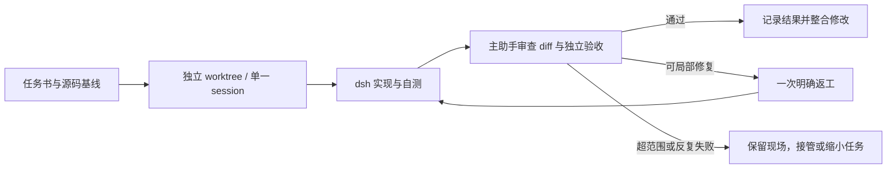

# DSH-001：固定观测 ID 对应的样本引用

**索引分组**：S1（DSH-001～013） · **状态**：历史归档，不是当前操作指南

## 阶段简述

阶段 2R 的首个委派试验，修复 ObservationBuffer 在同一 observation ID 下样本引用漂移：首次成功组装后固定 state 与相机引用，迟到合法帧只能供后续 state 使用。首轮候选经独立审查通过并整合；R1/R3 与后续重构当时仍未执行。

> 以下按原材料分块保存当时正文，块首记录原路径、SHA256 和原始字节数；命令、路径、预算、镜像、版本和外部来源均属当时状态，不保证今天可直接执行。结论、失败和限制保持原样，未按当前实现改写。

## 原始时间线

本阶段在清单中没有独立时间线行区间；相关背景见相邻阶段或本页原始材料。

## 原始材料

<a id="src-docs-tasks-dsh-001-observation-identity-md"></a>
### 原材料：DSH-001：固定观测 ID 对应的样本引用

- 原路径：`docs/tasks/dsh-001-observation-identity.md`
- SHA256：`5aa448fbac808097d668ba946248f53d204ff58836b63bccd245d2857665e10e`
- 原始字节：5336
- 归档锚点：`src-docs-tasks-dsh-001-observation-identity-md`

<!-- BEGIN SOURCE path="docs/tasks/dsh-001-observation-identity.md" sha256="5aa448fbac808097d668ba946248f53d204ff58836b63bccd245d2857665e10e" bytes="5336" -->
### DSH-001：固定观测 ID 对应的样本引用

状态：已执行并通过独立验收，见 [试验结果](#src-docs-tasks-dsh-001-result-md)。任务类型：阶段 2R 的首个委派试验。下文保留实际执行时的任务要求；监督者已在运行快照中补充真实工作目录、Python/Ruff 可执行路径、报告目录和时间限制。

#### 目标与基线

在基线 `c2c3e939116f9926f37a256b3b315cd80ce7fe53` 上修复 ObservationBuffer：同一运行上下文中的一个 observation ID，一经分配，其 state 与相机样本引用保持不变。实现一个局部修复并提交测试证据，保持代码易读。

监督者应先核对当前 HEAD 与任务基线。若基线不同、工作区已有未说明改动或运行路径不明确，报告阻碍，停止修改；不要自行重置分支。

#### 阅读范围与允许修改

允许修改且只允许修改：

- `components/runtime/ros/dual_arm_runtime/dual_arm_runtime/observation.py`
- `tests/unit/test_observation.py`

必要阅读：上述文件、`tests/unit/conftest.py`、`contracts/python/src/robot_contracts/models.py`；为理解调用方，可只读 `node.py` 中 `_publish_observation` 和 `_wait_observation`。根 `pyproject.toml` 定义检查入口。

日志等可重建产物仅写入监督者指定目录；测试工具的常规缓存除外。不修改 ROS 消息、node.py、Docker、依赖、profiles、配置、任务书或测试发现规则。不执行 Git 提交、重置、推送或分支操作；不启动其他代理。本任务不需要网络、Docker、ROS 或包安装。

#### 已知缺陷

使用同一 RunContext，配置 `max_skew_ns=20`、`max_age_ns=100`：

1. 添加 state(seq=1, stamp=100) 和 front(seq=1, stamp=90)。
2. `assemble(now_ns=100)` 返回 observation_id=1，front.frame_seq=1。
3. 添加迟到但满足因果约束的 front(seq=2, stamp=95)。
4. `assemble(now_ns=105)` 仍返回 observation_id=1，但 front.frame_seq 变成 2。

调用方仅在 ID 变化时发布和记录索引，却每次更新最新观测。相同 ID 对应不同图像会破坏后续推理与记录的一致性。

#### 明确的预期行为

- 对当前 state 第一次成功组成观测时分配 ID，并固定全部样本引用；相同 state 的后续组装返回相同 ID 和相同内容。
- 迟到的合法相机帧可以进入缓冲，供后续 state 选择，但不得改写已分配观测的引用。
- 新 state 第一次成功组装时获得递增 ID；仍选择时间不晚于该 state 且满足 max_skew 的最新相机帧。
- 组装失败时不消耗 observation ID；首次缺少相机、稍后相机到达时仍能正常生成观测。
- 每次 assemble 仍检查当前 state 的新鲜度；存在已组装观测不能使过期或未来时间的 state 绕过检查。
- RunContext 变化清空相关状态与引用，ID 从该上下文重新计数；旧上下文的样本仍被拒绝。
- 返回对象的引用集合不能通过调用方修改而污染后续返回结果。可采用适合现有只读调用方式的不可变表示或防御性复制，并解释选择。
- 保持有界存储、既有锁保护、顺序/时间检查和 dropped_samples 行为。不引入整段观测历史或通用缓存框架。
- 保持现有公共方法参数和调用方使用方式兼容。当前 `frames` 的名称查找、遍历、values 操作须继续可用。

#### 实施与验证

先补充至少一个暴露“迟到帧改变同一 ID 内容”的行为回归测试，在未修复实现上运行并记录失败；随后实现局部修复，再完成其余关键边界验证。测试应断言可观察结果，不依赖新增私有字段名或特定实现结构。

应覆盖：迟到帧不改旧观测、新 state 使用合适的新帧、缓存不绕过过期检查、上下文切换、首次缺帧后恢复，以及调用方无法污染已分配引用。可复用已有测试覆盖，避免重复案例。

监督者提供 `PROJECT_PYTHON` 和 `PROJECT_RUFF` 的实际可执行路径。在试验 worktree 根目录依次执行：

```bash
"$PROJECT_PYTHON" -m pytest -q tests/unit/test_observation.py
"$PROJECT_PYTHON" -m pytest -q
"$PROJECT_RUFF" check .
"$PROJECT_RUFF" format --check .
git diff --check
git status --short
```

当前主工作区 `.build/dev-venv/bin/` 可作为监督者评估的工具来源，但新 worktree 不会自动包含该目录。不要自行安装缺失工具，也不要从主工作区运行测试后将结果归于候选代码。实际工作目录与源码导入位置必须对应试验 worktree。

#### 停止条件

以下情况立即报告，不扩大范围：需要修改白名单外文件；依赖或工具不可用；发现必须改变协议/其他组件才可继续；无法说明线程与缓存行为；达到监督者规定的时限。首轮建议 15 分钟，返工由监督者按具体审查意见另行下发一次。

#### 最终交付格式

用简短中文返回：

1. 实现摘要，以及观测引用采用的所有权/不可变策略。
2. 修改文件清单。
3. 旧代码失败的回归测试及失败原因，修复后的实际测试命令和结果。
4. 未解决项、未执行验证；若有阻碍，明确写出。

代码保留在该 worktree 的未提交差异中。自测通过后停止，等待监督者独立审查；不要继续处理 R1、R3 或 runtime 重构。
<!-- END SOURCE path="docs/tasks/dsh-001-observation-identity.md" -->

<a id="src-docs-tasks-dsh-001-result-md"></a>
### 原材料：DSH-001 试验结果

- 原路径：`docs/tasks/dsh-001-result.md`
- SHA256：`2da114ee023c3fbd825bae9e4171d77fe4e5906f557166904a036b9610fd95c8`
- 原始字节：5143
- 归档锚点：`src-docs-tasks-dsh-001-result-md`

<!-- BEGIN SOURCE path="docs/tasks/dsh-001-result.md" sha256="2da114ee023c3fbd825bae9e4171d77fe4e5906f557166904a036b9610fd95c8" bytes="5143" -->
### DSH-001 试验结果

日期：2026-10-30。结论：首个委派任务经独立审查通过，R2 观测身份缺陷已修复并整合到主工作区，保留为未提交改动。实施者为本地 dsh 的 `deepseek-account / deepseek-flash`，推理档位 high；主助手负责任务书、监督、审查与验收，没有代写或重写候选实现。

任务范围见 [DSH-001](#src-docs-tasks-dsh-001-observation-identity-md)，协作约定见 [试验计划](#src-docs-dsh-collaboration-plan-md)。本次只完成这一项，R1/R3 与后续重构仍待执行。

后续更新：R3 和 R1 已分别完成，见 [DSH-002 结果](dsh-002.md#src-docs-tasks-dsh-002-result-md) 与 [DSH-003 结果](dsh-003.md#src-docs-tasks-dsh-003-result-md)；以下保留首次试验的独立记录。

#### 1. 代码与验证

仅修改两个业务/测试文件：

- `components/runtime/ros/dual_arm_runtime/dual_arm_runtime/observation.py`
- `tests/unit/test_observation.py`

实现为当前已分配观测保留一份缓存，同一 state 的迟到图像不改变其引用；每次返回时复制 frames 字典，避免调用方污染缓存。新鲜度检查仍在缓存返回之前执行，切换上下文时清空缓存。存储有界，公共调用方式保持兼容，没有增加依赖。

| 验证 | 实际结果 |
| --- | --- |
| dsh 先补测试再修复 | 原代码 1 failed / 9 passed；修复后观测测试 10 passed |
| 主助手重跑 dsh 回归测试，使用旧源码 | 预期的迟到帧断言失败 |
| 主助手独立的 5 项验收 | 旧源码 2 项失败；候选源码全部通过 |
| 候选 worktree 的纯 Python 测试 | 39 passed |
| 整合到主工作区后的纯 Python 测试 | 39 passed |
| Ruff lint / format 与 diff 检查 | 均通过 |
| 范围与基线 | HEAD 未变化；仅两个允许文件产生源码差异；无新增未跟踪业务文件 |

独立验收额外覆盖相机缓冲淘汰、多相机缺帧恢复、重复设置相同上下文和时钟边界。39 项是本次纯 Python 用例总数，不是先前 ROS 镜像的 39 项。本轮未重建镜像或重跑 ROS/MCAP 容器测试。

#### 2. 实际执行与用量

| 项目 | 结果 |
| --- | --- |
| 只读模型预检 | 3.947 秒，2 个 step、2 次工具调用 |
| dsh 实现与自测 | 69.643 秒，16 个 step、22 次工具调用 |
| 实现返工 | 0 次 |
| 入口适配重试 | 1 次：监督脚本的相对 overlay 路径错误，发生在模型调用前，已修正 |
| 主助手精确 token 用量 | 不可取得，未填作 0 |
| 主助手规划/审查的独立计时 | 本轮没有完整分段计时，不能据此给出全流程加速比例 |
| 实际账户扣费 | 未取得，不能由 token 数量直接推出 |

以下是 provider usage 字段的跨 step 累计值；缓存字段单列，不将重复出现的会话汇总再次加总：

| 原始字段 | 只读预检 | 实现任务 | 合计 |
| --- | ---: | ---: | ---: |
| inputTokens | 5,935 | 11,523 | 17,458 |
| outputTokens | 224 | 10,666 | 10,890 |
| cacheReadTokens | 5,888 | 257,664 | 263,552 |
| cacheWriteTokens | 0 | 0 | 0 |
| totalTokens | 12,047 | 279,853 | 291,900 |

totalTokens 包含多次请求读取的缓存上下文，并不等于任务书长度，也不代表这些 token 按同一费率计费。reasoningTokens 没有单独上报，保持未知。由于缺少主助手完整用量、费用和同类任务对照，当前只能确认这条执行流程可用，不能声称节省了某个百分比。

#### 3. 入口适配的发现

- headless 通过一次性 overlay 启用已保存的账号服务，沿用用户的模型选择。首次启动自动初始化本地 headless profile；没有修改 Web profile 或把凭据复制进项目。
- 显式采用 read-only / workspace-write 两种试验配置，approval=never，使需要额外授权的操作直接拒绝；正常任务工具可以在指定工作区运行。
- 只读预检正确读取 marker，session 的 cwd 与指定目录一致；实现 session 也绑定独立 worktree。
- stdout 中夹有一行模型列表日志，不能把每一行都当作 JSON。监督脚本保留原始输出并分别统计非 JSON 行。
- 监督进程配置了 900 秒上限，本次正常完成，未触发强制超时；主动中断和子进程异常残留尚未做专门故障试验，不能宣称已完成监督器的完整可靠性验证。

#### 4. 产物与后续判断

源码基线为 `c2c3e939116f9926f37a256b3b315cd80ce7fe53`。任务分支为 `dsh/dsh-001-observation-identity`，worktree 为 `/home/ljk/work/sim_dual_arm-worktrees/dsh-001`；保留候选差异供追溯。本轮没有创建 Git 提交或推送。

本地完整证据目录：`var/runs/dsh/dsh-001/20261030T031517Z/`。包含任务快照、单次配置、运行事件、退出结果、旧代码失败证据、候选验收、accepted.patch、review.json 和整合后的检查结果。独立验收程序与一次性监督脚本存放在 `.build/reports/dsh/`。

本次结果支持继续进行一个独立的 R3 小任务。下一轮应在开始前分段计时，将模型实现时间与主助手审查时间分别记录；继续保持单一任务和独立验收。暂不据这一次结果扩大为无人审查的整轮重构。
<!-- END SOURCE path="docs/tasks/dsh-001-result.md" -->

<a id="src-docs-dsh-collaboration-plan-md"></a>
### 原材料：dsh 委派执行试验计划

- 原路径：`docs/dsh-collaboration-plan.md`
- SHA256：`9c2979f65c680a8d05d23093ac61028e9377523a01acfab43bb017b6d4f8b901`
- 原始字节：12381
- 归档锚点：`src-docs-dsh-collaboration-plan-md`

<!-- BEGIN SOURCE path="docs/dsh-collaboration-plan.md" sha256="9c2979f65c680a8d05d23093ac61028e9377523a01acfab43bb017b6d4f8b901" bytes="12381" -->
### dsh 委派执行试验计划

日期：2026-10-30。状态：只读预检及 DSH-001～003 已执行并整合。R2/R3 首轮通过；R1 经一次定点返工和监督者局部补齐后通过，见 [DSH-001](#src-docs-tasks-dsh-001-result-md)、[DSH-002](dsh-002.md#src-docs-tasks-dsh-002-result-md)、[DSH-003](dsh-003.md#src-docs-tasks-dsh-003-result-md)。尚无节省用量或全流程提速的对照结论。项目功能推进继续停留在阶段 2R。

目标是验证一种分工：主助手负责限定问题、写任务书、审查代码与独立验收；dsh 负责在限定范围内实现和自测。评价对象是交付一个可接受修改的总成本，包括计划、执行、返工、审查、测试和人工介入。

后续实施已推进至 [DSH-015](dsh-015.md#src-docs-tasks-dsh-015-result-md)，S1、S2a环境门槛及双臂场景模型完成，按用户要求暂停；下面保留首次试验规划和当时状态，当前阶段以 [执行记录](README.md#timeline) 为准。DSH-013 达到一次返工上限后由主助手接管，说明扩大范围仍需严格验收和控制返工；目前没有可据以宣称节省费用或整体提速的对照数据。

#### 1. 已确认的本地条件

| 项目 | 事实与限制 |
| --- | --- |
| 项目版本基线 | `c2c3e939116f9926f37a256b3b315cd80ce7fe53`，首次提交；本轮开始时工作区干净 |
| dsh checkout | `/home/ljk/tools/deepseek-harness`，commit `687f282e8625c6b8d11ff58211a90524be2e4317`，包版本 `0.2.1-rc.2` |
| 自动执行接口 | 本地文档及源码提供 `--profile headless`、stdin 任务、`--json` 事件和 `--session-id` 续做 |
| 启动入口 | 已运行 CLI help、headless 只读探针和 DSH-001；实际结果见任务记录 |
| Web | 用户已启动 Web 并得到模型列表；本轮未控制已有 Web 会话 |
| 认证差异 | 默认 headless 禁用已保存凭据和 DeepSeek account 消费者，Web 登录不会自动证明 headless 可用 |
| 工作目录 | CLI 调用目录是默认工作区；从 harness 目录执行 pnpm dsh，不能据此认定工作区是机器人项目 |
| 用量事件 | 本地 headless JSON 实现在 step_end 可携带 usage，缺失任一尝试的样本时可省略；需实际核对完整性 |

上述判断来自本地 `apps/cli/README.md`、`packages/bundle/headless/README.md`、`packages/bundle/headless/src/json-stream.ts` 和 `packages/sandbox/sandbox-policy/README.md`。这是针对该 checkout 的方案，升级 dsh 后需复查。

Web 登录 URL 中的 token 不写入项目文件或任务书。模型账号沿用本地凭据机制，任务文本不携带密钥。

#### 2. 分工和交接材料

| 角色 | 负责的工作 | 交付材料 |
| --- | --- | --- |
| 主助手：任务作者 | 确定单一行为、允许文件、兼容要求、验收和停止条件 | 可单独理解的任务书、固定源码基线 |
| dsh：执行者 | 阅读最小必要上下文、实现、补行为测试、自测 | 未提交的源码差异、命令及结果、未解决项 |
| 主助手：审查者 | 检查范围和实现、验证测试有效性、独立运行验收 | 接受 / 定点返工 / 接管，以及具体证据 |
| 用户 | 调整目标和资源偏好，在需要时查看任务书与差异 | 不必逐步搬运实现细节 |

一个任务对应一个独立 Git worktree 和一个 dsh session。首轮串行执行。主助手验证时 dsh 应已停止写入，避免边改边测。worktree 用于隔离源码差异，并不等于操作系统权限隔离；有效写入策略与工作目录仍需在预检中确认。

任务书应包含：问题与复现、基线、允许修改文件、必要阅读、预期行为、兼容边界、验证命令、停止条件和交付格式。任务中的实施要求足够独立，不要求 dsh 读完整对话或所有设计文档。

#### 3. 先做三层试验

##### A. 入口预检：只读、短任务

先确认实际选中的 provider/model、推理档位和认证路径。若复用 Web 已登录账号，按本地 headless 文档使用单次 overlay 恢复对应服务，并检查模型路由；若已有环境 API-key 路由，验证其可用性即可。profile 和模型选择通过已支持的配置机制设置，不假设存在 `--model` 或 `--max-tokens` 参数。

在临时工作区写入无敏感信息的小文件，让 dsh 只读并报告内容、cwd 和任务标记。预检覆盖：

1. JSON session 事件中的 cwd 是预定工作区，模型请求实际成功。
2. 退出状态、turn_end 和 final 可以读取；只读任务没有产生源码变化。
3. 任务失败或外部超时可以被识别并停止；结束后核对任务启动的子进程。
4. 写任务前确认有效权限策略限制在指定工作区；任务书的文件白名单再通过 Git 差异核对。

这个阶段不需要真实项目修改。若 headless 的认证/权限预检不通过，记录阻碍；可改用现有 Web 新会话，显式选择试验 worktree 后提交同一任务书。此时标记为人工交接试验，不能把手工搬运时间从统计中去掉。

##### B. 第一个实现任务：R2 观测身份稳定

使用 [DSH-001 任务书](#src-docs-tasks-dsh-001-observation-identity-md)。只允许修改 `observation.py` 和 `test_observation.py`，无需 ROS、Docker 或新增依赖。

选择原因：缺陷可确定复现，行为边界清楚，能够检查回归测试是否在旧代码上失败，并能观察 dsh 是否引入多余抽象。它既验证执行能力，也验证我们能否用少量上下文完成可靠审查。

建议试验上限：首轮执行 15 分钟，最多一次定点返工、额外 10 分钟。这些是监督进程应实施的 wall-time 限制，不是声称 dsh 原生支持 token 硬上限。首次审查记录实际耗时；预算到达时保留现场和结果，不自动无限续跑。

##### C. 按结果扩大范围

| 顺序 | 候选任务 | 开始条件 |
| --- | --- | --- |
| 1 | R2 观测 ID 固定引用 | 入口预检通过 |
| 2 | R3 清理步骤独立尝试 | R2 经独立验收，范围控制与交付材料可用 |
| 3 | R1 中断与线程收尾 | R3 通过；先由主助手补充 ROS 生命周期设计和故障验收方案 |
| 4 | runtime 职责提取 | 已修复行为有回归保障；按一个责任一次提取 |

R1 不是简单增加 join；涉及信号处理、ROS 上下文和写盘生命周期，应在任务书明确设计后再委派。阶段 3 RPC 与 Gazebo 不在本次试验范围。

#### 4. 单个任务的执行流程



准备时记录 base SHA、任务书摘要、dsh 版本、模型选择和工具权限。试验 worktree 建议放在 `/home/ljk/work/sim_dual_arm-worktrees/dsh-001`，使用独立任务分支；主工作区可保留未提交的计划文档，任务书通过 stdin 传入。

从 worktree 的 cwd 启动已构建 CLI，可保持源码位置正确。下面仅是认证、权限、路径和超时监督就绪后的调用形式，不是已经执行的命令：

```bash
node "$DSH_ENTRY" --profile headless --patch "$TASK_OVERLAY" --json < "$TASK_FILE"
```

监督者捕获 stdout/stderr、退出码和起止时间。续做仅使用该任务已产生的 session ID，且 cwd 一致；不接管用户已有 Web 会话。每次返工只发送具体问题、失败证据和仍有效的边界，避免重新发送整份项目背景。

任务结束后先检查 `git status --short`、`git diff --name-status` 和 `git diff --check`，包含未跟踪文件。HEAD 应仍为约定基线，dsh 不自行提交或改分支。范围异常先解释，不能通过删除测试、放宽校验或修改任务书获得通过。

主助手验证通过后再整合已审查的差异；整合到目标分支后运行相应回归。具体 Git 提交按当次执行范围处理，不自动推送。失败 worktree 和日志保留到问题记录完成，清理仅针对本次创建的资源。

#### 5. 审查与验收

主助手依次检查：

1. **范围：** 是否仅修改允许文件，是否新增依赖、改配置、改测试入口或隐藏失败。
2. **行为：** 缺陷是否消失，旧行为是否保留，边界条件是否明确。
3. **测试：** 新回归用例能否在固定基线失败、在修改后通过；验收使用实际候选源码，不使用旧镜像内的代码。
4. **可维护性：** 命名、类型、状态归属和注释是否让人更容易理解；是否出现为一个局部修复增加的通用框架。
5. **交付证据：** 命令确实执行，未执行项明确标注，主助手独立结果与 dsh 自述一致。

dsh 的退出码 0 或“任务完成”只表示执行过程结束，不能代替项目验收。DSH-001 先跑针对性测试，再跑当前纯 Python 测试与 Ruff；不因纯 Python 小修复重复构建全部 Docker 镜像。

#### 6. 如何判断是否节省用量、加快进度

每次试验在 `var/runs/dsh/<task_id>/<attempt>/` 保存任务快照、运行元数据、事件、stderr、自测输出、候选差异、审查结果和独立验证结果。可公开的结论再归纳到任务记录，原始事件留在本地。

| 指标 | 记录方式 |
| --- | --- |
| 交付质量 | 首轮通过与否、返工次数、越界修改、独立验收发现的缺陷 |
| 总耗时 | 计划 + 排队/执行 + 自测 + 审查 + 返工 + 整合验证；另外记录人工操作时间 |
| 主助手用量 | 能取得的实际用量；没有数据时记 unavailable，不能填 0 |
| dsh 用量 | provider 报告的输入、缓存和输出用量，包含重试/失败；缺失字段标记未知 |
| 总成本 | 采用当次实际账单/账户用量；订阅额度与 API 费用分别记录，不把异构 token 简单相加当作费用 |
| 建设成本 | 认证适配、任务书模板、监督工具的首次成本单列，同时计入首轮总投入 |

headless 的 step_end usage 与最终会话统计不能重复相加。界面上下文占用估计也不能当作实际账单。若需要监督者的精确 token 数据但平台没有提供，则只报告可观测结果和未知项。

首次 R2 试验只能判断流程可行性，不能给出可信的节省百分比。通过后，可选至少三项规模相近的独立任务交替采用“主助手直接实施”和“dsh 实施、主助手审查”，保持验收标准一致；同一缺陷重复实现会受到已有解法影响，不能视为无偏对照。避免为了测量而重复完成整轮重构。

继续委派的条件是质量达标、返工有界、审查负担可接受；若只是把实现时间转成更长的修补时间，收缩到更小的任务。提速与节省主助手用量分别报告，不能假设二者必然同时发生。

#### 7. 交付状态与下一次试验

方案阶段交付协作计划和 DSH-001 任务书。用户随后授权试验，已完成入口适配、独立 worktree 实施、主助手审查与验收，并将 R2 修复整合到主工作区，尚未提交 Git。

后续已完成 R3 和 R1。R1 首轮测试通过后，独立审查仍发现异常分支、测试打包和 Docker 信号入口问题；一次返工后由监督者补齐剩余的 executor 异常分支。结果说明独立验收不能省略，也不证明这类复杂任务一定更省用量或更快。

下一次候选为 R4：先提取一个具体职责，保持外部行为，复用现有回归。每个新任务使用新 session，限制单次返工；达到边界后接管，避免持续扩大上下文。职责重构、完整监督器可靠性和成本优势仍待验证。本轮源码未提交，主工作区暂存区未改动。

#### 2026-11-01 · 隔离快照与主工作区提交的区别

每项任务使用临时Git index生成隔离输入快照，并以快照SHA建立`codex/dsh-*`工作树分支。
这些快照保留于Git对象与任务分支，供审查/复现；不移动主工作区HEAD，不改主暂存区。
任务结果中的“未提交”指没有提交主工作区的业务修改，dsh也不自行提交候选或推送。
输入快照、实际候选差异和整合结果分别记录在对应`var/runs/dsh/.../metadata.json`及验收产物中。
<!-- END SOURCE path="docs/dsh-collaboration-plan.md" -->

<a id="src-docs-maintainability-review-md"></a>
### 原材料：阶段 1～2 可维护性审查

- 原路径：`docs/maintainability-review.md`
- SHA256：`1157d95f2676c6ea218d950badb6d6ad1b65c857300ab847ae2d583ef97c03d5`
- 原始字节：19130
- 归档锚点：`src-docs-maintainability-review-md`

<!-- BEGIN SOURCE path="docs/maintainability-review.md" sha256="1157d95f2676c6ea218d950badb6d6ad1b65c857300ab847ae2d583ef97c03d5" bytes="19130" -->
### 阶段 1～2 可维护性审查

审查日期：2026-10-30。范围是当前源码、配置、Docker 入口、测试和已有规划。本文是本次审查记录与整改清单；操作命令仍以 [使用指南](dsh-013.md#src-docs-stage2-quickstart-md) 为准，公共职责仍以 [接口设计](dsh-000.md#src-docs-architecture-and-interfaces-md) 为准。

后续状态：用户已建立 Git 基线 `c2c3e93`，下文“尚无 Git 仓库”是审查当时的历史状态。R2、R3、R1 已分别通过 [DSH-001](#src-docs-tasks-dsh-001-result-md)、[DSH-002](dsh-002.md#src-docs-tasks-dsh-002-result-md)、[DSH-003](dsh-003.md#src-docs-tasks-dsh-003-result-md) 修复并独立验收。DSH-004～DSH-010 随后完成类型配置、职责拆分、日志、写盘/审计和人工结束语义；[DSH-011](dsh-011.md#src-docs-tasks-dsh-011-result-md) 完成 Compose 开发挂载，[DSH-012](dsh-012.md#src-docs-tasks-dsh-012-result-md) 完成人工命令，[DSH-013](dsh-013.md#src-docs-tasks-dsh-013-result-md) 完成整次运行监督。S1 已验收，[DSH-014](dsh-014.md#src-docs-tasks-dsh-014-result-md) 已验证独立仿真依赖/资产与 NVIDIA EGL；完整物理闭环尚未完成，最新状态见 [执行记录](README.md#timeline)。

结论：四类环境的职责划分和仓库顶层分类可以保留。当前实现适合作为短时 mock 联调基线，但应先完成一次收尾行为修正与小范围职责拆分，再进入阶段 3。主要负担来自 runtime 的职责集中、mock 假设进入公共实现，以及文档与实际入口不一致。单纯减少目录层数或增加注释无法解决这些问题。

最初审查轮只更新文档；下文保留当时发现与建议。后续源码修复状态以上方说明和各任务结果为准，阶段 3 尚未开始。

#### 1. 已执行的验证

| 检查 | 本次结果 | 能说明的范围 |
| --- | --- | --- |
| 当前源码纯 Python 测试 | 34 项通过 | 后端控制核心、观测选择和配置的已有用例 |
| Ruff lint / format | 通过，27 个 Python 文件格式正常 | 格式、导入与已启用的静态规则 |
| 已有 ROS test 镜像 | 39 项通过 | 上述单测及原生 MCAP 的 5 项测试；本次未重建镜像 |
| 真实 ROS runtime 中途 SIGINT | 复现退出码 0、没有 manifest | 人工中断没有等待 episode 收尾 |
| 迟到相机帧的纯 Python 探针 | 同一 observation ID 引用不同帧 | 观测身份不稳定 |
| 控制清理故障注入 | 续租等待超时后未调用 stop/release | 清理步骤之间存在不必要的短路 |
| 配置边界探针 | 30 ms lease 通过配置加载 | 与后端至少 100 ms 的限制不一致 |

39 项包含前述 34 项，不是额外的 39 项。SIGINT 探针使用独立 Docker 网络、mock 后端和挂载的当前 runtime 源码；本次创建的容器与网络已清理。探针及退出证据位于本地 `.build/reports/maintainability-review/`。这些复现说明测试存在缺口，不否定原有成功链路。

#### 2. 需要优先修复的行为

这里的 P1 表示应在阶段 3 前处理；P2 表示明确安排的维护问题，具体时限见各项。区分“已经复现”和“从代码确认的设计限制”，不将尚未测试的负载问题描述为实测故障。

##### R1 · P1：人工中断绕过 episode 收尾（已复现）

当前状态：已修复，包含实际 Docker PID 1 信号路径；过程、验收和限制见 [DSH-003 结果](dsh-003.md#src-docs-tasks-dsh-003-result-md)。下文保留原问题。

位置：[node.py](../../runtime/ros2/ros/dual_arm_runtime/dual_arm_runtime/node.py)，`_start`、`main`（审查时第 357、529～536 行）。episode 线程是 daemon；主线程接到中断后直接销毁 executor/node，没有等待 worker 完成停止、释放控制权和记录提交。

复现：订阅到第一条动作后等待 0.15 秒，向 runtime 子进程发送 SIGINT。进程返回 0，输出目录只有 `.partial-episode-*/recording/recording_0.mcap`，没有 metadata.yaml 和 manifest.json。人工无法从退出码判断记录未完成，也没有结构化的中断原因。

修复方向：提供明确的 shutdown 入口和有界收尾流程；在通信上下文仍可用时发起停止，等待 worker 和 writer 收尾，最后销毁 ROS 资源。协调 rclpy 的信号处理时机；仅在当前 `finally` 里增加 `join()` 不能保证控制服务仍可调用。中断、收尾失败和正常结束应有明确退出语义。

验收：在 PREPARING、动作执行中和记录收尾时分别中断；不会将不完整运行报告为成功；可写存储上的记录保留失败原因；无活跃 worker 访问已销毁 ROS 对象。SIGKILL/断电恢复是另外的问题。

##### R2 · P1：同一个 observation ID 的内容会变化（已复现）

当前状态：已修复，验收和改动范围见 [DSH-001 结果](#src-docs-tasks-dsh-001-result-md)。以下为原问题与修复要求。

位置：[observation.py](../../runtime/ros2/ros/dual_arm_runtime/dual_arm_runtime/observation.py)，`assemble`；[node.py](../../runtime/ros2/ros/dual_arm_runtime/dual_arm_runtime/node.py)，`_publish_observation`。

最小输入为 state(seq=1, t=100)、frame(seq=1, t=90)，第一次 assemble 得到 observation_id=1、frame_seq=1；随后加入 frame(seq=2, t=95)，再次 assemble 得到 observation_id=1、frame_seq=2。两张图都满足因果时间约束，但身份相同、内容不同。

runtime 仅在 ID 变化时发布/记录 ObservationIndex，却每次更新 `_last_observation`。目前脚本不消费图像载荷；接入推理后，这会使实际请求中的图像与记录索引不一致。

修复方向：确定“一次分配 ID 就冻结全部样本引用”的规则。建议同一 state 首次形成有效观测后固定相机引用；若确实需要重新组装，则必须产生新 ID 并同步更新记录。后续载荷缓存必须按这些固定引用读取。

验收：迟到但合法的相机帧不会改变已有 ID 的内容；记录、发布和调用方读取的是同一组引用。

##### R3 · P1：续租清理失败阻止后续停止尝试（故障注入复现）

当前状态：已修复，独立清理、错误聚合与回归证据见 [DSH-002 结果](dsh-002.md#src-docs-tasks-dsh-002-result-md)。下文保留原问题。

位置：[node.py](../../runtime/ros2/ros/dual_arm_runtime/dual_arm_runtime/node.py)，`_cleanup_control`（审查时第 481～509 行）。等待已有续租、stop 和 release 共用一个 try；第一步超时就跳过其余步骤，随后清空本地 lease。

故障注入将 `_wait_future` 设为抛出 CALL_TIMEOUT，实际调用的控制服务列表为空。后端仍有 lease 到期保护，但客户端没有主动尝试停止，也难以区分哪些清理步骤成功。

修复方向：每个必要的清理动作独立尝试并记录结果；保留首要失败原因与附加清理错误。通信仍可用时，前一步失败不能直接跳过 stop；上下文已经不可用时应明确记录未能完成的操作。

验收：续租等待失败、stop 失败分别注入，后续适用的清理仍被尝试，最终状态不误报成功。

#### 3. 职责与可读性问题

##### R4 · P2：RuntimeNode 同时拥有过多生命周期

当前状态：已通过 [DSH-005](dsh-005.md#src-docs-tasks-dsh-005-result-md) 和 [DSH-006](dsh-006.md#src-docs-tasks-dsh-006-result-md) 提取控制客户端与 episode 生命周期并验收。node 保留 ROS 接线、观测同步和进程入口；下文保留原问题与拆分依据。

位置：[node.py](../../runtime/ros2/ros/dual_arm_runtime/dual_arm_runtime/node.py)，542 行。行数本身不是判据；问题是 ROS 注册、跨线程状态、续租、服务等待、episode、脚本动作、记录和退出都由同一对象管理。一次修改很容易跨越多个责任。

当前优点是命名大体明确、协议转换显式、没有复杂继承或动态插件机制。应保留这些特点。建议先提取两个具体模块，仍在现有 Python 包内：

| 模块 | 唯一职责 |
| --- | --- |
| `node.py` | 注册 ROS 接口、转发消息、发布状态，作为组装入口 |
| `episode.py`（拟新增） | 一个 episode 的开始、执行、结束和错误收尾 |
| `control_client.py`（拟新增） | lease、动作调用、停止与释放，封装调用超时 |
| `configuration.py` | 外部配置加载、结构与语义验证、有类型的内部配置 |
| `observation.py` | 固定身份的观测选择，后续按需增加有界载荷缓存 |
| `recording.py` / `audit.py` | 写入与完整性检查，明确区分通用规则和 mock 演示断言 |

不为每个模块创建 Python distribution、ROS 节点或容器。暂不建立 session/manager/service/factory 等多层目录。脚本源只有一份简单实现时可先保留为函数，出现第二种动作源后再提取稳定接口。

拆分时应写清：ROS executor 线程与 episode worker 各自拥有哪些状态；哪个锁保护什么；谁创建/关闭 recorder；什么条件下可以销毁 node。长生命周期状态应有类型，长数据对象采用关键字参数，状态/错误码和时长上限采用具名定义。不要通过统一的“万能上下文”对象重新把所有可变状态连接起来。

##### R5 · P2：同步写盘阻塞 ROS 回调，审计占用随整段数据增长

当前状态：已由 [DSH-009](dsh-009.md#src-docs-tasks-dsh-009-result-md) 修复并验收；下文保留原问题证据。队列和原生writer关闭有明确预算，后续audit/hash仍在episode worker中；整个episode墙钟监督已由 [DSH-013](dsh-013.md#src-docs-tasks-dsh-013-result-md) 的自动采集启动器覆盖。

位置：[node.py](../../runtime/ros2/ros/dual_arm_runtime/dual_arm_runtime/node.py) 的 `_record`、SingleThreadedExecutor；[recording.py](../../runtime/ros2/ros/dual_arm_runtime/dual_arm_runtime/recording.py) 的 `append`、文件哈希；[audit.py](../../runtime/ros2/ros/dual_arm_runtime/dual_arm_runtime/audit.py) 的 `states/frames`。

传感器回调直接序列化并写 MCAP，续租定时器在同一个 executor 上运行。慢写盘会延迟续租和状态接收；“回调保持非阻塞”的维护约定尚未落实。离线审计又保留所有完整图像对象，并通过 `read_bytes()` 整文件计算哈希。

这些是从代码确认的限制，本次没有进行大图像/长 episode 负载测试。对当前 64×48、约 2.4 秒脚本影响有限；增加真实相机或长时间运行前需要处理。

建议有界写入队列和单一 writer 所有者，明确溢出与排空失败行为；审计只保留引用检查需要的元数据，文件哈希按块读取。低层 lease 看门狗继续独立存在。先增加一次慢写盘行为验证，再选择队列大小，不预先引入消息中间件。

##### R6 · P2：通用名称下包含 mock 专属规则

当前状态：记录来源、三维结果和generic audit已由[DSH-010](dsh-010.md#src-docs-tasks-dsh-010-result-md)修复；历史v1按旧规则读。BackendEngine仍是明确的mock实现，第二后端的共用规则提取留S3，不解除当前接入guard。下文保留原问题证据。

位置：[engine.py](../../libraries/backend_core/src/robot_backend_core/engine.py)、[recording.py](../../runtime/ros2/ros/dual_arm_runtime/dual_arm_runtime/recording.py)、[audit.py](../../runtime/ros2/ros/dual_arm_runtime/dual_arm_runtime/audit.py)、[manifest schema](../../contracts/schemas/v1/episode_manifest.schema.json)。

`BackendEngine` 不仅管理 lease，还持有 mock positions、执行线性插值，并使用 `mock-system` 时钟域；目前只有 mock 一个使用方。EpisodeRecorder 和 manifest schema 固定 `source=mock/test_only=true`，审计要求所有命令正常完成且关节必须产生运动。

这些约束适合验证当前演示，但不能直接成为真实/仿真后端或通用数据完整性的定义。静止采集、合法取消、任务失败也可能有完整且可用的记录。

建议现在明确标注 mock 实现边界；接入第二个后端时，再从实际共同需求提取 lease/校验逻辑。将“文件完整性”“运行结果”“任务成功标签”区分开。mock 必须运动的断言归测试验收。暂不为未来后端拆出多个抽象库，也不解除当前 test-only 接入限制。

##### R7 · P2：内部配置仍是可变字典，验证规则不一致

当前状态：已由 [DSH-004](dsh-004.md#src-docs-tasks-dsh-004-result-md) 修复并验收；下文保留原问题证据。

位置：[configuration.py](../../runtime/ros2/ros/dual_arm_runtime/dual_arm_runtime/configuration.py)、[runtime schema](../../contracts/schemas/v1/runtime_config.schema.json)、[engine.py](../../libraries/backend_core/src/robot_backend_core/engine.py)。

Configuration 虽然 frozen，内部 recipe/observation/action/snapshot 仍是可变 dict；业务代码散布字符串键和隐式约束。复现中 lease=30 ms、renew=10 ms 可以通过配置加载，后端 acquire 却规定 lease 至少 100 ms。脚本限位/有限值等也主要延迟到动作执行时检查。

建议保留 JSON Schema 验证外部文件，将已验证配置转换成少量有类型的 dataclass；在启动前检查已知参数冲突，错误包含文件/字段和原因。结构规则、机器人限位和后端能力分别有清晰权威来源。依赖当前测量状态的执行检查仍留在后端。

##### R8 · P2：人工操作入口和结束语义不完整

当前状态：[DSH-010](dsh-010.md#src-docs-tasks-dsh-010-result-md)已验收人工结束分类、幂等请求和停止后终止反馈；[DSH-011](dsh-011.md#src-docs-tasks-dsh-011-result-md)已验收 Compose 开发入口；[DSH-012](dsh-012.md#src-docs-tasks-dsh-012-result-md)已验收人工 CLI；[DSH-013](dsh-013.md#src-docs-tasks-dsh-013-run-supervision-md)已把自动采集统一到 Compose，并汇总退出码、日志排空和独立 audit 到 `status.json`。下文保留原问题证据。

位置：[node.py](../../runtime/ros2/ros/dual_arm_runtime/dual_arm_runtime/node.py) 的 `_end_service`、[EndEpisode.srv](../../contracts/ros/robot_api_msgs/srv/EndEpisode.srv)、[启动器](../../.build/restructure-20261103/retired-source/tools/run/mock_collect.py)。

EndEpisode 只确认进入 ENDING，不能表示已经落盘；它目前总把提前结束记为失败。目标接口文档却写成落盘后返回最终结果。默认启动器执行完即删除容器，只提供自动演示，缺少保留现场、只启动服务、查询状态和人工 start/end 的完整使用路径。

建议在阶段 3 前写清当前异步确认语义，以最终状态/manifest 判断结束，并提供最小人工调试入口。先支持查看状态、启动/结束、保留日志和产物，再考虑 GUI。预期的用户停止与记录损坏应有不同结果描述。

#### 4. 目录与规划的调整

顶层 `contracts / components / libraries / profiles / configs / deploy / tools / tests / docs` 的归属基本合理，`var` 和 `.build` 的区分也应保留。ROS 的包目录与同名 Python 包各有作用，不建议只为缩短路径而改布局。

需要收敛的是承诺与权威来源：

| 位置 | 本轮判断与后续规则 |
| --- | --- |
| `contracts/` | 保留唯一协议源；v1 仍是项目原型，不宣称所有目标语义已稳定。补充字段用途、错误含义及当前能力比增加类型更重要 |
| `components/runtime/` | 在原包内拆职责，避免每个功能再加一层包/容器 |
| `libraries/backend_core/` | 当前是 mock 使用的纯 Python 实现；共享价值要在第二个后端出现后验证 |
| `profiles/` | 保留机器人/模型语义；说明时间同步阈值影响观测语义，与运行超时的归属不同 |
| `configs/` | 当前真正使用的配方只有 `runtime/mock_collect.yaml`；先保持这一条加载路径清晰 |
| `deploy/examples/sim_collect.yaml` | 设计示例，没有解析器；不能通过编辑它改变当前演示。之后有实际部署解析需求时再实现多层覆盖 |
| `tools/` | 保留薄构建/启动入口；DSH-011 已验收 Compose 开发路径。DSH-013 已把旧自动演示改为 Compose 薄入口，监督职责集中在 `collect_run.py`，不再维护第二套容器/卷导出流程 |
| `tests/` | 当前集中在根目录合理，明确 unit/integration/doubles；不立即迁移到每个组件。将来拆独立发布项目时再评估 |
| `assets/`、`third_party/`、未实现组件 | 有实际文件才建立，不按目标树预建空目录 |
| `docs/` | 区分已实现操作、目标设计、历史材料和一次性审查；当前状态与命令不要多处独立维护 |

发现的文档偏差包括：路线图末尾仍要求开始阶段 1；目录文档仍引用不存在的 `libraries/backend_core/ros`；测试放置规则与实际根目录 tests 不一致；启动器被描述为必须调用 Compose；Policy proto 首行仍写未生成 SDK。前四项已在本轮文档中纠正，proto 注释留待协议维护时同步处理，避免本轮改变协议源摘要。

环境边界继续保留，镜像打包方式可随实际开发调整。当前 requirements-dev 同时给运行镜像提供 gRPC/Protobuf 与测试工具，ROS 包的自身声明又没有完整呈现项目 Python 依赖。下一轮维护应明确系统依赖、项目依赖和开发工具的来源，并提供受支持的开发安装/增量构建路径；不用在每次修改配置时重建全部镜像。现有 Docker 成功构建只能证明该镜像配方可用。

离线边界也需要一个小验证：现在 MCAP 审计依赖 ROS，而规划的 learning 不依赖 ROS。应在大规模数据转换前用一份现有 MCAP 验证独立 Python 环境能解码公共消息；若需要导出步骤，将其明确归属于 ROS 侧。先解决这条实际边界，再扩展数据集转换框架。

#### 5. 建议的整改顺序与恢复推进条件

在阶段 2 和阶段 3 之间增加“2R：可维护性与人工操作收敛”，每一步单独审阅：

1. **建立变更基线，修复 R1～R3。** 当前 `git status` 报告此目录不是 Git 仓库；先确认项目真正的版本管理位置或建立可回退基线。本轮没有初始化 Git。补上中断、迟到帧和清理失败的行为测试。
2. **拆分 runtime 的 episode 与 control client。** 尽量保持外部 ROS 接口、当前配置和成功演示行为不变；提取过程中记录线程所有权与资源关闭顺序。不要把修复与全仓库改名混在一起。
3. **补齐人工接手路径。** 有类型的配置、启动前错误、当前状态说明、手动 start/end/查看结果、保留日志与失败产物；提供一条可重复运行的检查入口。以人的实际修改任务验证文档。
4. **恢复阶段 3。** 增加真实 RPC 时，基于稳定的观测引用与单一执行入口接入。慢写盘/记录容量及 mock 断言分离最迟在增大图像、延长 episode 或进入阶段 4 前完成。

允许恢复阶段 3 的标准：已有成功链路仍通过；R1～R3 的新增行为验证通过；维护者能按文档修改一段脚本、运行、查看当前状态、中途结束并找到有原因的记录；能从入口定位到配置、episode、控制和记录四个责任。R5～R8 的剩余限制有明确归属和时限。

Gazebo、机器人选型、LeRobot 依赖和真实相机接入继续保持待定。本次审查不需要重新选择技术栈，也不需要增加通用插件系统或分布式调度层。
<!-- END SOURCE path="docs/maintainability-review.md" -->

