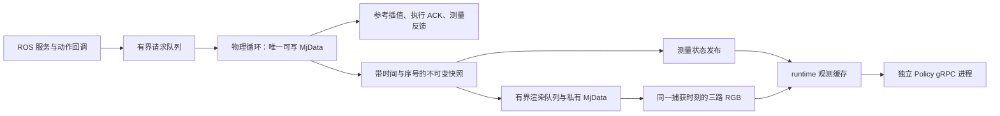

# DSH-019：命令状态查询、执行时间与反馈记录

**索引分组**：S3（DSH-018～032） · **状态**：历史归档，不是当前操作指南

## 阶段简述

命令状态查询、执行时间与反馈记录：新增 `CommandStatus`、`QueryCommand` 和独立 `command_feedback` 流，分离采样/执行时钟，记录接受、开始、反馈和终态；mock 测量仍等于参考，物理执行尚未接入。20 个文件整合。

> 以下按原材料分块保存当时正文，块首记录原路径、SHA256 和原始字节数；命令、路径、预算、镜像、版本和外部来源均属当时状态，不保证今天可直接执行。结论、失败和限制保持原样，未按当前实现改写。

## 原始时间线

`docs/simulation-loop-progress.md` 在清单指定行区间内的逐字快照；行区间互不重叠，全部 531 行按阶段拆分，完整覆盖见 [历史索引](README.md#timeline)。

<a id="timeline-0227-0238"></a>
### 时间线第 227～238 行

- 原路径：`docs/simulation-loop-progress.md`
- 原始行区间：227～238
- 区间 SHA256：`4d5d68e70e03416b1345bb0bfd652cc2d4f1ec4af1e6015494a6fc07d0fa536b`

<!-- TIMELINE BEGIN 227-238 sha256=4d5d68e70e03416b1345bb0bfd652cc2d4f1ec4af1e6015494a6fc07d0fa536b -->
```text
## 2026-11-01 · 恢复S3，命令状态与反馈执行中

- 用户要求继续，解除DSH-018后的暂停。先执行[DSH-019](tasks/dsh-019-command-status.md)：新增命令状态查询与独立反馈流，保持现有事件消息与历史MCAP兼容；物理reset留控制核心任务。
- 本地headless session `session-6a4dfb5c-ddca-46cc-8839-bfcd15c43f84`，隔离快照`15cf4bd2393d285c224913dc479007a5165dbbb5`，首轮25分钟。监督者独立生成SDK、验证真实服务/记录与历史数据，不把mock反馈作为物理跟踪证据。

## 2026-11-01 · S3命令查询与执行反馈已验收

- [DSH-019结果](tasks/dsh-019-result.md)：一次dsh返工后由主助手接管剩余兼容性与状态组织整改；20个允许文件已整合，无Git提交，主暂存区未变。
- 495项unit、115项真实Jazzy/MCAP、公开单/三相机采集及主工作区默认入口通过。实际DDS故障、独立轨迹/进度重建、非home连续episode和原始v1读取通过；原15个IDL字节不变，默认SDK已重建。
- 实时/离线共用轨迹和状态转换校验，保留每命令最后快照；明确执行时钟与采样时钟，terminal反馈入队后再完成有界收尾。v2缺terminal事件的诊断与运行结果保持分开。
- 正式数据为0，ACT未开始；接下来验证16维SI执行器/测量映射，再接物理控制与ROS。未把mock反馈或空手运动学结果当物理任务通过。

```
<!-- TIMELINE END 227-238 -->

## 原始材料

<a id="src-docs-tasks-dsh-019-command-status-md"></a>
### 原材料：DSH-019：命令状态查询、执行时间与反馈记录

- 原路径：`docs/tasks/dsh-019-command-status.md`
- SHA256：`c5df7f915a2dae7d3d1dd205df61f8077b02dd9f8edc26217baf7f039ea96d12`
- 原始字节：8418
- 归档锚点：`src-docs-tasks-dsh-019-command-status-md`

<!-- BEGIN SOURCE path="docs/tasks/dsh-019-command-status.md" sha256="c5df7f915a2dae7d3d1dd205df61f8077b02dd9f8edc26217baf7f039ea96d12" bytes="8418" -->
### DSH-019：命令状态查询、执行时间与反馈记录

2026-11-01。用户已恢复任务。S2已验收，DSH-018完成多相机profile/记录；本项补S3协议与mock证据，不实现MuJoCo物理控制、reset或Policy。首轮25分钟、最多一次10分钟定点返工；完成一次必要自测后写报告并立即退出。

#### 目标与兼容性

新增公共命令状态查询与参考/测量反馈，使runtime能读取命令实际阶段及执行时间，不把ROS goal接受视为完成。此时mock的参考等于合成测量，文档明确它不证明物理跟踪。

**不得修改任何现有msg/srv的字段或现有ExecuteTrajectory.action结构**，避免破坏旧MCAP与调用者。通过新增CommandStatus.msg、QueryCommand.srv及独立command_feedback话题扩展；BackendInfo仍protocol_major=1，新增能力command_query/command_feedback_v1。reset/epoch的运行实现留后续物理控制任务；不新增返回成功但没有物理效果的reset占位接口。

#### 允许范围

- 新增 `contracts/ros/robot_api_msgs/msg/CommandStatus.msg`、`srv/QueryCommand.srv`，更新同包CMakeLists；
- `contracts/python/src/robot_contracts/models.py`，允许新增同包 `status.py` 集中纯领域校验；`libraries/backend_core/src/robot_backend_core/engine.py`；
- `libraries/ros_support/src/robot_ros_support/conversions.py`；
- mock `tests/doubles/ros/mock_robot_backend/mock_robot_backend/node.py`；
- runtime `control_client.py`、`node.py`、`audit.py`；
- 新增 `tests/unit/test_command_status.py`、`tests/integration/test_command_status_ros.py`；现有 backend_engine/control_client/recording/episode测试若确实受影响可小幅更新，不能删除旧行为断言；
- `contracts/README.md`、`docs/architecture-and-interfaces.md`、`docs/episode-recording-format.md`、`docs/simulation-control-design.md`、`docs/README.md`、`README.md`。

不修改配置、profile、依赖、镜像、Compose、日志/队列库、生成代码、构建保护或其他工作树。不运行Docker、不安装依赖、不申请权限、不启动其他代理、不提交Git。需要额外生产文件在报告说明，不擅自扩范围。监督者负责真实生成SDK、ROS/MCAP、公开入口与历史记录验收。

#### 状态模型与时钟

1. 新增冻结领域 `CommandStatus`：context、command_id、command_seq、observation_id、phase、reason、sample_time_ns、accepted_at_ns、started_at_ns、elapsed_ns、joint_names、initial_positions、reference_positions、measured_positions、tracking_error、progress。数组全为tuple；不暴露可变Execution/history。initial_positions是该命令开始参考，用于重建第一段插值，后续反馈不变。所有时间为整数ns；accepted/started/sample使用机器人时钟，elapsed为执行时长。当前mock立即开始，accepted_at=started_at合法；物理后端后续实现实际STARTED，不能沿用mock的墙钟插值。
2. ROS CommandStatus字段相应采用RunContext、string/uint64、Time/Duration、string[]/float64[]/float64 progress；含相同身份和顺序。转换集中在ros_support；字段命名稳定明确，单位写注释。tracking_error固定为reference-measured，progress有限且[0,1]。
3. mock现有插值仍按单调墙钟，不偷偷改成物理实现。必须独立记录机器人时钟的accepted/started/采样/事件发生时刻；`submit(robot_now_ns, steady_now_ns)`已分离。tick可增加显式robot_now_ns（保留旧单参数测试语义）；stop/release/expire/cancel等在真实ROS调用时传入实际机器人时间。不可用单调墙钟伪装机器人时间。CommandEvent的stamp改为捕获的转换发生时间，不能延后到drain时的发布时间。
4. 活跃状态快照与同一次tick的位置一致；terminal保存最后状态/时间，不随后续命令运动改变。query是只读，不推进插值、不产生重复事件、不执行/续租/恢复命令。历史上限沿用max_history；查询不能无限缓存。lease失效即使机器人时间不动也取消；已结束记录可以在租约失效/释放后查询。
5. query要求完整原command.context与command_id匹配。历史记录可跨同generation内的控制权交接查询，但只允许匹配其原context；后端generation变化拒绝STALE_CONTEXT。未知或被逐出的ID明确RESULT_EXPIRED，不猜测成功。不要求活跃lease；不允许拿同ID配其他episode/control_epoch读取记录。相同ID幂等和冲突拒绝规则不退化。

#### ROS与runtime

- QueryCommand.Request包含context/command_id；Response含success/reason/status。失败status仅默认值，调用者不能作为有效结果使用。mock发布能力并提供服务；服务读取快照，无I/O或等待。
- 活跃期间每tick将同一捕获快照发往 `<robot_namespace>/command_feedback`；terminal至少发布一次；空闲不无限重复terminal。独立高频参考进入MCAP，不把数组写进普通JSONL日志。保留现有ExecuteTrajectory反馈接口。
- runtime `ControlClient.query_command(context, command_id)`提供有界调用与身份/数组/有限性/时间/阶段校验，超时或未知状态清楚失败。日志只记录查询意图/结果身份、阶段、原因、进度等标量。
- **本项不自动重发、不把query COMPLETED改写成丢失的action结果、不掩盖原execute超时**。默认execute行为不变，清理仍Stop/等待真实terminal/Release。查询恢复编排在物理接入时再做；不能为了这项改episode状态机。
- runtime订阅command_feedback、按sample_time记录，校验当前完整context、关节顺序、数值与时序；坏反馈触发现有episode故障/停止路径，不能只是忽略后继续成功。旧context反馈不进入当前episode判断。共用小而清楚的status校验/转换函数，避免runtime与audit各写一套。
- audit只在存在新反馈流时核对：身份/关节数组与有限性、reference-measured、时间/progress/阶段、command_seq/observation_id关联、参考与实际接受轨迹及STARTED对应，terminal不回退到STARTED。新反馈不影响历史无该topic的数据；禁止修改旧消息结构/历史文件来伪装兼容。保持流式读取，不保存整段反馈数组。

#### 自测、交付与验收

自测用PROJECT_PYTHON/PROJECT_RUFF。至少覆盖活跃/terminal冻结、query不推进、lease失效/停机器人钟、history逐出/上下文错配/跨租约查询、重复命令不重发事件、不同robot/steady时钟、参考/测量/误差/进度。新增真实ROS集成测试供监督者运行：公开QueryCommand、command_feedback与MCAP审计，错误身份/NaN/错参考/时间回退等反例；宿主缺ROS可skip，不能用自制ROS替身冒充真实通过。

监督者使用隔离生成SDK和源码挂载，运行现有ROS回归、公开collect、历史v1MCAP原件读取、反馈反例及实际服务超时/错误上下文探针。dsh交付 `.build/reports/dsh-019/report.md`：修改范围、自测、未完成项、接口字段与时钟、旧记录兼容边界。保持函数短、显式依赖、单向状态所有权；不要加入泛型总线或多层注册框架。

#### 独立审查后的补充

首轮真实探针确认停钟时长失真、中间参考/进度/终止反馈审计遗漏、非home连续episode回归和关键查询日志故障被吞。唯一返工增加以下明确约束，原目标与预算不变：

- 新增消息尚未验收，补 `execution_clock`（mock为steady，后续物理为robot）与 `interpolation_version`（当前linear_v1），使执行时长与采样时钟各自可追溯；旧IDL继续保持字节不变。
- `elapsed_ns`表示生成实际参考时使用的执行时长，不要求等于机器人采样时间减开始时间。停止冻结最后实际执行参考与对应时长；进度、参考和时间不能互相矛盾。
- 逐样本关联已发送/接受轨迹；声明反馈topic时要求已接受命令有terminal反馈，并在原有有界收尾等待中等待它入队。历史无该topic的数据维持原要求。
- 首命令不假定profile的home；episode可从前次停止保留的位置开始。查询关键日志错误必须传播；错误响应保留原原因。
- 为可读性额外允许新增 `runtime/feedback_audit.py`，将反馈审计提取为具体职责；共用纯领域轨迹关联校验放 `contracts/status.py`。不创建通用框架。
<!-- END SOURCE path="docs/tasks/dsh-019-command-status.md" -->

<a id="src-docs-tasks-dsh-019-result-md"></a>
### 原材料：DSH-019：命令查询与执行反馈已验收

- 原路径：`docs/tasks/dsh-019-result.md`
- SHA256：`0ce5216c6d2fd20d2e3682f03c4d6f508eebd45f792fd87a9a077336a212e6eb`
- 原始字节：5159
- 归档锚点：`src-docs-tasks-dsh-019-result-md`

<!-- BEGIN SOURCE path="docs/tasks/dsh-019-result.md" sha256="0ce5216c6d2fd20d2e3682f03c4d6f508eebd45f792fd87a9a077336a212e6eb" bytes="5159" -->
### DSH-019：命令查询与执行反馈已验收

2026-11-01。对应[任务书](#src-docs-tasks-dsh-019-command-status-md)。20个允许文件已整合，主暂存区未变，未提交Git。S3仍未整体完成。

#### 完成内容

- 新增 `CommandStatus` / `QueryCommand` 与独立 `command_feedback` 流，15个原有ROS消息/服务/action源码字节未变，历史MCAP继续可读。
- 查询按完整原context与command ID读取不可变快照；支持释放/交接后的历史结果，未知或逐出返回RESULT_EXPIRED，错代际/episode拒绝；不推进、续租或重执行命令。
- accepted/started/sample使用机器人时钟，elapsed使用显式execution_clock；当前mock为steady + linear_v1。事件记录发生时间，terminal冻结最后实际参考/执行时长。参考和测量分别保留。
- runtime关联已发送轨迹，拒绝错误参考、身份、时序及terminal漂移；记录有身份的ERROR事件并停止。已声明反馈能力时，原有有界收尾同时等待terminal事件和已验证、入队的terminal反馈。
- 实时与离线共用轨迹和状态转换校验，只保留每命令最后一个不可变快照。离线逐样本重建参考/进度；声明流后缺终止反馈不能成为完整记录。历史无该流的数据保持原语义。

人工阅读顺序：新增ROS两类型 → `contracts/python/src/robot_contracts/status.py` → runtime的 `ControlClient.query_command` / `RuntimeNode._on_feedback` → `audit.py`。物理执行尚未接入，mock测量仍等于其参考。

#### 实施与接管

本地headless session `session-6a4dfb5c-ddca-46cc-8839-bfcd15c43f84`，隔离输入 `15cf4bd2393d285c224913dc479007a5165dbbb5`。12:11:03首轮启动，585.38s、exit0；12:21:22唯一返工启动，256.38s、exit0。

独立检查发现停钟时长错误、中间参考/进度/终止反馈审计遗漏、非home连续episode误拒和关键查询日志失败被吞；dsh返工修复。返工后真实回归仍发现旧v2诊断分类冲突与新增测试混用时钟的断言，由主助手接管。

主助手将runtime与audit的多字段字典收敛为已发送轨迹/最后快照，共用 `validate_status_transition`，补执行时钟改写、阶段倒退、terminal测量/原因漂移检查与拒绝日志。`_on_feedback`从90行降至46行（含拒绝日志），主审计从305行降至241行。v2缺terminal事件仍单独计数并导致runtime失败；另有有效terminal反馈时保留诊断记录，不将运行失败误当文件损坏。正式数据须额外满足成功/ACK门槛。

#### 独立证据

| 检查 | 结果 |
| --- | --- |
| 整合后单测 / Ruff | 495项通过；89个Python文件格式与lint通过 |
| 冻结最终候选真实Jazzy/MCAP | 115项通过、无skip；包括原人工停止/缺terminal事件分类 |
| 实际mock CLI / 原生ROS查询 | 幂等、错context、停止、释放/交接后查询、冻结历史、后端退出后有界失败通过 |
| 查询响应与日志故障 | 错身份/顺序/NaN/拒绝响应、关键日志故障均拒绝 |
| MCAP独立反例 | 有效对照及9个错误参考/进度/终止/身份/NaN/时钟/阶段/快照/时间反例通过 |
| 实际DDS坏反馈注入 | 未知ID、错参考、改写执行时钟均触发FAULT/停止和带命令身份的ERROR事件；健康已接收记录可保留 |
| 中途End后再Start | 从保留的非home位置继续，停止/完成两条结果及记录均正确 |
| 公开Compose入口 | 最终单相机、三相机采集均exit0，日志排空/独立审计/清理通过；整合后默认入口另行复验 |
| 独立读取三相机原始MCAP | 3命令、51反馈、每命令1条terminal；图像51/51/49帧、51个有效因果观测，三路内容不同；逐反馈参考/进度和事件时间匹配 |
| 原始v1文件 | 6个原文件hash未变；完整记录可读，原失败/未知版本继续拒绝 |
| 源码 / SDK | 整合后的50个业务Python文件与冻结验收源码一致；默认SDK已由公开构建入口重建 |

首次完整ROS回归110通过/2失败，返工版113通过/2失败，均保留。早期SDK在末尾协议注释变动后被摘要保护拒绝；冻结后重新构建，未把此设置错误计为功能失败。最终SDK摘要 `b5a26e7935020a4d3d00a1633dc0f150eedb4ad7f03af7df9ec8cd1f32493e94`，19个契约源文件。

证据根 `var/runs/dsh/dsh-019/20261101T041055Z/`，含三轮源码归档、首轮/返工用量、accepted.patch；最终检查在 `acceptance/*-final`，公开三相机在 `public-three-final`，整合复验在 `main-public`。两轮dsh累计841.76s、131 steps、157 tool calls；输入123,162、输出124,577、cache-read19,512,960、total19,760,699 tokens。费用与主助手用量未知，不推算节省比例。

#### 剩余边界

当前查询是显式读接口，execute超时仍失败，不自动重发或用查询结果覆盖丢失的action结果。尚无MuJoCo物理控制、reset/epoch运行实现、精确同快照三图/状态配对或Policy传输；三相机仍沿用已有因果对齐规则。正式数据数量为0，ACT未开始。接下来先验证16维SI与原生执行器/真实测量映射，再接物理控制核心及ROS。
<!-- END SOURCE path="docs/tasks/dsh-019-result.md" -->

<a id="src-docs-simulation-control-design-md"></a>
### 原材料：S3 接口与当前实施边界

- 原路径：`docs/simulation-control-design.md`
- SHA256：`0dd090e12587b138beb1ea7221a330eb341ddfdb5e5cd925785e9935e11e8d4e`
- 原始字节：9040
- 归档锚点：`src-docs-simulation-control-design-md`

<!-- BEGIN SOURCE path="docs/simulation-control-design.md" sha256="0dd090e12587b138beb1ea7221a330eb341ddfdb5e5cd925785e9935e11e8d4e" bytes="9040" -->
### S3 接口与当前实施边界

2026-11-01。S2已验收；S3已完成三相机profile/记录、命令状态协议与mock证据、双Panda具名物理I/O、可验证计划及无ROS连续执行。接触完成、有限刹车、真实反馈和期限已通过原生验收，详见[DSH-024结果](dsh-024.md#src-docs-tasks-dsh-024-result-md)。执行依据仍是 [最小闭环计划](dsh-000.md#src-docs-minimal-simulation-loop-plan-md)。图中物理执行已实现；DSH-027 已提供可启动的 ROS 原生后端、公共命令/租约/reset、
有界队列与精确观测/三图配对，详见[原生后端说明](dsh-027.md#src-docs-native-backend-md)。runtime/Policy
接线和 S3 整体验收仍待后续。

#### 现有能力与缺口

| 位置 | 现有行为 | 接入物理后端前必须补齐 |
| --- | --- | --- |
| `contracts/python/.../models.py`、`profiles.py` | DSH-018已支持v1/v2与不可变cameras集合，具备Panda16维/三相机绑定及旧数据兼容 | 当前runtime仍只接mock；实际MuJoCo后端尚待接入 |
| `backend_sim/.../panda_io.py` | DSH-020已按完整名称绑定16维SI与真实qpos/qvel/actuator，拒绝错误profile/模型/相机并限制为创建线程使用 | 公共reset/lease与ROS适配，继续保持唯一物理数据所有者 |
| `backend_sim/.../motion.py` | DSH-022/024已验收停稳与连续块执行、接触完成、刹车、实测停止、整体/进度/跟踪期限 | 公共命令身份、租约/幂等/reset、ROS接线与精确观测配对 |
| `libraries/backend_core/.../engine.py` | mock 按单调墙钟插值，参考等于合成测量；另存 robot-clock accepted/started/sample、有界历史与只读查询，terminal 冻结 | 物理测量与参考分开；轨迹按仿真时钟推进，lease/通信故障按单调墙钟；终止取决于测量误差与超时 |
| `robot_api_msgs/ExecuteTrajectory`、CommandEvent、CommandStatus、QueryCommand | 已有命令身份、轨迹、ACK/terminal、租约；DSH-019新增只读状态查询与独立反馈流，runtime按sample_time记录并校验 | reset 与 epoch 的运行实现、物理 STARTED/测量及真实跟踪验收留后续 |
| `runtime/observation.py` | 选择最新 state 及不晚于它的相机帧 | 渲染延迟时按同一捕获快照关联三图和测量状态；不能把完成渲染时的新状态配给旧图 |
| `contracts/policy/v1/policy.proto` | 有三相机完整载荷、context/request/session/observation 等字段，仍是设计稿 | 真正生成 SDK；动作块截止/顺序/过期与缓存边界有可运行校验，先用 fake policy 验证传输和拒绝路径 |

复用现有租约、身份和事件规则时，只提取两种后端确实共用的协议逻辑；不让物理后端继承 mock 的测量状态或直接把模型预测写入 qpos。Panda 的关节 actuator 保留上游设置；16 维 SI 动作到原生执行器的映射按具名索引完成，夹爪总开度与两指测量/0～255 控制量明确转换。

#### 状态所有权



渲染器在所属线程创建/使用/关闭，ROS、写盘和 IK 不持有物理写权限。慢渲染允许按有界队列规则跳过快照，必须计数；控制循环不能等待 GPU 或磁盘。状态与三路图像都保留捕获时间，完成时间只作性能诊断。500 Hz/20 Hz 是待实测候选频率，单独渲染吞吐不算并发倍率通过。

#### 实施顺序

1. profile/契约：三相机与16维绑定/记录接线已由DSH-018完成；命令查询、采样/执行时钟分离与参考/测量反馈协议/mock记录由DSH-019完成；DSH-020完成16维SI到真实actuator/qpos/qvel的具名映射与构造校验。reset/epoch运行语义、物理STARTED/测量与动作-观测时间对应仍待实现。
2. 物理控制核心：DSH-020提供I/O，DSH-021～024已验收参考计划、停稳/连续跟踪、接触完成与停止；下一项补公共命令身份、lease、网络命令幂等与复位。成功写ctrl或时间走完不等于到达。
3. ROS 适配与完整观测：有界队列、同快照状态/三图、运行日志；通过同一 runtime 做小幅物理运动及故障检查。
4. fake policy 链路：真实 gRPC 完整观测与动作块，校验迟到结果、丢失 ACK、查询、旧 epoch、断连和停止；通过后才接入 teacher。

这四项是依赖顺序，最终任务号、文件范围与预算在前置验收后确定。公共 Robot 接口不要求真机提供物体真值或仿真 reset；仿真专用能力单独声明，teacher 只在采集部署启用。推理进程不能获得物体真值。

#### 验收重点

- 相同 ID/相同载荷幂等，冲突载荷拒绝；查询记录过期须明确返回 `RESULT_EXPIRED`，错误 context 返回 `STALE_CONTEXT`，不能猜测成功或盲目重发。DSH-019只在同 generation 内允许按原 context 跨租约查询。
- accepted、started、feedback、terminal 对应不同事实；Stop 响应后仍有界等待真实停止与 terminal，失败进入明确故障结果。
- 仿真停钟不能冻结 lease 或墙钟故障期限；reset 使旧命令、图像、策略结果全部失效，不能跨 epoch 复用缓存。
- ACT 和 teacher 采用相同密集 16 维目标语义。记录实际接受/执行的参考，标签关联观测 t 与下一周期目标；测量夹爪开度不能覆盖闭合命令标签。
- 三相机/状态延迟、队列丢弃、GPU 错误和日志关闭失败都需要真实故障证据，不能只靠替身测试通过。


#### 已确认的接触完成语义

2026-11-01用户确认：臂关节须满足配置的位置误差、速度与稳定时长；夹爪闭合时允许“双指接触同一物体且稳定”作为完成依据。闭合参考保持原目标，目标/测量/误差/接触证据分别记录；不把此执行完成当作堆叠成功。原生后端的具体力、速度、时长阈值放入控制配置，不能仅凭时间走完或任意碰撞就报成功。

#### 无ROS执行模块的当前分派边界

DSH-021已验收三次参考计划。[DSH-022结果](dsh-022.md#src-docs-tasks-dsh-022-result-md)已验收真实步进、参考/测量时刻区分、臂稳定与双指接触完成、有限减速和墙钟故障。先用明确返回的不可变快照与既有EventLogger验收，不提前接网络ACK。随后再接共用租约/命令身份、reset/epoch和ROS；不把私有motion序号当公共command序号。

正常参考段内部C2；旧停稳接口使用零端点速度，连续模式携带交接时的参考p/v，跨块C1而不要求加速度连续。刹车采用逐轴恒减速到0，位置/速度连续，允许加速度阶跃，不承诺jerk受限。初值来自保持参考或固定交接参考，重力静差不能通过改测量或改模型掩盖。

原生接触时刻依据[MuJoCo仿真流程](https://mujoco.readthedocs.io/en/stable/programming/simulation.html)：mj_step先计算动力学再积分，步后派生量可能仍对应积分前状态，故接触与步后测量配对时刷新forward。接触力通过官方[mj_contactForce](https://mujoco.readthedocs.io/en/stable/APIreference/APIfunctions.html#mj-contactforce)读取。夹爪的受阻完成可参考[ROS2 control参数语义](https://control.ros.org/jazzy/doc/ros2_controllers/gripper_controllers/doc/userdoc.html)，本项目按用户约定额外要求双指同物体证据，单纯低速度不能报接触完成。

#### 连续ACT动作块：已确认的执行节奏

旧停稳式normal计划要求两端参考速度为0，适合完整示教阶段和单步调试；不能直接当作连续ACT动作块执行器。设计实验 `var/runs/s3-control-design/20261101/action-chunk-boundaries/result.json`：一条合法3s/0.15rad平滑轨迹按50ms采样切成三个1s块，逐块clamped为0端点速度时，最大参考加速度约4.59～4.65rad/s²，超过1.0限位并被正确拒绝；携带原参考边界速度时最大约0.10rad/s²。该实验是选型依据，实际连续执行证据见DSH-024结果。

用户已选连续接续。保留停稳执行器用于示教/调试，增加有界提前预测和连续参考接续，迟到/断流受控刹车。不得通过调宽加速度或偷偷修改预测来规避。实施细节见[连续动作设计](dsh-023.md#src-docs-continuous-action-design-md)。

后续任务书依照新设计固定：动作时间与观测捕获时刻/实际执行时刻的映射；正常块边界的参考p/v与取消刹车的时间基准；“运动中跟踪完成”和“停稳完成”的ACK口径；预测迟到、未执行旧块、计划替换和有界队列规则。当前S3公共协议尚未宣称支持这些语义，不提前采集50条或训练ACT。
<!-- END SOURCE path="docs/simulation-control-design.md" -->

