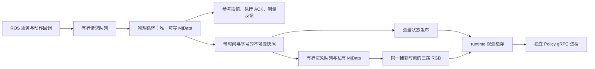

# S3 接口与当前实施边界

2026-11-01。S2已验收；S3已完成三相机profile/记录、命令状态协议与mock证据、双Panda具名物理I/O、可验证计划及无ROS连续执行。接触完成、有限刹车、真实反馈和期限已通过原生验收，详见[DSH-024结果](tasks/dsh-024-result.md)。执行依据仍是 [最小闭环计划](minimal-simulation-loop-plan.md)。图中物理执行已实现；DSH-027 已提供可启动的 ROS 原生后端、公共命令/租约/reset、
有界队列与精确观测/三图配对，详见[原生后端说明](native-backend.md)。runtime/Policy
接线和 S3 整体验收仍待后续。

## 现有能力与缺口

| 位置 | 现有行为 | 接入物理后端前必须补齐 |
| --- | --- | --- |
| `contracts/python/.../models.py`、`profiles.py` | DSH-018已支持v1/v2与不可变cameras集合，具备Panda16维/三相机绑定及旧数据兼容 | 当前runtime仍只接mock；实际MuJoCo后端尚待接入 |
| `backend_sim/.../panda_io.py` | DSH-020已按完整名称绑定16维SI与真实qpos/qvel/actuator，拒绝错误profile/模型/相机并限制为创建线程使用 | 公共reset/lease与ROS适配，继续保持唯一物理数据所有者 |
| `backend_sim/.../motion.py` | DSH-022/024已验收停稳与连续块执行、接触完成、刹车、实测停止、整体/进度/跟踪期限 | 公共命令身份、租约/幂等/reset、ROS接线与精确观测配对 |
| `libraries/backend_core/.../engine.py` | mock 按单调墙钟插值，参考等于合成测量；另存 robot-clock accepted/started/sample、有界历史与只读查询，terminal 冻结 | 物理测量与参考分开；轨迹按仿真时钟推进，lease/通信故障按单调墙钟；终止取决于测量误差与超时 |
| `robot_api_msgs/ExecuteTrajectory`、CommandEvent、CommandStatus、QueryCommand | 已有命令身份、轨迹、ACK/terminal、租约；DSH-019新增只读状态查询与独立反馈流，runtime按sample_time记录并校验 | reset 与 epoch 的运行实现、物理 STARTED/测量及真实跟踪验收留后续 |
| `runtime/observation.py` | 选择最新 state 及不晚于它的相机帧 | 渲染延迟时按同一捕获快照关联三图和测量状态；不能把完成渲染时的新状态配给旧图 |
| `contracts/policy/v1/policy.proto` | 有三相机完整载荷、context/request/session/observation 等字段，仍是设计稿 | 真正生成 SDK；动作块截止/顺序/过期与缓存边界有可运行校验，先用 fake policy 验证传输和拒绝路径 |

复用现有租约、身份和事件规则时，只提取两种后端确实共用的协议逻辑；不让物理后端继承 mock 的测量状态或直接把模型预测写入 qpos。Panda 的关节 actuator 保留上游设置；16 维 SI 动作到原生执行器的映射按具名索引完成，夹爪总开度与两指测量/0～255 控制量明确转换。

## 状态所有权

渲染器在所属线程创建/使用/关闭，ROS、写盘和 IK 不持有物理写权限。慢渲染允许按有界队列规则跳过快照，必须计数；控制循环不能等待 GPU 或磁盘。状态与三路图像都保留捕获时间，完成时间只作性能诊断。500 Hz/20 Hz 是待实测候选频率，单独渲染吞吐不算并发倍率通过。

## 实施顺序

1. profile/契约：三相机与16维绑定/记录接线已由DSH-018完成；命令查询、采样/执行时钟分离与参考/测量反馈协议/mock记录由DSH-019完成；DSH-020完成16维SI到真实actuator/qpos/qvel的具名映射与构造校验。reset/epoch运行语义、物理STARTED/测量与动作-观测时间对应仍待实现。
2. 物理控制核心：DSH-020提供I/O，DSH-021～024已验收参考计划、停稳/连续跟踪、接触完成与停止；下一项补公共命令身份、lease、网络命令幂等与复位。成功写ctrl或时间走完不等于到达。
3. ROS 适配与完整观测：有界队列、同快照状态/三图、运行日志；通过同一 runtime 做小幅物理运动及故障检查。
4. fake policy 链路：真实 gRPC 完整观测与动作块，校验迟到结果、丢失 ACK、查询、旧 epoch、断连和停止；通过后才接入 teacher。

这四项是依赖顺序，最终任务号、文件范围与预算在前置验收后确定。公共 Robot 接口不要求真机提供物体真值或仿真 reset；仿真专用能力单独声明，teacher 只在采集部署启用。推理进程不能获得物体真值。

## 验收重点

- 相同 ID/相同载荷幂等，冲突载荷拒绝；查询记录过期须明确返回 `RESULT_EXPIRED`，错误 context 返回 `STALE_CONTEXT`，不能猜测成功或盲目重发。DSH-019只在同 generation 内允许按原 context 跨租约查询。
- accepted、started、feedback、terminal 对应不同事实；Stop 响应后仍有界等待真实停止与 terminal，失败进入明确故障结果。
- 仿真停钟不能冻结 lease 或墙钟故障期限；reset 使旧命令、图像、策略结果全部失效，不能跨 epoch 复用缓存。
- ACT 和 teacher 采用相同密集 16 维目标语义。记录实际接受/执行的参考，标签关联观测 t 与下一周期目标；测量夹爪开度不能覆盖闭合命令标签。
- 三相机/状态延迟、队列丢弃、GPU 错误和日志关闭失败都需要真实故障证据，不能只靠替身测试通过。

## 已确认的接触完成语义

2026-11-01用户确认：臂关节须满足配置的位置误差、速度与稳定时长；夹爪闭合时允许“双指接触同一物体且稳定”作为完成依据。闭合参考保持原目标，目标/测量/误差/接触证据分别记录；不把此执行完成当作堆叠成功。原生后端的具体力、速度、时长阈值放入控制配置，不能仅凭时间走完或任意碰撞就报成功。

## 无ROS执行模块的当前分派边界

DSH-021已验收三次参考计划。[DSH-022结果](tasks/dsh-022-result.md)已验收真实步进、参考/测量时刻区分、臂稳定与双指接触完成、有限减速和墙钟故障。先用明确返回的不可变快照与既有EventLogger验收，不提前接网络ACK。随后再接共用租约/命令身份、reset/epoch和ROS；不把私有motion序号当公共command序号。

正常参考段内部C2；旧停稳接口使用零端点速度，连续模式携带交接时的参考p/v，跨块C1而不要求加速度连续。刹车采用逐轴恒减速到0，位置/速度连续，允许加速度阶跃，不承诺jerk受限。初值来自保持参考或固定交接参考，重力静差不能通过改测量或改模型掩盖。

原生接触时刻依据[MuJoCo仿真流程](https://mujoco.readthedocs.io/en/stable/programming/simulation.html)：mj_step先计算动力学再积分，步后派生量可能仍对应积分前状态，故接触与步后测量配对时刷新forward。接触力通过官方[mj_contactForce](https://mujoco.readthedocs.io/en/stable/APIreference/APIfunctions.html#mj-contactforce)读取。夹爪的受阻完成可参考[ROS2 control参数语义](https://control.ros.org/jazzy/doc/ros2_controllers/gripper_controllers/doc/userdoc.html)，本项目按用户约定额外要求双指同物体证据，单纯低速度不能报接触完成。

## 连续ACT动作块：已确认的执行节奏

旧停稳式normal计划要求两端参考速度为0，适合完整示教阶段和单步调试；不能直接当作连续ACT动作块执行器。设计实验 `var/runs/s3-control-design/20261101/action-chunk-boundaries/result.json`：一条合法3s/0.15rad平滑轨迹按50ms采样切成三个1s块，逐块clamped为0端点速度时，最大参考加速度约4.59～4.65rad/s²，超过1.0限位并被正确拒绝；携带原参考边界速度时最大约0.10rad/s²。该实验是选型依据，实际连续执行证据见DSH-024结果。

用户已选连续接续。保留停稳执行器用于示教/调试，增加有界提前预测和连续参考接续，迟到/断流受控刹车。不得通过调宽加速度或偷偷修改预测来规避。实施细节见[连续动作设计](continuous-action-design.md)。

后续任务书依照新设计固定：动作时间与观测捕获时刻/实际执行时刻的映射；正常块边界的参考p/v与取消刹车的时间基准；“运动中跟踪完成”和“停稳完成”的ACK口径；预测迟到、未执行旧块、计划替换和有界队列规则。当前S3公共协议尚未宣称支持这些语义，不提前采集50条或训练ACT。
